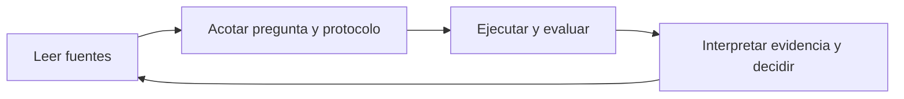

# Thinking Harness

Bienvenido a Thinking Harness, un proyecto de investigación aplicada sobre la construcción
y mejora de harnesses agénticos. Reúne lecturas, propuestas, prototipos y evidencia para
acotar una pregunta de tesis.

El **harness** es el andamiaje de software que permite operar a un modelo: instrucciones,
herramientas, contexto, ejecución, controles y evaluación. La pregunta central es qué aporta
mejorar al propio mejorador frente a mantenerlo fijo, considerando calidad, generalización y costo.

## Por dónde empezar

- **[Entrega actual: Notebook en GitHub y guía visual](docs/README.md).** Ajuste de inferencia, caso simulado y resultados ejecutados.
- [Casos de estudio](research/cases/README.md): explicación e historial de cada experimento.
- [Literatura](research/synthesis/research-options.md): mapa de lectura y referencias.

Se ejecutaron controles de inferencia y búsquedas de políticas con modelos locales. En el caso
actual, Qwen 8B pasó de 3/8 a 7/8 decisiones correctas con políticas generadas, sin ventaja final
observada del mejorador adaptativo. Son pruebas acotadas; no una reproducción de STOP ni una
validación general de la tesis. El [plan](docs/doc-0002-research-plan.md) reúne alcance y evidencia.



## Estructura

| Ruta | Contenido |
|---|---|
| `research/literature/` | Catálogo, búsquedas y una carpeta por paper revisado |
| `research/cases/` | Un caso por carpeta: guía, entradas, notebooks ejecutados, utilidades y resultados |
| `research/synthesis/` | Comparación de métodos y alternativas |
| `docs/` | Plan, estándares, decisiones, diseños, requisitos académicos y plantillas |
| `scripts/` | Comprobaciones y exportación de documentación |
| `tests/` | Pruebas del código y la integridad; los experimentos están en `research/cases/` |
| `.github/` | CI y plantillas de issues y PRs |

Los [IDs](docs/catalog.csv) se conservan aunque cambie una ruta. Las carpetas crecen
cuando existe una necesidad concreta; véase [evolución del proyecto](docs/project-evolution.md).
Los PDFs de papers y sus anotaciones permanecen en la biblioteca local.

## Trabajo y validación

Las tareas se siguen en el [Project](https://github.com/users/jairzinhosantos/projects/2).
`develop` integra trabajo revisado; `main` conserva baselines formales. Ambas integraciones
requieren aceptación humana según el [estándar de ramas](docs/standards/std-0003-branching-and-releases.md).
El [modelo operativo](docs/operating-model.md) define el flujo. El diseño multiagente es una propuesta futura.

Python 3.11 o posterior; Node.js 22 para Mermaid:

```sh
python3 -m pip install -r research/cases/case-0003-debt-negotiation/requirements.txt
python3 scripts/check_repository.py
python3 -m unittest discover -s tests/unit -v
npm ci
npm run check:diagrams
```

El CI comprueba estructura, enlaces, pruebas locales y diagramas; no valida conclusiones científicas.
Antes de cambiar contenido, leer [AGENTS.md](AGENTS.md). Documentación en español, nombres
y código en inglés, traducciones selectivas y decks en inglés.

## Alcance público

No se incluyen credenciales, datos privados ni implementaciones institucionales. El material
original usa [MIT](LICENSE); fuentes externas conservan sus licencias. Para citar el proyecto,
usar [CITATION.cff](CITATION.cff) e identificar el commit o versión consultados.
