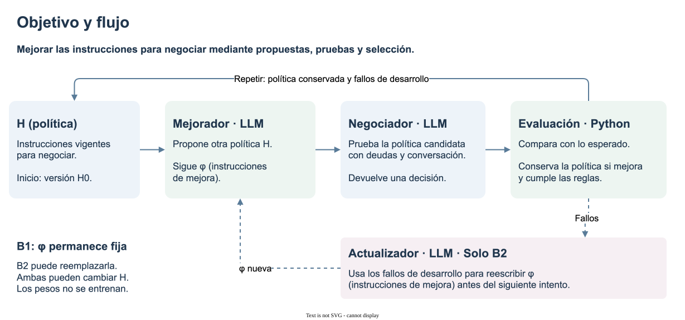
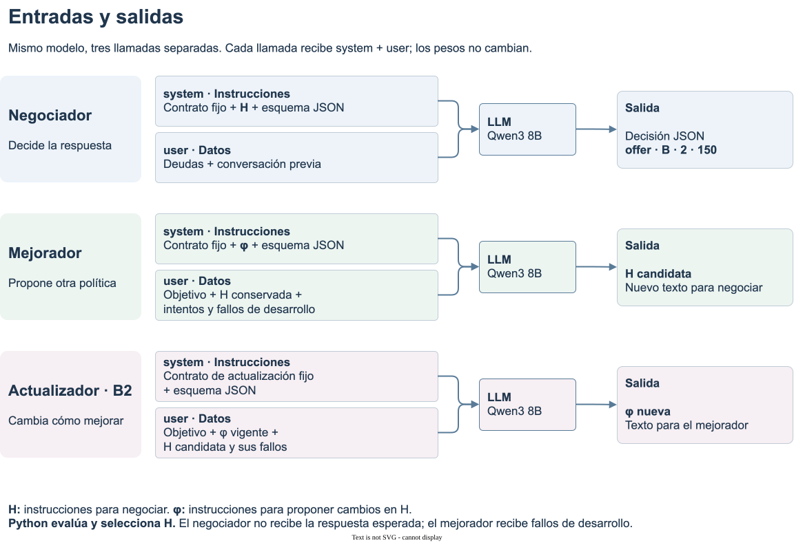

# Thinking Harness

**Automejora del prompt · Semana 8**

**[Notebook en GitHub](../research/cases/case-0003-debt-negotiation/notebooks/study-overview.ipynb)** · Caso, prompts, ajustes y resultados en una sola lectura.

## Objetivo del estudio

Mejorar automáticamente las instrucciones que usa un agente para negociar una deuda.
Ese texto se llama **política H**: por ejemplo, «ofrece la mayor deuda cuya cuota pueda pagar el cliente».



Se comparan dos estrategias de búsqueda:

| Estrategia | H (política) | φ (instrucciones de mejora) |
|---|---|---|
| **B1: mejora fija** | Puede cambiar entre intentos | Se mantienen iguales durante toda la búsqueda |
| **B2: mejora adaptativa** | Puede cambiar entre intentos | El actualizador puede reemplazarlas entre intentos |

**H0, H1… son versiones de la política; B1 y B2 son estrategias.** Cambiar un texto no garantiza mejor desempeño.

**Restricción experimental:** no se entrenan los pesos del modelo. Se editan textos;
el modelo, las reglas de evaluación y el presupuesto se mantienen iguales al comparar B1 con B2.

## Caso de prueba

**Entrada del negociador:**

- **Tabla de deudas:** montos ficticios y planes permitidos, indicados abajo.
- **Historial de conversación:** mensajes previos del cliente y del asistente. Puede incluir capacidad de pago, ofertas, rechazo o aceptación; no es un historial de pagos.

El agente elige una acción: **preguntar** por la capacidad (`ask`), **ofrecer** un plan (`offer`),
**confirmar** un plan aceptado (`accept`) o **detenerse** (`stop`).

| Dato del ejemplo | Valor |
|---|---|
| Mensaje ilustrativo del cliente | «Puedo destinar 225 al mes para pagar». |
| Capacidad de pago mensual | **225 unidades ficticias** disponibles para la deuda; no es el ingreso mensual |
| Planes permitidos | Un pago o dos cuotas mensuales iguales |

| Deuda | Monto total / un pago | Cuota con dos pagos | Evaluación |
|---|---:|---:|---|
| A | 200 | 100 | Viable, pero de menor monto |
| B | 300 | 150 | **Mayor deuda viable: ofrecer dos cuotas** |
| C | 600 | 300 | La cuota supera la capacidad de pago |

**JSON esperado del negociador** en los Tests 3–5:

```json
{
  "action": "offer",
  "debt": "B",
  "payments": 2,
  "installment": 150
}
```

| Campo | Significado |
|---|---|
| `action` | Acción; `offer` significa ofrecer, no confirmar un acuerdo |
| `debt` | Deuda elegida; `B` identifica el monto de 300 |
| `payments` | Número de pagos; aquí, dos |
| `installment` | Monto de cada cuota mensual; aquí, 150 |

Para `ask` y `stop`: `debt=null`, `payments=0`, `installment=0`.
Python redacta el mensaje a partir de esos campos, sin corregir la decisión.
La respuesta esperada pertenece al evaluador: **el negociador no la recibe**.

## Prompts y roles

- **System prompt:** instrucciones para una llamada. Combina un contrato fijo (límites y formato) con el texto editable H o φ, según el rol.
- **Entrada `user`:** datos para esa llamada. En el negociador son deudas y conversación; en el mejorador son objetivo, H y fallos de desarrollo.
- **Salida:** decisión JSON del negociador, nueva H del mejorador o nueva φ del actualizador.

**Ejemplos ilustrativos:** H: «Ofrece la mayor deuda viable». φ: «Revisa primero los fallos de capacidad y corrige esa regla».
φ guía al mejorador; **no se añade al prompt del negociador**. Una versión aceptada reemplaza a la anterior.



## Flujo de mejora


Python evalúa y selecciona. Los fallos de desarrollo guían las propuestas;
la validación decide qué H conservar; el test final se consulta después.

## Pruebas ejecutadas

| Prueba | Qué se comprueba | Evidencia |
|---|---|---|
| Piloto | Búsqueda inicial con mejorador fijo | [Registro](../research/cases/case-0003-debt-negotiation/notebooks/prompt-search.ipynb) |
| Test 1 | Actualizar φ y reutilizarla | [Adaptación](../research/cases/case-0003-debt-negotiation/notebooks/harness-smoke-test.ipynb) |
| Test 2 | Capacidad de Qwen 4B y 8B | [Modelos locales](../research/cases/case-0003-debt-negotiation/notebooks/local-model-test.ipynb) |
| Test 3 | Ajustar inferencia con H manual fija | [Inferencia](../research/cases/case-0003-debt-negotiation/notebooks/inference-tuning.ipynb) |
| Test 4 | Buscar H con B1/B2; ampliar tokens | [Automejora](../research/cases/case-0003-debt-negotiation/notebooks/paired-search.ipynb) |
| Test 5 | Restringir la generación de JSON | [Formato](../research/cases/case-0003-debt-negotiation/notebooks/structured-output.ipynb) |

La lectura principal reúne los Tests 3–5. Las otras notebooks conservan cada prueba; no es necesario abrirlas para seguir el estudio.

El Test 3 separa capacidad del negociador y calidad del mejorador. Los Tests 4–5 utilizan
la inferencia elegida, pero parten de H0; no reciben la política manual.

## Definición de hiperparámetros

Se ajusta **cómo el modelo genera respuestas**, sin entrenarlo. Un token es una unidad de texto del modelo; no equivale siempre a una palabra.

| Parámetro | Significado | Valores y fundamento |
|:---|:---|:---|
| Temperatura | Regula la diversidad al elegir el siguiente token | **0:** elegir el más probable.<br>**0,3:** explorar poca variación.<br>**0,7:** referencia sin razonamiento.<br>**0,6:** referencia con razonamiento. |
| `top_k` | Limita la selección a los k tokens más probables | **20:** referencia de Qwen; fijo durante el barrido. |
| `top_p` | Filtra candidatos por probabilidad acumulada | **0,8:** sin razonamiento.<br>**0,95:** con razonamiento. |
| `max_tokens` | Tope de salida por llamada, incluido razonamiento | **512:** barrido directo.<br>**2.048:** con razonamiento.<br>**4.096:** comprobar cortes de salida. |

**Referencia:** [Qwen3](https://huggingface.co/Qwen/Qwen3-8B#best-practices). Temperaturas 0 y 0,3: exploratorias. Topes de tokens: límites locales de prueba.

## Métricas y criterio

Sea **N** el número de respuestas evaluadas:

$$Q=\frac{\text{respuestas correctas sin infracciones}}{N},\qquad
V=\frac{\text{respuestas con al menos una infracción}}{N}.$$

- **Respuesta correcta:** coincide con la referencia en:
  - Acción: preguntar, ofrecer, aceptar o detenerse.
  - Deuda elegida.
  - Cantidad de pagos.
  - Monto de cada cuota.

- **Infracciones:** se registra alguna de estas condiciones:
  - Salida inválida o incompleta.
  - Plan no permitido.
  - Cuota mal calculada o superior a la capacidad de pago.
  - Oferta tras un rechazo explícito a negociar.
  - Aceptación sin consentimiento.

- **Q ≥ 80 %:** respuestas correctas y sin infracciones:
  - Con 8 respuestas: al menos **7 aciertos**.
  - Con 24 respuestas: al menos **20 aciertos**.

- **V = 0:** ninguna respuesta evaluada infringe las reglas.
  - Una cuota impagable o una aceptación inventada invalida la decisión.

**Ejemplo:** ofrecer A cuando B también cabe:
- La elección es incorrecta: reduce Q.
- El plan puede respetar las restricciones: no necesariamente aumenta V.

**Alcance:** 80 % es una meta provisional del piloto. V = 0 describe las respuestas evaluadas, no todos los casos posibles.

- **T(H), T(φ):** tokens de cada texto con el tokenizer del modelo, sin tokens especiales.
- **Palabras y caracteres:** conteos complementarios.
- **Consumo:** tokens de todas las entradas y salidas, llamadas, tiempo y costo de API.

La longitud se registró, pero no selecciona políticas ni mide claridad. T(H) y T(φ) excluyen contrato, esquema e historial.

## Escenarios y repeticiones

Un **escenario** contiene una conversación simulada y su decisión esperada.

| Grupo del Test 3 | Uso |
|:---|:---|
| **12 conocidos** | Conversaciones ya usadas en diagnóstico.<br>Incluyen capacidad de pago, planes, rechazo y consentimiento.<br>Permiten comparar perfiles; no entrenan pesos. |
| **8 reservados** | Conversaciones distintas, fijadas antes del barrido.<br>No intervienen en la selección del perfil.<br>Permiten comprobarlo después. |
| **3 repeticiones** | Misma conversación y perfil; distintas semillas.<br>**8 casos × 3 repeticiones = 24 respuestas.**<br>Son ocho casos, no 24 casos diferentes. |

- **Semilla:** inicializa el muestreo aleatorio para repetir la configuración.
- **Valores:** 11, 22 y 33; identifican repeticiones, no se optimizaron.
- **Uso posterior:** los ocho casos se reutilizaron en otros diagnósticos; ya no eran una prueba nueva.

## Resultados principales

| Prueba | Resultado | Alcance |
|---|---|---|
| Test 3 | Qwen 8B: 24/24 respuestas correctas, sin infracciones | H manual; ocho casos reservados, tres repeticiones |
| Test 4 | B1 y B2: de 3/8 a 7/8 decisiones correctas | Sin ventaja final observada de B2 |
| Test 5 | JSON válido: B1 53/53 y B2 73/73; ambas mantienen 7/8 | Mejora del formato, no de las decisiones |

El ajuste posterior del Test 4 y el Test 5 reutilizan casos finales conocidos. Falta ampliar
escenarios y repetir búsquedas para estudiar generalización.

[Historial del caso](../research/cases/case-0003-debt-negotiation/README.md)
· [Matriz de consistencia](academic/README.md)
· [Matriz en PDF](academic/consistency-matrix.pdf)
· [Índice del proyecto](../README.md)
