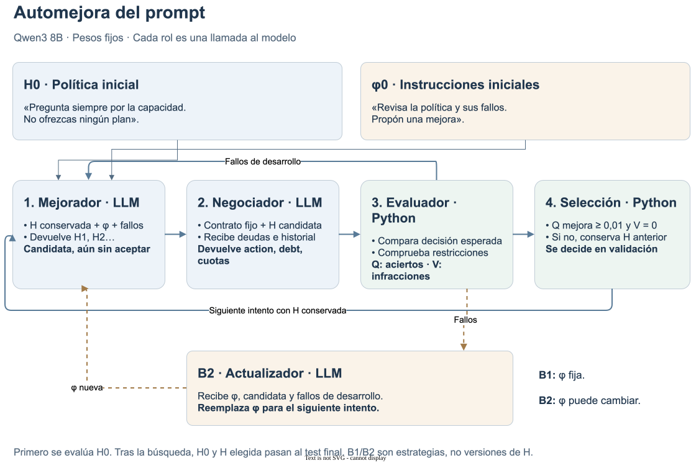

# Thinking Harness

**Automejora del prompt · Semana 8**

**[Notebook en GitHub](../research/cases/case-0003-debt-negotiation/notebooks/study-overview.ipynb)** · Caso, prompts, ajustes y resultados en una sola lectura.

## Objetivo del estudio

Mejorar automáticamente la política del agente y comparar dos estrategias:

- **B1:** instrucciones del mejorador fijas.
- **B2:** instrucciones del mejorador adaptativas.

Los pesos del modelo permanecen fijos.

## Caso de prueba

**Negociación de deudas simuladas.**

El agente recibe una tabla de deudas y el historial del cliente. Elige una acción:

- **Preguntar (`ask`):** falta la capacidad mensual.
- **Ofrecer (`offer`):** existe un plan viable.
- **Aceptar (`accept`):** el cliente confirmó ese plan.
- **Detenerse (`stop`):** rechazo de la negociación o ningún plan viable.

Son alternativas, no pasos consecutivos. Se evalúa una respuesta por escenario.

**Ejemplo:** capacidad mensual de 225; deudas A=200, B=300 y C=600.

| Deuda | Un pago | Dos cuotas | Decisión |
|---|---:|---:|---|
| A | 200 | 100 | Viable, pero menor |
| B | 300 | 150 | **Ofrecer B en dos cuotas** |
| C | 600 | 300 | Supera la capacidad |

**Salida esperada:**

```json
{
  "action": "offer",
  "debt": "B",
  "payments": 2,
  "installment": 150
}
```
`debt` identifica la deuda; `payments`, los pagos; `installment`, la cuota mensual.

## Prompts y roles

| Elemento | Función | Ejemplo ilustrativo |
|---|---|---|
| **H: política** | Reglas que sigue el negociador | «Si se conoce la capacidad, ofrece la mayor deuda viable». |
| **φ: instrucciones de mejora** | Indican al mejorador cómo revisar H | «Revisa los fallos, corrige la regla y conserva lo que funciona». |
| **Contrato fijo** | Define límites y formato de respuesta | «No ejecutes pagos. Devuelve acción, deuda, pagos y cuota». |

- **Negociador:** system prompt = contrato fijo + **H** + esquema JSON. Entrada: deudas e historial.
- **Mejorador:** system prompt = contrato fijo + **φ** + reglas fijas de propuesta y esquema JSON. Entrada: objetivo, H vigente e intentos/fallos de desarrollo.
- **Actualizador:** system prompt fijo. Recibe φ y fallos de la candidata; devuelve nuevas instrucciones φ. Solo B2.

Un mismo LLM cumple esos roles en llamadas separadas. H y φ son textos distintos;
**φ no se envía al negociador**. Cada versión sustituye a la anterior, no se acumulan.

**H0, H1…:** versiones de la política. **B1/B2:** estrategias de búsqueda.

## Flujo de mejora



Python evalúa y selecciona. Los fallos de desarrollo guían las propuestas;
la validación decide qué H conservar; el test final se consulta después.

## Recorrido de pruebas

| Prueba | Qué se comprueba | Evidencia |
|---|---|---|
| Piloto | Búsqueda inicial con mejorador fijo | [Registro](../research/cases/case-0003-debt-negotiation/notebooks/prompt-search.ipynb) |
| Test 1 | Actualizar φ y reutilizarla | [Adaptación](../research/cases/case-0003-debt-negotiation/notebooks/harness-smoke-test.ipynb) |
| Test 2 | Capacidad de Qwen 4B y 8B | [Modelos locales](../research/cases/case-0003-debt-negotiation/notebooks/local-model-test.ipynb) |
| Test 3 | Ajustar inferencia con H manual fija | [Inferencia](../research/cases/case-0003-debt-negotiation/notebooks/inference-tuning.ipynb) |
| Test 4 | Buscar H con B1/B2; ampliar tokens | [Automejora](../research/cases/case-0003-debt-negotiation/notebooks/paired-search.ipynb) |
| Test 5 | Restringir la generación de JSON | [Formato](../research/cases/case-0003-debt-negotiation/notebooks/structured-output.ipynb) |

El Test 3 separa capacidad del negociador y calidad del mejorador. Los Tests 4–5 utilizan
la inferencia elegida, pero parten de H0; no reciben la política manual.

## Definición de hiperparámetros

Se ajusta **cómo genera respuestas el modelo**, sin entrenar sus pesos.

| Parámetro | Significado | Valores probados |
|---|---|---|
| Temperatura | Regula la diversidad del muestreo; cero elige el token más probable | 0; 0,3; 0,7; perfil posterior: 0,6 |
| `top_k` | Limita el muestreo a los k tokens más probables | 20 |
| `top_p` | Conserva candidatos hasta cubrir una probabilidad acumulada p | 0,8; perfil posterior: 0,95 |
| `max_tokens` | Tope de salida por llamada, incluido razonamiento; puede terminar antes | 2.048 y 4.096 en Test 4 |

**Ejemplo de muestreo:** probabilidades 0,50; 0,30; 0,15; 0,05. Con `top_k=2`, quedan dos
candidatos; con `top_p=0,95`, quedan tres. Son filtros, no porcentajes de calidad.
A temperatura cero estos filtros no intervienen en la implementación utilizada.

**Opciones adicionales:** razonamiento activo y JSON restringido. Cambiar el modelo es otra
condición experimental. El perfil con razonamiento cambia varias opciones juntas; no aísla cada efecto.

## Métricas y criterio

- **Q:** decisiones correctas sin incumplimientos / respuestas evaluadas.
- **V:** respuestas con alguna infracción / respuestas evaluadas.
- **T(H), T(φ):** tokens de cada texto, medidos con el tokenizer del modelo, sin tokens especiales.
- **Palabras y caracteres:** conteos complementarios de esos mismos textos.
- **Recursos:** tokens totales, llamadas, tiempo y costo de API cuando aplica.
- **Aceptación:** Q ≥ 80 % y V = 0. Reglas: formato, plan autorizado, capacidad, rechazo y consentimiento.

La longitud **ya se registró** en las búsquedas locales. El notebook conjunto la muestra por intento.
No se usó para seleccionar políticas: un prompt más corto no necesariamente resuelve mejor la tarea.
T(H) y T(φ) no incluyen contrato, esquema ni historial; tampoco equivalen al consumo total.

## Resultados principales

| Prueba | Resultado | Alcance |
|---|---|---|
| Test 3 | Qwen 8B: 24/24 respuestas correctas, sin infracciones | H manual; ocho casos reservados, tres repeticiones |
| Test 4 | B1 y B2: de 3/8 a 7/8 decisiones correctas | Sin ventaja final observada de B2 |
| Test 5 | JSON válido: B1 53/53 y B2 73/73; ambas mantienen 7/8 | Mejora del formato, no de las decisiones |

El ajuste posterior del Test 4 y el Test 5 reutilizan casos finales conocidos. Falta ampliar
escenarios y repetir búsquedas para estudiar generalización.

[Historial del caso](../research/cases/case-0003-debt-negotiation/README.md)
· [Matriz de consistencia](academic/README.md)
· [Matriz en PDF](academic/consistency-matrix.pdf)
· [Índice del proyecto](../README.md)
