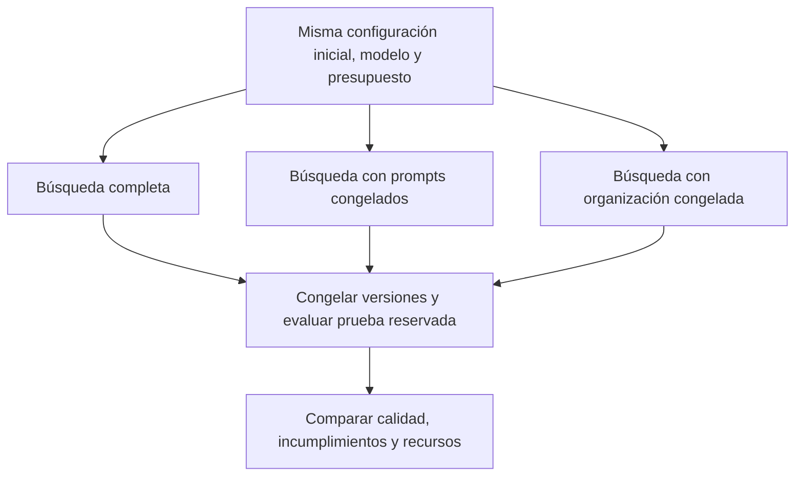

# Variables y análisis de componentes del harness

Detalle del [siguiente sprint y su matriz](https://github.com/jairzinhosantos/thinking-harness/blob/develop/docs/academic/README.md), aplicado al [caso de negociación sintética](https://github.com/jairzinhosantos/thinking-harness/blob/develop/research/cases/case-0003-debt-negotiation/README.md).
Se preparan las comparaciones entre componentes. El [Test 1](https://github.com/jairzinhosantos/thinking-harness/blob/develop/research/cases/case-0003-debt-negotiation/harness-smoke-test.ipynb) ya ejecuta el bucle sobre prompts, pero no mide todavía el aporte de cada componente.

## Qué significa importancia en este caso

Se busca saber qué se gana al permitir cambios en los prompts o en el workflow. Para ello se repetirá
la búsqueda dejando fija una de esas partes y se comparará con la búsqueda completa: una **ablación**.
Estas ablaciones no entrenan pesos ni calculan importancia de columnas. Un análisis de atributos del prompt sería complementario y todavía no forma parte del protocolo. Se medirá el aporte de estos componentes
a la calidad, el cumplimiento y el consumo, bajo las mismas condiciones.

| Concepto del curso | Aplicación en este estudio |
|---|---|
| Variables independientes | Procedimiento de mejora fijo o adaptable; grupo de componentes que se permite editar |
| Variables dependientes | Éxito válido, incumplimientos, tiempo, recursos e intervención humana |
| Feature engineering | Representación de escenarios y de configuraciones declarativas; atributos derivados para diagnóstico |
| Feature importance | Aporte de permitir cambios en prompts o en la organización del workflow, mediante ablaciones |
| Variable objetivo | Calidad de la ejecución, no una etiqueta para entrenar los pesos del modelo |

## Representación y controles

El harness se representa como `H = (A, E, P, R)`. YAML describe la configuración;
el motor que la interpreta permanece fijo.

| Parte | Qué representa | Qué se podrá cambiar |
|---|---|---|
| A | Agentes y roles | De uno a tres agentes; responsabilidades permitidas |
| E | Conexiones | Rutas de mensajes dentro del patrón autorizado |
| P | System prompts | Instrucciones por rol y etapa |
| R | Orquestación | Orden, delegación y revisión dentro del catálogo permitido |
| phi | Instrucciones para proponer mejoras | Solo en la variante adaptativa; debe registrarse su uso posterior |

Se fijan modelo, pesos, inferencia, motor, herramientas, política de memoria y contexto,
evaluador, particiones y presupuesto total. Las trazas cambian al ejecutar; la política
que decide cómo se entregan se mantiene igual. La prueba final no retroalimenta la búsqueda.

Los escenarios pueden describirse por número de turnos, información faltante, rechazo explícito
y correcciones. Se pueden derivar cuota y brecha con la capacidad de pago cuando esos datos
sean conocidos. Estos atributos sirven para cobertura y diagnóstico. No se envían al agente
etiquetas protegidas, decisiones esperadas ni datos ocultos del evaluador.

## Comparaciones

**B0:** configuración inicial sin búsqueda. **B1:** mejora automática con instrucciones de
mejora fijas. **B2:** mejora automática que también adapta esas instrucciones. B1 y B2 pueden
cambiar el harness; solo B2 cambia la forma de proponer cambios.

El contraste principal es B2 frente a B1, con el mismo punto inicial y tope de recursos.
Después, dentro de un mismo régimen, se estudiarán estos tres espacios:

| Condición | Prompts P | Organización A, E, R | Qué permite contrastar |
|---|---|---|---|
| Completa | Editables | Editable | Referencia de búsqueda |
| Prompts congelados | Fijos en la versión inicial | Editable | Aporte de permitir cambios en instrucciones |
| Organización congelada | Editables | Fija en la versión inicial | Aporte de permitir cambios en roles y workflow |

Cada condición vuelve a buscar desde el inicio; no se quita una parte del mejor candidato
al terminar. Los efectos pueden interactuar y no se sumarán como porcentajes de importancia.
Se priorizará un régimen para la ablación según factibilidad, antes de abrir la prueba final.

## Indicadores

`q` mide respuestas con acción, deuda, pagos y cuota correctos, sin infracciones; `v`, respuestas con alguna infracción. Las [definiciones y reglas del caso](README.md#qué-se-considera-un-resultado-correcto) precisan formato, plan, capacidad, rechazo y consentimiento. No son complementos.

Para `m` pares de búsquedas independientes, el aporte estimado de permitir el grupo `g` será:

$$
\widehat I_g = \frac{1}{m}\sum_{b=1}^{m}
\left(\widehat q_b^{\mathrm{full}}-\widehat q_b^{\mathrm{freeze}(g)}\right).
$$

`b` identifica una búsqueda completa; `g` será prompts u organización. Un valor positivo
favorece permitir ese grupo, en las condiciones estudiadas. Se reportan también diferencias
de incumplimientos, costo y tiempo, con incertidumbre que respete búsquedas y familias.
No se tratarán repeticiones del mismo escenario como observaciones independientes.

## Entrega del sprint y criterios

| Entrega | Comprobación |
|---|---|
| Espacio editable | Esquema y patrones definidos; campos protegidos identificados |
| Matriz de escenarios | Cada celda del alcance acordado tiene una prueba prevista; exclusiones explícitas |
| Diseño de ablaciones | Tres condiciones comparables, mismo inicio y presupuesto, particiones separadas |
| Protocolo de medición | q, v, tiempo y consumo definidos; versiones y trazas reconstruibles |
| Preparación para ejecutar | Modelo, número de búsquedas, presupuesto y parada acordados; reserva para prueba final |

El sprint de preparación termina con estos elementos en **Review**, no con resultados
científicos. La ejecución posterior requiere autorización y un registro nuevo. Alcanzar
un umbral provisional no autoriza cambiar la prueba ni descartar búsquedas fallidas.

## Correspondencia con el plan de tesis

La [matriz de consistencia](https://github.com/jairzinhosantos/thinking-harness/blob/develop/docs/academic/README.md) reúne objetivos, hipótesis, variables y criterios.

- **OE1 / HE1:** configuración con al menos 80% de decisiones correctas en test y ninguna infracción observada, sin edición humana durante
  el ciclo; en B2, actualización de instrucciones utilizada en una propuesta posterior.
- **OE2 / HE2:** mejora de calidad frente a B1, sin aumentar incumplimientos y con el mismo
  tope de recursos. Las ablaciones complementan esta comparación.
- El diagnóstico de fallos y la delimitación del espacio son actividades de preparación.

Las referencias conceptuales son GPTSwarm y GEPA para el espacio editable; AFlow para
búsqueda de workflows; STOP y MetaSkill-Evolve para adaptar la mejora; Self-Harness y DGM
para participación en la siguiente versión. Véase el [mapa de literatura](https://github.com/jairzinhosantos/thinking-harness/blob/develop/research/synthesis/research-options.md).
