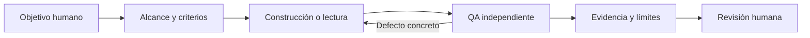

# Estrategia de desarrollo con agentes

**Propuesta para un piloto posterior.** No habilita agentes persistentes, programaciones
ni un bucle autónomo. Asistir al desarrollo y evaluar científicamente la mejora de un harness
son actividades distintas. Los agentes no alteran datos reservados ni criterios para aprobar una prueba.

| Rol | Responsabilidad | Límite |
|---|---|---|
| `coordinator` | Objetivo, alcance, asignación y resumen | No ampliar alcance sin decisión |
| `research-reviewer` | Fuentes, evidencia y objeciones | No acreditar lectura humana |
| `builder` | Cambio pequeño y explicación | No aprobar su propio trabajo |
| `qa` | Verificar criterios originales y fallos reproducibles | No debilitar criterios |
| `experiment-runner` | Ejecutar protocolo y registrar evidencia | Respetar presupuesto y parada |
| `documentation-reviewer` | Mantener consistencia | No convertir expectativas en resultados |

La corrección tiene un límite de intentos y costo; un desacuerdo sin resolver pasa a Review.
El [estándar de ramas](../standards/std-0003-branching-and-releases.md) define la integración posterior.

## Primer piloto propuesto

1. Seleccionar una tarea determinista, sin llamadas adicionales a modelos externos.
2. Fijar criterios y [contrato de transferencia](../templates/agent-handoff.md).
3. Separar construcción y QA; verificar criterios y un fallo plausible.
4. Comparar retrabajo, tiempo, costo y defectos con el flujo de referencia.
5. Decidir si conviene incorporar paralelismo o herramientas de orquestación.

Un responsable de escritura por rama. La evidencia debe permitir reconstruir el cambio;
calidad y aceptación no pueden depender solo de autoevaluación.
