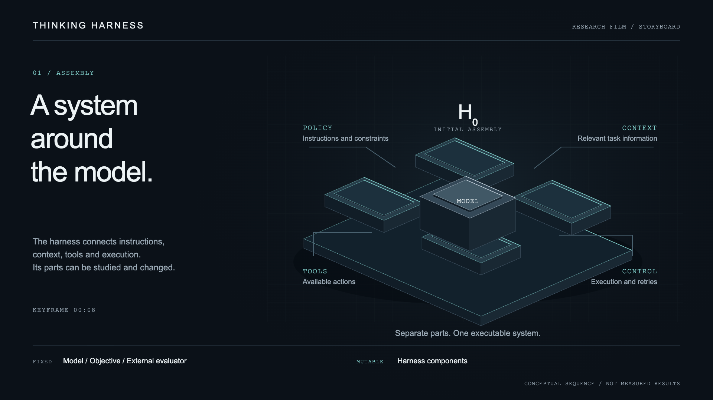
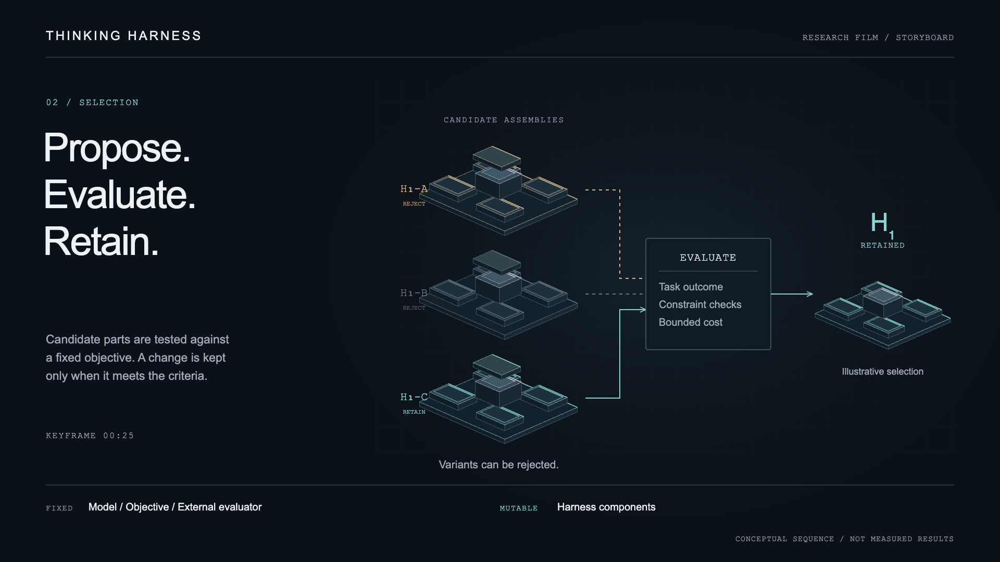
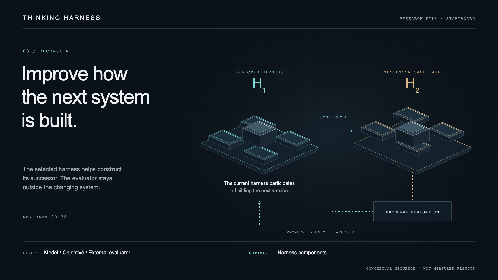

# Thinking Harness / Research film

A 45-second conceptual sequence about assembling an agent harness, evaluating changes,
and using the selected harness to help construct its successor. Designed for silent
viewing, with English text and restrained motion.

## Scope

The film illustrates a research direction. It does not report measured improvement.
The [current pilot](../../../research/cases/case-0003-debt-negotiation/README.es.md)
changes a YAML prompt while keeping the optimizer, model and evaluator fixed.
The broader component assembly and recursive construction shown here remain conceptual.

A harness connects instructions, context, tools and execution around a model.
`H₀` denotes the initial harness, `H₁` a selected version and `H₂` its successor candidate.
The model, objective and external evaluator remain fixed throughout the sequence.
Acceptance requires evidence against the same criteria; a new version is not automatically better.

## Sequence

| Time | Action | On-screen text |
|---|---|---|
| 00:00–00:05 | A model core appears on a dark surface. Four separated components enter slowly. | Thinking Harness |
| 00:05–00:12 | Policy, context, tools and control align around the core. Thin connections form as the parts settle into `H₀`. | A system around the model. |
| 00:12–00:20 | One component lifts out. Three replacement configurations appear beside the original assembly. Changed parts receive a restrained amber edge. | Propose. |
| 00:20–00:27 | Each candidate passes through the same evaluator. Two are rejected and fade; the retained candidate becomes `H₁`. This selection is illustrative. | Evaluate. Retain. |
| 00:27–00:32 | The view follows `H₁`. Its construction process becomes visible as a thin path toward an empty assembly surface. | Improve how the next system is built. |
| 00:32–00:40 | `H₁`, using the fixed model, helps assemble `H₂`. The candidate goes to the external evaluator. Only if accepted does `H₂` take the constructor position for a subsequent version. | Construct. Evaluate. Repeat. |
| 00:40–00:45 | Motion settles. The two assemblies remain faintly visible behind the project name and research question. | Thinking Harness / Can a harness improve how it improves? |

The distinction is visible in the final transition: ordinary improvement changes the
task-solving configuration; the recursive direction lets an accepted configuration
participate in constructing later configurations. Neither guarantees progress.
If a candidate fails, the current harness remains in place.

## Keyframes

### 01 / Assembly

An exploded view introduces the parts before they form one system.

[Editable SVG](01-assembly.svg)

### 02 / Selection

Three candidate assemblies enter one fixed evaluator. Rejection and retention are explicit.
No score or performance curve is invented for the scene.

[Editable SVG](02-selection.svg)

### 03 / Recursion

The selected harness participates in building its successor. Evaluation stays outside the
mutable system. The dashed return path denotes conditional promotion into the constructor role.

[Editable SVG](03-recursion.svg)

## Visual direction

- Graphite background, off-white type, cyan for retained structures and amber for candidate changes.
- Isometric modules, fine edges and a faint spatial grid. No humanoids, holographic dashboards or decorative data streams.
- Continuous camera direction, slow assembly and short pauses at evaluation. No flashes or rapid cuts.
- Optional low ambient sound; the meaning remains complete without audio.
- The conceptual-sequence label remains visible. Component labels appear before movement and fade when no longer needed.

The three frames share a 1920 × 1080 canvas. Their authoritative source is
[storyboard.py](storyboard.py), which generates editable SVGs and the
[review gallery](index.html). The [renderer](render_storyboard.cjs) produces matching PNGs.
These are motion-design assets rather than repository architecture diagrams.
