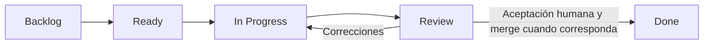

# Modelo operativo

Una lectura profunda y una tarea técnica en curso. Cada tarea define una pregunta,
criterios, presupuesto y evidencia esperada; una lectura o prueba pequeña no necesita PRD.
Un resultado negativo cuenta como avance si reduce incertidumbre.

## Cadencia y decisiones

Se proponen ciclos de dos semanas, revisión semanal y retrospectiva. Las fechas dependen
de las entregas académicas y del alcance acordado. Las horas conectadas no miden progreso;
la [combinación de métricas](designs/doc-0004-progress-and-hitl.md) sigue pendiente.

Pregunta → lectura o prueba acotada → evidencia → continuar, ajustar o descartar.
Fijar condiciones antes del experimento; cambios materiales generan una revisión del protocolo.

## Responsabilidades

El trabajo asistido prepara cambios y evidencia dentro de lo autorizado. Las prioridades,
el alcance y las conclusiones requieren criterio humano, con revisión académica cuando corresponda.
La [propuesta de builder y QA](designs/doc-0003-agentic-development-strategy.md) todavía no se ejecuta.

El agente llega a **Review**. Solo Jairzinho acepta, integra y mueve a **Done**; los checks
no automatizan el cierre. Las dos puertas de integración, a `develop` y a `main`, se definen
una sola vez en el [estándar de ramas](standards/std-0003-branching-and-releases.md).

Issues definen trabajo; milestones agrupan resultados; el [Project](project-links.md) conserva
estado y prioridad. Un PR usa `Refs #N`. La tarea puede cerrarse tras su aceptación e integración
en `develop`, si cumple todos sus criterios; no necesita esperar una promoción a `main`.
Una tarea bloqueada registra causa y siguiente acción. No hay agentes ni recordatorios programados.
