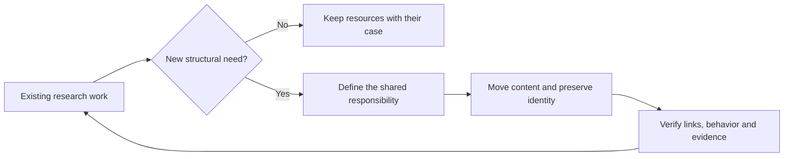

# Project evolution

Thinking Harness is in exploratory applied research. Literature reviews and candidate cases
support the selection of a bounded thesis question. Case 0003 has one recorded pilot, without
an accepted improvement or a completed final comparison.

## Current structure

| Location | Present responsibility |
|---|---|
| `research/literature/` | Sources, search records and bilingual paper reviews |
| `research/cases/` | Case definitions, related studies, prototypes and recorded evidence |
| `research/synthesis/` | Comparisons across papers and research directions |
| `docs/` | Charter, plan, conventions, decisions, designs and iteration records |
| `docs/academic/` | University requirements and academic traceability |
| `docs/templates/` | Reusable research and engineering document templates |
| `scripts/` | Repository checks and document tooling |
| `tests/` | Offline checks of the repository and implemented case behavior |
| `.github/` | CI and issue/PR templates |

Folders represent existing work. A case keeps its inputs, configuration, code and evidence
together until an actual shared responsibility emerges. Mermaid sources and other diagram
assets stay with their case or design document. No empty implementation or delivery tree is
required to describe a future direction.

### Implemented cases

Keep the reading and execution entry points at the case root. Put supporting Python modules
in case-local `utils/`; this is a folder convention, not a shared framework or installable package.
For example:

```text
case-0003-debt-negotiation/
  README.es.md
  prompt-search.ipynb
  prompt-search.es.ipynb
  config.yaml
  golden-set.yaml
  prompt.yaml
  requirements.txt
  utils/
    prompt_search.py
    notebook_view.py
  diagrams/
  results/
```

`prompt_search.py` implements the bounded search; `notebook_view.py` presents its evidence.
Future implemented cases use the same layout when supporting modules are needed. A Markdown-only
case needs no empty `utils/`. Keep repository tooling in `scripts/` and offline tests in `tests/`.
See the [case-utils decision](decisions/dec-0007-case-local-utils.md).

## Conditions for growth

| Evidence of a need | Possible structural change |
|---|---|
| Two cases use the same tested component | Extract that component to `src/` with its tests |
| A reusable evaluation set has stable tasks, metrics and versions | Introduce `benchmarks/` |
| Experiments span cases or need a common execution registry | Introduce `experiments/`; preserve original run identities and hashes |
| Thesis drafting begins | Introduce `manuscripts/` for manuscript sources |
| A formal academic document is issued | Introduce `deliverables/` with immutable versions and manifests |
| A case needs simulated services | Add an environment definition inside that case; share it only when reused |
| Data requires a lifecycle independent of one case | Introduce `data/` with provenance, licensing and version records |

These are conditions, not a fixed sequence or a commitment to create every directory.
Small changes can remain local to a case. Extraction is justified by reuse, evaluation or
publication needs rather than anticipated scale.



## Identity and history

A case or paper folder carries its stable ID. Its README is the primary document.
Supporting documents have descriptive filenames and retain their original IDs in metadata
and the [document catalog](catalog.csv). Language pairs share identity and source revision.
The [naming standard](standards/std-0001-naming-and-lifecycle.md) defines the details.

Git retains edits and removed scaffolding. Historical experiment records retain the paths,
commits and hashes measured at execution time; relocation does not rewrite scientific evidence.
Negative results remain available. Superseded research stays identifiable without requiring
an empty archive directory.

## Structural decisions

| Date | Decision | Reason |
|---|---|---|
| 2026-10-16 | Replace `research/proposals/` with `research/cases/` | Cases now include models, prototypes and evidence |
| 2026-10-16 | Use one folder per case and reviewed paper | Keep each research unit understandable in one location |
| 2026-10-16 | Remove placeholder-only top-level folders | Align the repository with its present stage |
| 2026-10-16 | Keep academic requirements, templates and design diagrams under `docs/` | Preserve useful material without separate top-level collections |

This record describes structural decisions. Work priorities and task progress remain in the
[GitHub Project](project-links.md).
