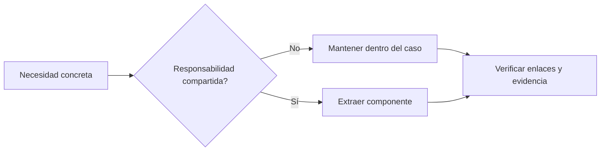

# Evolución de la estructura

Mantener los recursos junto a su caso o paper. Extraer componentes compartidos cuando
exista reutilización real, no para anticipar un proyecto de mayor tamaño.
La [guía raíz](../README.md#estructura) describe las carpetas actuales.

## Caso implementado

```text
case-0003-debt-negotiation/
  README.md
  prompt-search.ipynb
  prompt-search.pdf
  config.yaml
  golden-set.yaml
  prompt.yaml
  requirements.txt
  utils/
    prompt_search.py
    notebook_view.py
  diagrams/
  results/
```

El README es la fuente narrativa; el notebook presenta la ejecución; el PDF es una copia
regenerable de lectura. `utils/` es apoyo local, no un framework instalable. Un caso solo
Markdown no necesita carpetas de implementación. Véase [dec-0007](decisions/dec-0007-case-local-utils.md).

## Cuándo crecer

| Necesidad comprobada | Posible cambio |
|---|---|
| Dos casos reutilizan un componente probado | Extraerlo a `src/` con pruebas |
| Conjunto de evaluación estable e independiente | Crear `benchmarks/` |
| Ejecuciones entre varios casos | Registro compartido en `experiments/` sin alterar IDs ni evidencia |
| Comienza la tesis escrita | Fuentes en `manuscripts/` |
| Se emite una entrega formal | `deliverables/` con versiones inmutables y manifiestos |
| Se necesitan servicios simulados | Definición de entorno dentro del caso |
| Datos con ciclo de vida propio | `data/` con procedencia, licencia y versión |

Son condiciones, no carpetas por crear ahora. La ubicación de decks está pendiente de elegir;
su contenido será en inglés y referenciará documentos y commits de origen.



## Identidad y conservación

IDs estables en metadatos y [catálogo](catalog.csv). Eliminar documentos reemplazados y
registrar IDs retirados en decisiones, sin `_archive`. Git conserva lo eliminado.
Los resultados de ejecuciones mantienen bytes, nombres, rutas históricas y hashes aunque
se reorganice el código actual. Las decisiones [dec-0006](decisions/dec-0006-active-research-cleanup.md)
y [dec-0008](decisions/dec-0008-spanish-primary-documentation.md) explican las consolidaciones.
