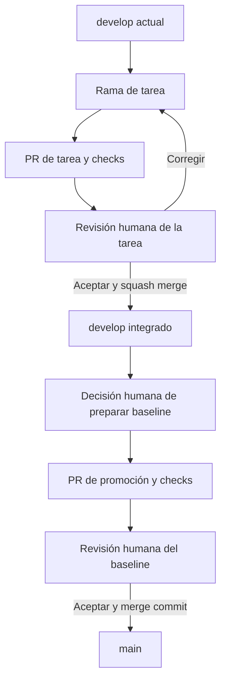

# Ramas y baselines formales

## Ramas permanentes

| Rama | Propósito | Entrada |
|---|---|---|
| `develop` | Integración de investigación e implementación | PR de tarea, checks correctos, revisión humana y squash merge por el responsable humano |
| `main` | Baseline para presentación, entrega o release | PR de promoción, checks correctos, aceptación explícita del baseline y merge commit por el responsable humano |

`main` sigue como rama predeterminada. Elegir `develop` al abrir un PR de tarea.
Los commits iniciales preceden este flujo y no constituyen una entrega científica formal.
El agente prepara cambios, evidencia y PRs; se detiene en Review, sin merge ni auto-merge.
CI correcto no equivale a aceptación humana.

## Dos puertas de revisión



Revisar la posibilidad de promoción cada una o dos semanas como referencia, sin automatizarla.
La aceptación de una tarea no autoriza una promoción posterior. Sincronizar `main` hacia
`develop` mediante otro PR, checks, revisión humana y merge commit.

## Ramas de tarea

Formato `<type>/<issue-number>-<short-description>`, en inglés y minúsculas.
Tipos: `docs`, `research`, `feat`, `fix`, `chore`, `refactor`, `test`.
Crear desde `origin/develop`, un objetivo acotado y un responsable de escritura por rama;
eliminar después de integrar. Los roles de agentes no son ramas permanentes.

```sh
git fetch origin
git switch -c docs/43-spanish-research-notes origin/develop
# Edit, validate, commit, and push the task branch.
gh pr create --base develop --head docs/43-spanish-research-notes --body-file pr-body.md
```

El ejemplo no reserva futuros IDs. Commits: `type: concise English description`.
El PR explica problema, resultado, evidencia, límites y `Refs #N`. Solo Jairzinho cierra
issues, mueve tarjetas a Done y asigna Completed date. Un PR parcial no cierra una tarea amplia.

## Integración y protección

- Squash para tareas; merge commit para promoción y sincronización. No squash ni rebase
  entre ramas permanentes, ni historial lineal obligatorio que impida sincronización.
- Aceptación sobre el diff y commit revisados; cambios materiales exigen revisión renovada.
- Ramas permanentes: PR, `Repository checks` / `validate`, rama actualizada y conversaciones
  resueltas. Prohibir force-push y eliminación, también a administradores.
- Cero aprobaciones técnicas obligatorias permite operar al único mantenedor; no elimina
  la revisión humana ni autoriza al agente a integrar. El squash deliberado registra
  aceptación de tarea; una promoción registra además aceptación explícita del baseline.
- No automatizar Done ni cierre de issues por eventos de PR o CI.

## Baselines y excepciones

Seleccionar un commit coherente de `develop`, validar ese head y abrir PR a `main` con
alcance, límites y entregables. Tras aceptación y merge humano, identificarlo con un tag
inmutable `milestone/<name>-rNNN`; software publicado usa `vMAJOR.MINOR.PATCH`.
Una entrega o experimento cita commit o tag, no solo una rama mutable.

Solo si hace falta preparar una entrega aparte, usar `release/<milestone>-rNNN` temporal.
Una corrección urgente puede partir de `main` en `fix/<issue>-<description>`, pasar por PR
y sincronizarse luego a `develop`. No crear esas ramas por anticipación.

Esta revisión traduce y concentra el flujo de [dec-0005](../decisions/dec-0005-human-integration-and-promotion.md),
sin cambiar sus dos aceptaciones humanas. [Protección de ramas en GitHub](https://docs.github.com/en/repositories/configuring-branches-and-merges-in-your-repository/managing-protected-branches/about-protected-branches).
