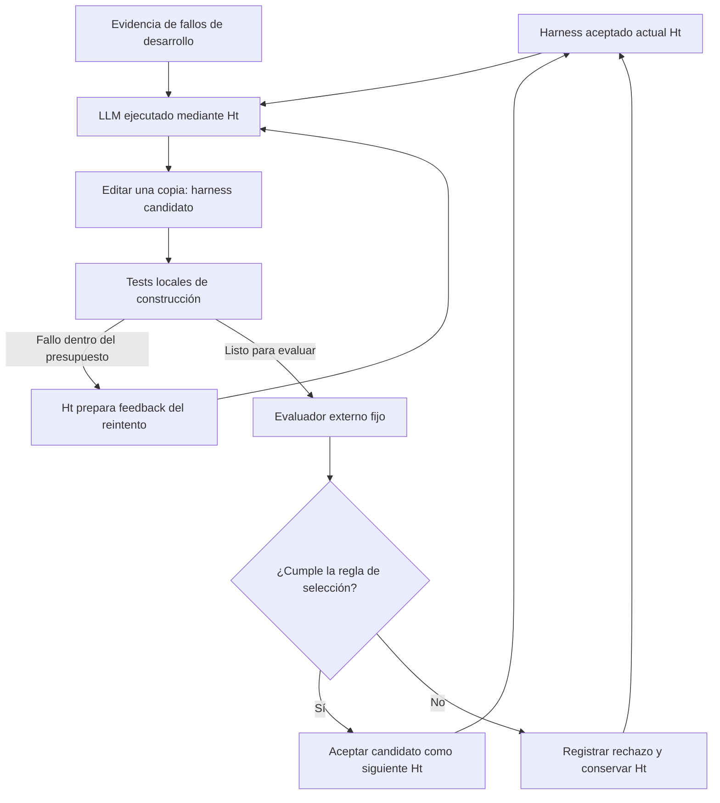
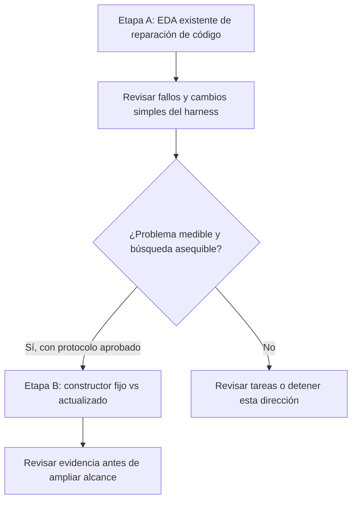

# Participación del harness en su propia mejora

[English](harness-participation.md) | Español

**Propuesta separada para revisión.** Este documento explora una extensión del
[case-0001](README.es.md). No reemplaza ese caso, no selecciona un
método de tesis ni asigna otro número de caso. Los ejemplos son hipotéticos; no se ha ejecutado
código ni experimentos.

## 1. Pregunta propuesta

¿Usar el harness aceptado actual para construir su siguiente versión produce mejores
harnesses de reparación de código que usar siempre el harness inicial como constructor?

La tarea sigue siendo reparar programas defectuosos. La pregunta adicional se refiere a
**cómo se construye el harness**. Un LLM fijo opera mediante el harness en ambos roles:
reparar código de las tareas y proponer cambios sobre una copia del código del harness.

| Rol | Artefacto ilustrativo | Límite |
|---|---|---|
| Programa que se repara | `task.py` | Los parches resuelven problemas individuales |
| Harness del agente | `harness.py` | Inicialmente solo puede cambiar `select_feedback` |
| Coordinador de búsqueda | `optimizer.py` | Fijo: inicia construcción, evaluación y selección |
| Evaluador externo | `evaluation.py` | Fijo: comprueba resultados, regresiones y uso de recursos |

Los nombres ilustran roles, no implementaciones existentes. El coordinador puede permanecer
fijo: el harness que cambia puede participar en construir a su sucesor. No es necesario
modificar los pesos del modelo ni el evaluador.

## 2. Un ejemplo posible

Supongamos que un pequeño paquete de facturación omite incorrectamente un total de cero en
su salida serializada. El requisito es preservar el total numérico, incluido el cero.

- **Reparación de la tarea:** cambiar la condición de serialización para conservar el cero.
- **Mejora del harness:** cambiar cómo se presentan los tests fallidos al LLM, lo que podría
  ayudarlo a reparar este y otros programas.

Llamemos `H0` al harness inicial. Su función de feedback reenvía la salida completa de los
tests. La misma función sirve para los reintentos al reparar tareas y al construir harnesses.

| Paso | Qué podría ocurrir | Qué permite establecer |
|---|---|---|
| Observar | Las trazas de desarrollo contienen logs repetidos que ocultan la aserción fallida | Una explicación candidata, no una prueba de la causa |
| Construir H1 | Un agente que ejecuta H0 edita una copia de H0 para conservar nombres de tests fallidos, ubicaciones y valores esperados/obtenidos | H0 participa en construir H1 |
| Evaluar | Un evaluador fijo ejecuta H1 sobre varias tareas de desarrollo y validación | Si el candidato cumple la regla de selección |
| Construir H2 | Si H1 se acepta, un agente que ejecuta H1 edita una copia de H1, por ejemplo para eliminar fallos duplicados sin perder ubicaciones | La versión aceptada ahora gobierna la construcción de su sucesora |

Si al construir H2 falla un test local, la función de feedback de H1 prepara ese fallo para
el siguiente intento del LLM. Allí la mejora anterior podría ayudar a la construcción.
Pasar únicamente el código fuente de H1 a un proponente fijo no ejercitaría este mecanismo.



Cada ronda usa una versión en ejecución inmutable y una copia candidata separada. Los
candidatos no pueden editar tests protegidos, resultados de referencia ni controles de
presupuesto. El bucle termina por el presupuesto o la regla de parada declarados; detenerlo
operativamente no demuestra convergencia matemática.

## 3. La comparación relevante

Ambas variantes parten de H0 y mejoran su candidato actual. Solo difiere el harness que
**ejecuta al constructor**.

| Variante | El constructor se ejecuta mediante | Código que se edita |
|---|---|---|
| Constructor fijo | H0 en todas las rondas | Copia del harness aceptado actual de esa variante |
| Constructor actualizado | Ht aceptado actual de esa variante | Copia del harness aceptado actual de esa variante |

Pseudocódigo ilustrativo, no ejecutable. `run_agent` devuelve una instantánea candidata;
su argumento `harness` configura al agente en ejecución, no solamente su prompt.

```python
constructor = initial_harness if mode == "fixed" else current_harness
candidate = run_agent(
    model=fixed_model,
    harness=constructor,
    workspace=copy_of(current_harness),
    task=change_request(development_evidence),
    editable_surface="select_feedback",
    limits=construction_limits,
)
# A protected coordinator evaluates the candidate and applies the selection rule.
```

Las variantes tienen la misma configuración en la primera ronda. El mecanismo puede diferir
cuando un cambio aceptado se usa en una ronda posterior de construcción. Registrar hashes de
las versiones del constructor y del código objetivo, llamadas a la función de feedback e
intentos fallidos. Si la función modificada nunca se ejecuta durante la construcción, el
experimento no ha ejercitado el mecanismo de feedback propuesto.

## 4. Evaluación y aceptación

- **Controles:** mismo modelo/versión, harness inicial, particiones de tareas, superficie
  editable, prompts, límites por ejecución y presupuesto total de búsqueda. El comportamiento
  diferente del harness es la intervención.
- **Regla para candidatos:** edición válida y acotada, comprobaciones protegidas aprobadas,
  límites respetados, sin disminución del éxito en desarrollo ni validación, y aumento en
  al menos una partición. Fijar repeticiones y denominadores antes de ejecutar; esta regla
  no es una prueba de significancia.
- **Comparación final:** congelar un harness seleccionado por variante y evaluarlo en familias
  de tareas reservadas, nunca usadas para construcción o selección. Comparar éxito y
  variabilidad; registrar costo total de construcción/evaluación, tokens, tiempo y regresiones.
- **Evidencia de beneficio:** ventaja frente al constructor fijo con el mismo presupuesto,
  en repeticiones independientes de la búsqueda. Un mejor parche o un único H1 aceptado no
  bastan. La tasa de candidatos válidos es un diagnóstico, no el resultado final.

Las puntuaciones de desarrollo y validación influyen en la selección; ninguna es una prueba
final intacta. Tamaños de muestra, límites de costo, umbrales de parada y análisis de
incertidumbre quedan para el protocolo de ejecución. Conservar resultados negativos y no
suponer mejoras en cada ronda.

## 5. Cómo podría integrarse

**Ubicación sugerida para revisión: dos etapas dentro del caso de reparación de código.**
Comparten entorno, pero responden preguntas distintas. El workflow de servicios sigue como
candidato independiente.



El [plan de EDA existente](scenarios.es.md) propone 36 ejecuciones
de referencia. Estas ejecuciones no financian ni validan la etapa B; las trayectorias de
búsqueda repetidas requieren un presupuesto separado. Una suma trivial corregida en una
llamada puede servir como control, pero no demuestra el beneficio propuesto si ambas
variantes ya la resuelven.

| Opción editorial | Consecuencia |
|---|---|
| Extender case-0001 con etapas A/B | Conservar la referencia actual y añadir esta pregunta de investigación |
| Reemplazar case-0001 | Reformular su pregunta principal, alcance y plan de EDA alrededor de este mecanismo |
| Mantener un caso separado | Asignar un ID de caso solo tras aprobación; conservar el ID del workflow de servicios |

La ubicación queda pendiente de revisión. Este borrador no cambia las especificaciones de
casos ni los planes de EDA existentes. Este documento no autoriza la implementación.

## 6. Relación con Self-Harness

Es una adaptación acotada de la idea de construcción mediante el harness actual descrita en
[Self-Harness, sección 3](https://arxiv.org/html/2606.09498v3), con modelo fijo y evaluación
externa. La comparación entre constructor fijo y actualizado y el ejemplo de facturación
son propuestas de este proyecto, no experimentos reportados por el paper ni una reproducción.

La [revisión parcial](../../literature/reviews/pap-0011-self-harness/README.es.md) detalla diferencias
entre versiones del paper y del código y límites de la evidencia. Alinearse con trabajos
previos no establece novedad; la contribución aún requiere una limitación medible y evidencia
comparativa.
