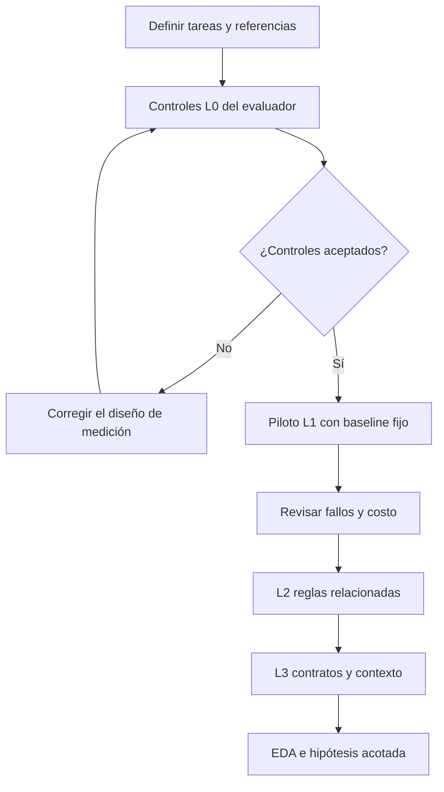
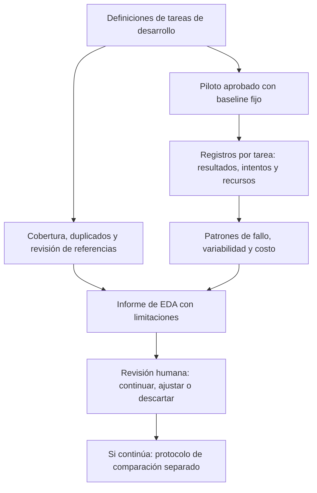

# Matriz de escenarios y plan de EDA para corrección de código

[English](scenarios.md) | Español

## 1. Objetivo

Para [case-0001](README.es.md), identificar tareas válidas, fallos del baseline
y una intervención viable mediante análisis exploratorio de datos (EDA).
**Solo planificado:** sin código, ejecuciones, golden set validado ni resultados. El EDA evalúa viabilidad;
no demuestra causalidad, mejora o beneficio económico.

El [diseño ilustrativo](README.es.md#2-un-diseño-posible) separa corregir
código de tarea de proponer cambios al harness. El piloto de 36 ejecuciones evalúa solo un
harness fijo; buscar cambios mediante un optimizador requiere otro protocolo y presupuesto.
Siguen abiertos el método y su ventaja frente a un bucle simple de edición/evaluación con LLM.

## 2. Matriz de escenarios

Cada fila es una plantilla prevista con futuros IDs de instancia. L0 comprueba el evaluador y se excluye de las puntuaciones de rendimiento.

| ID | Nivel y condición | Entrada o fallo ilustrativo | Resultado requerido y evidencia de aceptación |
|---|---|---|---|
| CR-00A | L0: sensibilidad del evaluador | Una solución correcta conocida y otra que suma precio y cantidad | La solución correcta pasa; la incorrecta falla para 250 × 3. Contrastar ambos veredictos con referencias revisadas |
| CR-00B | L0: artefactos protegidos | Un parche modifica una prueba de aceptación en lugar de la solución | Rechazar el parche, aunque las pruebas informadas pasen; registrar el cambio en el archivo prohibido |
| CR-01A | L1: aritmética local | Precio de 250 céntimos, cantidad 3; resultado inicial 253 | Resultado 750, entrada sin modificar y cumplimiento de todos los criterios comunes de tarea indicados más adelante |
| CR-01B | L1: casos límite | Precio 250, cantidad 0; y precio 0, cantidad 4 | Ambos resultados son 0; conservar el resultado habitual de 250 × 3 |
| CR-02A | L2: orden de reglas de precios | Subtotal de 1.000 céntimos, descuento fijo de 100, impuesto del 20 por ciento | Descuento primero: base de 900, total 1.080. Un total de 1.100 revela que se aplicó el impuesto antes del descuento fijo |
| CR-02B | L2: límite inferior del descuento | Subtotal de 100 céntimos, descuento fijo de 150, impuesto del 20 por ciento | Base y total iguales a 0; conservar el comportamiento de CR-02A y prohibir cargos negativos |
| CR-03A | L3: contrato entre módulos | Un total correcto de 1.080 se serializa como texto, o se omite un total igual a cero | Coinciden el cálculo de precios y el total numérico serializado; se conserva el cero y los campos no relacionados no cambian |
| CR-03B | L3: selección del contexto del fallo | Una tarea de la familia de CR-03A incluye fallos de integración relevantes mezclados con líneas de diagnóstico no relacionadas | Corregir el contrato dentro de los mismos límites y superar las mismas reglas de aceptación; registrar el contexto de diagnóstico suministrado |

- Usar centavos y cantidades enteros no negativos, con impuestos de centavos enteros. Se excluyen redondeo y entradas inválidas; las reglas son ficticias.
- Especificar requisitos, archivos editables, pruebas de desarrollo y aceptación protegida por instancia.
- Mantener variantes con/sin ruido en la misma partición. Más texto no implica mayor dificultad.
- Los ejemplos publicados son datos de desarrollo, nunca pruebas finales no vistas.

## 3. Aceptación

| Nivel | Evidencia requerida |
|---|---|
| Evaluador | Referencias revisadas con solución; distingue soluciones correctas/defectuosas; rechaza ediciones prohibidas; veredictos consistentes tras reinicio; versión y registro de ambigüedades |
| Ejecución | Pasan todas las pruebas funcionales/regresión, solo archivos permitidos, entradas/comportamiento ajeno preservados y presupuesto respetado; conservar parche, pruebas, estado y recursos |
| Afirmación de mejora | Protocolo separado, baseline fijo, tareas finales independientes, restricciones equivalentes y análisis de incertidumbre; fuera del EDA |

La corrección parcial y el agotamiento del presupuesto cuentan como fallo. Las puntuaciones parciales son diagnósticas.
Separar incidentes de infraestructura y justificar exclusiones/repeticiones; pasar pruebas no compensa ediciones prohibidas.

## 4. Baseline y muestra

**Baseline:** prompt y feedback fijos; máximo tres intentos de parche, una solicitud al modelo
por intento, sin memoria entre ejecuciones. El protocolo debe fijar modelo/configuración,
truncado de contexto, contabilidad de reintentos, límites de tokens/tiempo y presupuesto total.
No optimizar candidatos durante el EDA.

**Muestra provisional:** 6 plantillas no L0 × 2 instancias × 3 repeticiones = **36 ejecuciones**.
L0 y repeticiones justificadas son adicionales. Estima viabilidad, no potencia estadística.
Agrupar generadores, familias y variantes relacionadas al separar desarrollo/validación/evaluación final.
Todo dato del piloto inspeccionado pasa a desarrollo; las tareas finales no se tocan. Las repeticiones no son tareas independientes.

Avanzar solo con medición válida y costo viable. Conservar niveles previos como regresión;
fijar las cohortes comparadas e informar adiciones por separado. Si L1 está saturado, conservarlo
como control y examinar niveles más difíciles predefinidos. No eliminar tareas para mejorar una puntuación.

## 5. Registros y EDA

| Registro | Campos que se recogerían |
|---|---|
| Instancia de tarea | IDs de caso/escenario/instancia, nivel, familia, generador u origen, procedencia, partición, versión del requisito, hash del código inicial, archivos permitidos y versiones de referencia y evaluador |
| Ejecución | ID de ejecución, ID de tarea, revisión y commit del baseline, modelo/proveedor/parámetros, semilla si se admite, versión del entorno, inicio/fin, límite de intentos, estado final y resultado del restablecimiento |
| Intento | Índice de intento, referencia al parche, contexto suministrado, resultados de las pruebas de desarrollo, llamadas al modelo, tokens de entrada/salida, duración de pruebas y motivo de reintento o parada |
| Evaluación final | Comprobaciones de aceptación, cambios prohibidos, categoría de éxito/fallo, recursos totales, intervención humana, incidentes de infraestructura y enlaces a evidencia conservada |

| Cuándo | Revisar | Resultado y decisión |
|---|---|---|
| Antes de ejecutar | Cobertura, ambigüedad, duplicados, referencias y veredictos L0 | Tablas de cobertura/veredictos; corregir colección o evaluador |
| Después del baseline | Éxito y etapa del fallo por nivel/familia | Conteos y mapa de calor; identificar un problema acotado de feedback |
| Después del baseline | Repeticiones, trayectoria de intentos y pares con/sin ruido | Resultados por instancia; evaluar variabilidad y formular una hipótesis, no causalidad |
| Después del baseline | Tokens, llamadas, intentos, duración y costo frente al resultado | Valores individuales y distribuciones; evaluar presupuesto |

Usar igual peso por tarea, incluso con diferentes números de repeticiones. Mostrar numeradores,
denominadores, ejecuciones faltantes, totales intentados/válidos y motivos de exclusión. El análisis
de incertidumbre debe considerar dependencia por tarea/familia; con muestras pequeñas, preferir tablas y rangos a tendencias ajustadas.

Separar recursos de ejecución del esfuerzo de construcción: búsqueda, ediciones manuales y revisión humana.
Los costos monetarios requieren tarifas fechadas y moneda. Los gráficos previstos no son resultados.

## 6. Revisión y condiciones de ejecución

1. **Aprobar alcance e instrumento:** seleccionar cohorte, revisar requisitos/referencias/particiones, pasar L0 y verificar reinicios.
2. **Aprobar ejecución:** un [protocolo versionado](../../../docs/templates/experiment-protocol.md) debe fijar modelo, muestra,
   tope monetario, tokens/tiempo por ejecución, reintentos/repeticiones y revisión humana. Este plan no autoriza implementación ni gasto.
3. **Detener:** al primer límite aplicable; detener el lote si falla la integridad del evaluador o el reinicio. Conservar evidencia parcial.
4. **Revisar EDA:** cobertura, todos los estados, exclusiones, métricas con denominadores, fallos, costo y limitaciones;
   decidir continuar/ajustar/descartar antes de una intervención y un protocolo de comparación separado.

Aceptar evidencia trazable y decisiones justificadas, incluso con hallazgos negativos. Hasta ejecutar,
el entregable sigue siendo matriz y plan. Las etapas pueden ser objetivos de sprint; no hay fechas comprometidas.
Los recursos de una futura implementación permanecerán dentro de este caso.
El [plan de evolución](../../../docs/project-evolution.md) define cuándo extraer componentes compartidos.

Los agentes llegan hasta Review. Solo Jairzinho decide integración, cierre de issues, Done y Completed date;
los checks o un merge previo no autorizan estas acciones. Sin automatización de cierre.
