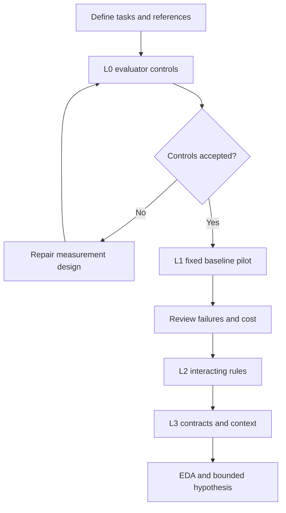
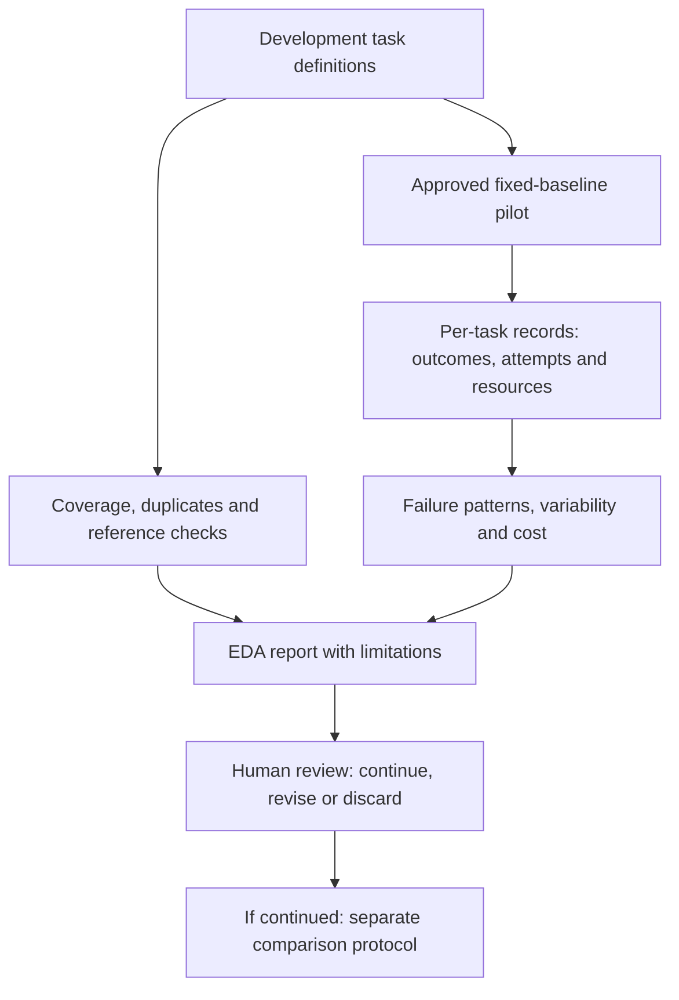

# Code repair scenario matrix and EDA plan

English | [Español](scenarios.es.md)

## 1. Objective

For [case-0001](README.md), identify valid tasks, baseline failures,
and an affordable harness intervention through exploratory data analysis (EDA).
**Planned only:** no code, runs, validated golden set, or results. EDA supports feasibility,
not causal, improvement, or economic claims.

The [illustrative design](README.md#2-one-possible-design) separates
repairing task code from proposing harness changes. The 36-run pilot below evaluates a fixed
harness only; optimizer search would require another protocol and budget. Its method and
advantage over a simple LLM edit/evaluate loop remain open.

## 2. Scenario matrix

Each row is a planned template with future instance IDs. L0 checks the evaluator and is excluded from performance scores.

| ID | Level and condition | Illustrative input or fault | Required result and acceptance evidence |
|---|---|---|---|
| CR-00A | L0: evaluator sensitivity | A known correct solution and a solution that adds price and quantity | The correct solution passes; the wrong one fails on 250 × 3. Check both verdicts against reviewed references |
| CR-00B | L0: protected artifacts | A proposed patch edits an acceptance test instead of the solution | Reject the patch, even if reported tests pass; record the forbidden file change |
| CR-01A | L1: local arithmetic | Price 250 cents, quantity 3; starting output 253 | Output 750, unchanged input, and all common task criteria below |
| CR-01B | L1: boundary handling | Price 250, quantity 0; and price 0, quantity 4 | Both outputs are 0; preserve the ordinary result for 250 × 3 |
| CR-02A | L2: ordered pricing rules | Subtotal 1,000 cents, fixed discount 100, tax 20 percent | Discount first: taxable amount 900, total 1,080. A total of 1,100 reveals tax applied before the fixed discount |
| CR-02B | L2: discount floor | Subtotal 100 cents, fixed discount 150, tax 20 percent | Taxable amount and total are 0; preserve CR-02A behavior and prohibit negative charges |
| CR-03A | L3: cross-module contract | A correct total of 1,080 is serialized as text, or a zero total is omitted | The pricing result and serialized numeric total agree; zero is retained; unrelated fields stay unchanged |
| CR-03B | L3: failure-context selection | A CR-03A-family task includes relevant integration failures mixed with unrelated diagnostic lines | Repair the contract within the same limits and pass the same acceptance rules; trace which diagnostic context was supplied |

- Use nonnegative integer cents and quantities, with integer-cent tax results. Rounding and invalid inputs are excluded; pricing rules are fictional.
- Specify requirements, editable files, development checks, and protected acceptance checks per instance.
- Keep clean/noisy variants in the same partition. Added text is not assumed to be harder.
- Published examples are development data, never unseen final tests.

## 3. Acceptance

| Level | Required evidence |
|---|---|
| Evaluator | Reviewed solvable references; correct and faulty solutions distinguished; forbidden edits rejected; consistent verdicts after reset; version and ambiguity log |
| Run | All functional/regression checks pass, allowed files only, inputs/unrelated behavior preserved, budget respected; patch, test outcomes, status, and resource record retained |
| Improvement claim | Separate protocol, fixed baseline, independent final tasks, matched constraints, and uncertainty analysis; outside EDA |

Partial correctness and budget exhaustion count as failure. Partial test scores are diagnostic.
Keep infrastructure incidents separate and justify exclusions/reruns; passing tests never override forbidden edits.

## 4. Baseline and sample

**Baseline:** fixed prompt and feedback format; at most three patch attempts, one model request
per attempt, no memory across runs. The execution protocol must set model/settings, context
truncation, retry accounting, token/time caps, and total budget. No candidate optimization during EDA.

**Provisional sample:** 6 non-L0 templates × 2 instances × 3 repetitions = **36 runs**.
L0 and documented reruns are additional. This estimates feasibility, not statistical power.
Group related generators, program families, and variants when splitting development/validation/final data.
All inspected pilot data become development data; final tasks stay untouched. Repetitions are not independent tasks.

Advance only with valid measurement and affordable cost. Keep earlier strata for regression;
freeze comparison cohorts and report additions separately. If L1 is saturated, retain it as
an instrument check and examine predeclared harder strata. Do not remove tasks to improve a score.

## 5. Records and EDA

| Record | Fields to collect |
|---|---|
| Task instance | Case/scenario/instance IDs, level, family, generator or source, provenance, split, requirement version, starting-code hash, permitted files, reference and evaluator versions |
| Run | Run ID, task ID, baseline revision and commit, model/provider/settings, seed if supported, environment version, start/end, attempt limit, terminal status, and reset outcome |
| Attempt | Attempt index, patch reference, context supplied, development-test outcomes, model calls, input/output tokens, test duration, and reason for retry or stop |
| Final evaluation | Acceptance checks, prohibited edits, success/failure category, total resources, human intervention, infrastructure incidents, and links to retained evidence |

| When | Inspect | Output and decision |
|---|---|---|
| Before runs | Coverage, ambiguity, duplicates, references, L0 verdicts | Coverage/verdict tables; repair the collection or evaluator |
| After baseline | Success and failure stage by level/family | Counts and heatmap; identify a bounded feedback problem |
| After baseline | Repetitions, attempt trajectories, paired clean/noisy diagnostics | Per-instance outcomes; assess variability and form a hypothesis, not a causal claim |
| After baseline | Tokens, calls, attempts, duration, cost versus outcome | Individual values and distributions; assess budget |

Use equal task weights, including when repetition counts differ. Show numerators, denominators,
missing runs, attempted/valid totals, and exclusion reasons. Any uncertainty analysis must account
for task/family dependence; small samples favor tables and ranges over fitted trends.

Separate runtime resources from construction effort: search, manual edits, and human review.
Monetary estimates require dated provider rates and currency. Planned charts are not results.

## 6. Review and execution gates

1. **Approve scope and instrument:** select the pilot cohort, review requirements/references/splits, pass L0, verify resets.
2. **Approve execution:** an [versioned protocol](../../../docs/templates/experiment-protocol.md) must set model, sample,
   monetary cap, token/time limits per run, retries/reruns, and human review budget. This plan authorizes no implementation or spend.
3. **Stop:** at the first applicable cap; stop the batch for evaluator integrity or reset failures. Preserve partial evidence.
4. **Review EDA:** coverage, all statuses, exclusions, metrics with denominators, failure patterns, cost, and limitations;
   decide continue/revise/discard before one intervention and a separate comparison protocol.

Accept traceable evidence and justified decisions, even for negative findings. Until execution,
this deliverable remains a matrix and plan. Stages may become sprint goals; no dates are committed.
Resources for a future implementation stay within this case.
The [evolution plan](../../../docs/project-evolution.md) defines when to extract shared components.

Agents stop at Review. Only Jairzinho decides integration, issue completion, Done, and Completed date;
passing checks or a prior merge do not authorize these actions. No completion automation.
