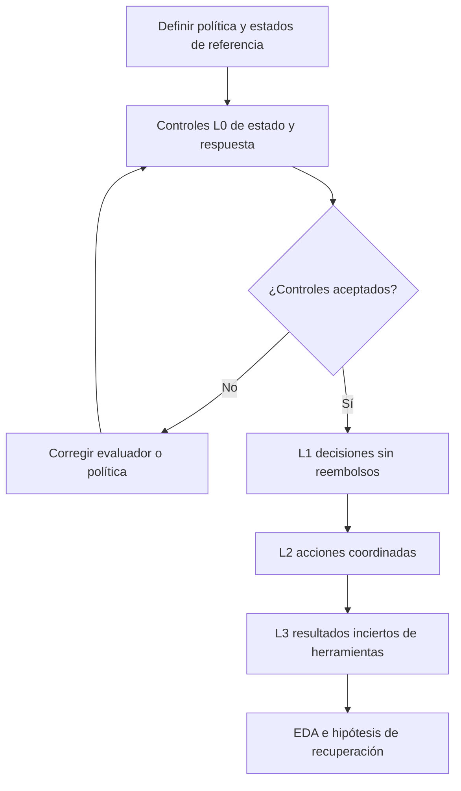
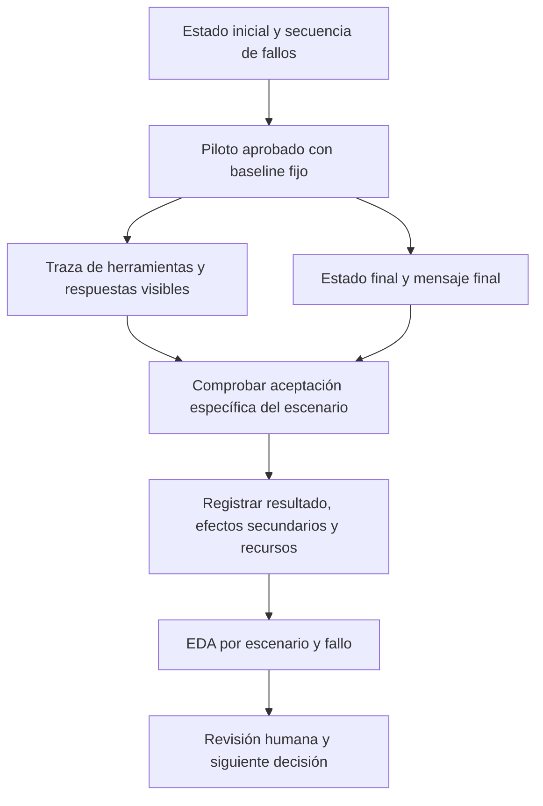

# Matriz de escenarios y plan de EDA para el flujo de servicio

[English](scenarios.md) | Español

**Referencia sustituida.** Se conservan su identidad y supuestos originales. El trabajo activo
del caso de negocio continúa en [case-0003: negociación de deudas](../case-0003-debt-negotiation/README.es.md).
La matriz de escenarios de servicio no se aplica a negociación; no se implica implementación ni resultados.

## 1. Objetivo

Para [case-0002](README.es.md), evaluar cobertura, fallos de recuperación
y costo del baseline mediante análisis exploratorio de datos (EDA).
**Solo planificado:** referencias ficticias, sin simulador, golden set validado ni resultados.
El EDA no demuestra mejora ni rentabilidad en producción. El [caso de código](../case-0001-code-repair-harness/scenarios.es.md) sigue siendo una alternativa separada.

## 2. Política y matriz de escenarios

Se pueden cancelar pedidos no enviados; los enviados no. Una cancelación sin pago no requiere reembolso;
una pagada requiere exactamente un reembolso completo. Repetir una cancelación completada no cambia nada.
Mantener fija la idempotencia del backend. Excluir reembolsos parciales, varias monedas, pagos reales y registros privados.

Cada fila es una plantilla prevista con futuros IDs de instancia. L0 valida la medición y se excluye del rendimiento.

| ID | Nivel y condición inicial | Evento o solicitud | Resultado requerido y evidencia de aceptación |
|---|---|---|---|
| SW-00A | L0: controles de estado de referencia | Suministrar un registro final válido y otro con dos reembolsos | Aceptar el resultado válido y rechazar el duplicado, aunque el pedido esté cancelado |
| SW-00B | L0: consistencia de la respuesta | Suministrar un pedido cancelado sin reembolso y un mensaje que afirma que el reembolso se completó | Rechazar la afirmación falsa; comprobar solo el estado es insuficiente |
| SW-01A | L1: pedido no pagado ni enviado | Solicitar cancelación | Cancelar el pedido, no crear reembolsos e informar la cancelación con precisión |
| SW-01B | L1: pedido enviado | Solicitar cancelación | Rechazar según la política; conservar pedido, registro de reembolsos y registros no relacionados; explicar el rechazo |
| SW-02A | L2: pedido pagado y no enviado; importe pagado de 1.200 céntimos | Solicitar cancelación con herramientas que funcionan normalmente | Cancelar y registrar exactamente un reembolso de 1.200 céntimos; informar ambos resultados con precisión |
| SW-02B | L2: pedido cancelado con un reembolso completo existente | Repetir la solicitud de cancelación | Conservar el estado completado; no crear otro reembolso e informar que la cancelación y el reembolso ya están completos |
| SW-03A | L3: estado inicial de SW-02A | Se registra el reembolso y después su respuesta agota el tiempo de espera | Resolver la incertidumbre; el registro final contiene exactamente un reembolso de 1.200 céntimos, con un mensaje veraz de finalización |
| SW-03B | L3: estado inicial de SW-02A | El reembolso agota el tiempo de espera antes de escribir; la consulta de estado está disponible | Establecer que no existe reembolso y completar uno dentro del presupuesto; no asumir que la primera llamada funcionó |
| SW-03C | L3: cancelación completada, resultado del reembolso desconocido para el agente | La solicitud de reembolso agota el tiempo de espera y los endpoints de reembolso/estado permanecen indisponibles | Detenerse dentro de los límites e indicar seguimiento manual; informar el reembolso como no verificado, no como completo; no crear duplicados ni efectos no autorizados |

- SW-03C requiere variantes con/sin registro del reembolso: el evaluador conoce el estado; el agente no.
  Solo SW-03C acepta escalación. En las demás filas no cumple la resolución requerida.
- SW-03A/B comparten familia; inyectar fallos en operaciones identificadas, no solo según el tiempo transcurrido.
- Variar importes e IDs. Son válidas distintas secuencias si cumplen estado, reglas y límites.

## 3. Aceptación

| Nivel | Evidencia requerida |
|---|---|
| Evaluador | Reglas claras, estados/mensajes válidos e inválidos revisados, comprobación de registros afectados/ajenos, reinicios/fallos reproducibles, versiones y registro de ambigüedades |
| Ejecución | Resultado esperado, sin efectos prohibidos, respuesta veraz y límites respetados; conservar estado anterior/posterior, traza/claves, mensaje, estado y recursos |
| Afirmación de mejora | Protocolo separado, baseline/protecciones fijos, escenarios finales reservados y restricciones equivalentes; fuera del EDA |

Conservar cuatro resultados: **completed**, **correctly_rejected**, **correctly_escalated**, **failed**.
Los efectos prohibidos o agotar el límite cuando se exige completar significan fallo. Las puntuaciones
parciales son diagnósticas. Contrastar mensajes con estado y evidencia disponible mediante una salida
estructurada; calibrar cualquier juez semántico con ejemplos revisados, nunca usar uno sin validar como única autoridad.

Los timeouts inyectados son condiciones de la tarea, no exclusiones de infraestructura. Registrar
aparte los fallos ajenos del simulador. Conservar efectos antes del reinicio y justificar repeticiones/exclusiones.

## 4. Baseline y muestra

**Baseline:** prompt/herramientas fijos y recuperación acotada. Ante un reembolso ambiguo, consultar estado;
si no existe, reintentar con la misma clave; si se desconoce, seguir una regla fija de reintento/escalación.
Fijar modelo, límites de intentos/tiempo y memoria en el protocolo. No optimizar candidatos durante el EDA.

**Muestra provisional:** 7 plantillas no L0 × 2 instancias × 3 repeticiones = **42 ejecuciones**.
SW-03C incluye una instancia por variante de estado oculto. L0 y repeticiones justificadas son adicionales.
Es una muestra de viabilidad, no de potencia estadística ni representatividad de producción.

Agrupar plantillas/variantes de fallo relacionadas al separar desarrollo/validación/evaluación final.
Todo dato inspeccionado del piloto pasa a desarrollo; los escenarios finales no se tocan. Las repeticiones
no amplían cobertura independiente. Reiniciar el estado relevante y verificar registros ajenos antes de cada ejecución.
Conservar niveles anteriores como regresión; informar cohortes nuevas por separado. Mantener reglas y protecciones
permite avanzar, pero los niveles propuestos no son dificultades medidas.

## 5. Registros y EDA

| Registro | Campos que se recogerían |
|---|---|
| Instancia de escenario | IDs de caso/escenario/instancia, nivel, familia de plantilla, hash del estado inicial, solicitud, importe, evento de fallo previsto, resultado esperado, versión de política/evaluador, procedencia y partición |
| Ejecución | ID de ejecución, ID de escenario, revisión/commit del baseline, modelo/proveedor/parámetros, semilla admitida, versión del entorno/restablecimiento, presupuestos, inicio/fin y estado final |
| Evento de herramienta | Índice ordenado de evento, herramienta, argumentos relevantes y clave de solicitud, fallo inyectado, respuesta visible, transición de estado real y tiempo transcurrido |
| Evaluación final | Resultado de política, efectos secundarios, consistencia de respuesta, resolución autónoma, intervenciones, llamadas, reintentos, tokens, duración y referencias de evidencia |

| Cuándo | Revisar | Resultado y decisión |
|---|---|---|
| Antes de ejecutar | Cobertura de estados/fallos, referencias, mensajes y veredictos L0 | Tablas de cobertura y desacuerdos; corregir la medición |
| Después del baseline | Cuatro resultados por escenario; finalización frente a escalación | Conteos con denominadores; identificar autonomía útil o evasión |
| Después del baseline | Pares de fallo antes/después de escribir y trazas | Comparaciones y secuencias; formular una hipótesis de recuperación, no causalidad |
| Después del baseline | Resultados repetidos, llamadas, reintentos, tokens y duración | Valores y distribuciones por instancia; elegir una comparación viable |

Informar por separado finalización en escenarios elegibles, rechazo donde corresponde y escalación en SW-03C.
Una política que siempre escala falla las otras filas. Resultado aceptable no equivale a finalización autónoma.
Usar igual peso por instancia salvo justificación; mostrar conteos, totales intentados/válidos y exclusiones.
Agrupar repeticiones por instancia; con muestras pequeñas, mostrar resultados individuales/rangos. El balance sintético no refleja frecuencias reales.

Separar costo de ejecución del esfuerzo de construcción: búsqueda, ediciones manuales y revisión humana.
Las estimaciones monetarias requieren tarifas fechadas y moneda. El diagrama describe registros previstos, no resultados observados.

## 6. Revisión y condiciones de ejecución

1. **Aprobar alcance e instrumento:** seleccionar cohorte/política/fallos; revisar evaluación de estado/mensaje; pasar L0; verificar reinicios e inyección por evento.
2. **Aprobar ejecución:** un [protocolo exp-NNNN](../../../docs/templates/experiment-protocol.md) debe fijar modelo, tope monetario,
   tokens/llamadas/tiempo, muestra/repeticiones, reejecuciones y revisión humana. Este plan no autoriza construir el simulador ni hacer llamadas.
3. **Detener:** al primer límite; detener el lote por filtraciones al evaluador, reinicios inválidos o estado corrupto. Conservar trazas parciales.
4. **Revisar EDA:** cobertura, todos los resultados con denominadores, exclusiones, trazas de fallos, costo, incertidumbre y limitaciones;
   decidir continuar/ajustar/descartar antes de una intervención y un protocolo de comparación separado.

Aceptar evidencia trazable, incluidos hallazgos negativos. Si el baseline ya resuelve los casos,
puede no haber una intervención útil. El tamaño muestral depende de variabilidad, presupuesto y afirmación prevista.
Las etapas pueden ser objetivos de sprint, no fechas fijas. Puede bastar un simulador local; Compose es opcional.
Los recursos de una futura implementación permanecerán dentro de este caso.
El [plan de evolución](../../../docs/project-evolution.md) define cuándo extraer componentes compartidos.

Los agentes llegan hasta Review. Solo Jairzinho decide integración, cierre de issues, Done y Completed date;
los checks o un merge previo no autorizan estas acciones. Sin automatización de cierre.
