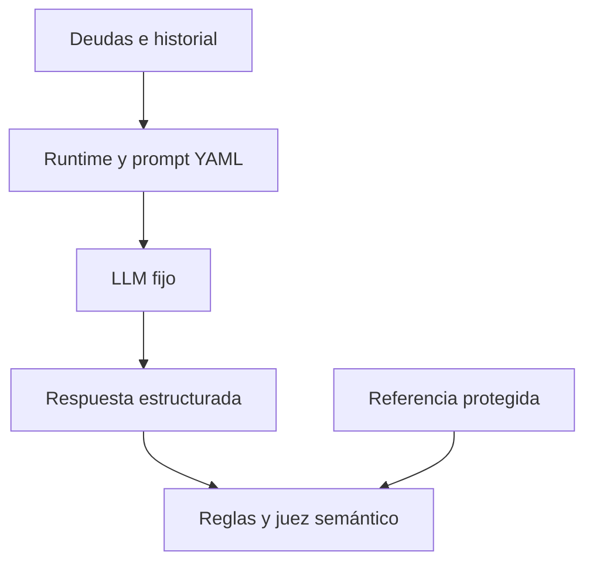
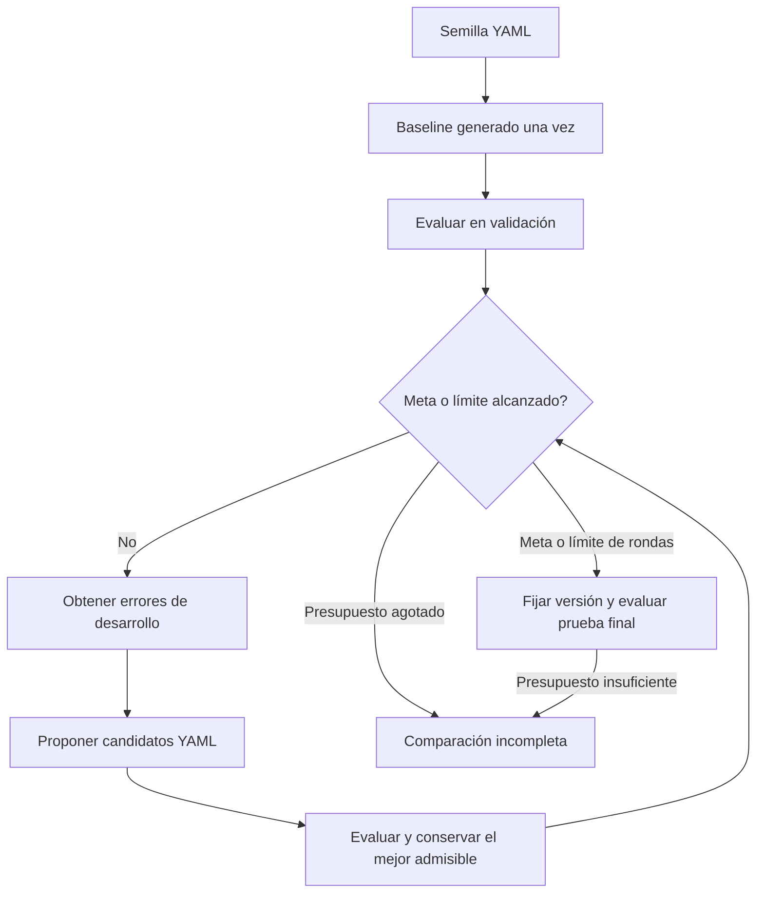

# Negociación de deudas sintéticas

[Notebook](prompt-search.ipynb) · [PDF de lectura](prompt-search.pdf) · [Matriz y próximo sprint](../../../docs/academic/README.md)

El código de apoyo está en `utils/`: [búsqueda acotada](utils/prompt_search.py) y
[presentación de evidencia](utils/notebook_view.py). El notebook y los YAML permanecen
en la raíz del caso; `results/` conserva las ejecuciones registradas.

## Extensión propuesta

El [análisis de componentes](../../../docs/academic/doc-0008-component-analysis.md) prepara una comparación de prompts y workflows,
con mejora fija o adaptativa. Es un diseño posterior al piloto; no cambia su objetivo ni sus resultados.

## Caso

Un asistente negocia con un cliente ficticio el pago de una deuda. Busca un acuerdo para la
mayor deuda viable, respetando la capacidad de pago, los planes permitidos y el consentimiento.
Puede terminar sin acuerdo. Todos los datos son sintéticos; no hay pagos ni datos bancarios reales.

| Deuda | Monto | Un pago | Dos pagos mensuales |
|---|---:|---:|---:|
| A | 200 | 200 | 100 cada uno |
| B | 300 | 300 | 150 cada uno |
| C | 600 | 600 | 300 cada uno |

**Pregunta de investigación:** ¿mejorar automáticamente el prompt produce mejores decisiones
que generarlo una sola vez, con el mismo modelo y evaluador?
El caso sigue en estudio junto con [reparación de código](../case-0001-code-repair-harness/README.md).

## Objetivo

Esta sección contiene la especificación que lee el optimizador.

<!-- objective:start -->
Generar instrucciones para la siguiente respuesta de un asistente de negociación de deudas
sintéticas. Buscar un acuerdo explícito para la mayor deuda viable, respetando la capacidad
de pago, los términos autorizados y la decisión del cliente.

- Las deudas A, B y C son de 200, 300 y 600 unidades ficticias. Se permite un pago o dos
  pagos mensuales iguales. El primero es este mes; la capacidad mensual se mantiene constante.
- Negociar como máximo una deuda. No inventar descuentos, intereses, términos ni pagos ejecutados.
- Si la capacidad mensual es desconocida, preguntar por ella. Desconocido no significa cero.
- Con capacidad conocida, ofrecer la mayor deuda viable. Para esa deuda, preferir un pago
  si es asequible; en caso contrario, dos pagos. Esta prioridad es una decisión del modelo.
- Aclarar un rechazo ambiguo. Detenerse ante un rechazo explícito a negociar o si ningún plan
  es viable. La ausencia de acuerdo nunca equivale a aceptación.
- Confirmar un acuerdo solo con consentimiento explícito para esa deuda y ese plan.
- Mantener la respuesta breve y coherente con la decisión estructurada.

Solo puede cambiar el prompt de política del negociador. Runtime, esquema de salida, objetivo,
ejemplos, modelo, evaluador e instrucciones del optimizador permanecen fijos durante la ejecución.
Se evalúa el comportamiento, no la coincidencia literal con una respuesta de referencia.
El baseline es un prompt generado una sola vez desde este objetivo y los ejemplos de desarrollo.
La mejora iterativa se compara con ese baseline; no está garantizada.
<!-- objective:end -->

## Modelamiento

El alcance inicial es **mejorar un prompt en YAML**. Cada ejemplo proporciona un historial
fijo y el modelo genera la siguiente respuesta. No se construye todavía una conversación
completa, un backend de pagos ni un optimizador que se modifique a sí mismo.

| Parte | Representación |
|---|---|
| Entrada visible | Deudas, planes permitidos e historial del cliente |
| Política modificable | Campo `prompt` de [prompt.yaml](prompt.yaml) |
| Referencias | 18 ejemplos en [golden-set.yaml](golden-set.yaml) |
| Salida | `action`, `debt`, `payments`, `installment`, `message` |
| Optimizador fijo | LLM que propone cambios al prompt a partir de errores de desarrollo |
| Evaluador fijo | Reglas de montos y consentimiento, más un juez LLM de consistencia, pertinencia y claridad |
| Límites | Modelo, precios, tokens y paradas en [config.yaml](config.yaml) |

Para una deuda `d`, `n` pagos y capacidad mensual `c`: cuota `a = d / n` y brecha `g = a - c`.
Si `g <= 0`, la cuota es viable. Por ejemplo, capacidad 170 permite B en dos pagos de 150,
pero no C en dos pagos de 300. Una capacidad desconocida se representa con `null`.
Estas son características derivadas; definir entradas, salidas y reglas es modelamiento.
No se entrenan pesos ni se realiza un EDA convencional.

El historial se envía explícitamente en cada llamada. El negociador no recibe respuestas
esperadas; las etiquetas de capacidad y consentimiento sirven al evaluador. La API transporta
JSON estructurado y el runtime guarda cada política como YAML. No se ejecuta código generado.

## Evaluación y mejora

El golden set se divide en seis ejemplos de desarrollo, seis de validación y seis de prueba
final. Solo desarrollo y sus errores llegan al optimizador. Validación selecciona candidatos;
la prueba final compara versiones después de fijar la selección.

Una respuesta es exitosa si coincide con la acción y plan esperados, cumple las reglas y
aprueba la rúbrica semántica. No necesita repetir el texto de referencia. La similitud de
embeddings por sí sola podría pasar por alto un monto incorrecto o consentimiento inventado.

`S = respuestas exitosas / respuestas evaluadas`

Se conserva un candidato si tiene **cero respuestas con incumplimientos** y mejora `S` al menos
`min_gain` frente a la versión actual. Gana el mayor puntaje admisible; un empate conserva
el primer candidato admisible. Es búsqueda discreta, no descenso de gradiente.

`p000` es una semilla didáctica; `p001` es el baseline experimental. Todas las propuestas,
incluso las descartadas, conservan versión padre, YAML, hash y evaluación. Si el baseline
alcanza la meta, no se fabrican iteraciones. El optimizador fijo no constituye mejora recursiva.

Valores iniciales: tres rondas, dos candidatos por ronda, dos repeticiones, meta 1.0, paciencia
dos rondas y `min_gain = 0.01`. El presupuesto común es USD 1 y 100 000 tokens, incluida la
prueba final. Cada llamada reserva consumo antes de enviarse. Un corte deja la comparación
incompleta; no se reintenta automáticamente cuando el consumo es incierto.

Los ejemplos comparten plantillas entre particiones, aunque no repiten historiales exactos.
El juez no está calibrado. Es un piloto sintético, no un benchmark independiente ni evidencia
de efectividad real; dos repeticiones no establecen significancia estadística.

## Resultados registrados

Una ejecución real el 16 de octubre de 2026 (America/Lima; ID en UTC) produjo estas versiones.
Usó el protocolo `v2`, con el objetivo original en inglés del commit `a93b35f`.
El objetivo actual está en español (`v3`); sus resultados todavía no se han medido.

| Versión | Etapa | Éxitos en validación | Respuestas con incumplimientos |
|---|---|---:|---:|
| p000 | Semilla | Sin evaluar | Sin evaluar |
| p001 | Baseline | 9/12 (75,0%) | 1 |
| p002 | Ronda 1, candidato 1 | 9/12 (75,0%) | 2 |
| p003 | Ronda 1, candidato 2 | 8/12 (66,7%) | 2 |
| p004 | Ronda 2, candidato 1 | 10/12 (83,3%) | 1 |

**No se aceptó ningún candidato.** Se conservó `p001`. La búsqueda consumió 148 llamadas y
83 815 tokens, con costo estimado de USD 0,10261125. La siguiente reserva de 24 329 tokens
habría superado el límite de 100 000. Se detuvo antes de completar la ronda dos y de llegar
a la prueba final. El mayor puntaje observado no demuestra una mejora aceptada ni generalización.

El baseline eligió una deuda menor cuando existía otra mayor viable y, en otro ejemplo,
ofreció una cuota de 100 con capacidad de 70. Estos fallos limitan la interpretación del
puntaje agregado.

Evidencia: [reporte](results/20261017T011558Z-f5eca942/report.json),
[consumo](results/20261017T011558Z-f5eca942/usage.jsonl),
[procedencia](results/20261017T011558Z-f5eca942/provenance.json) y prompts
[p000](results/20261017T011558Z-f5eca942/prompts/p000.yaml),
[p001](results/20261017T011558Z-f5eca942/prompts/p001.yaml),
[p002](results/20261017T011558Z-f5eca942/prompts/p002.yaml),
[p003](results/20261017T011558Z-f5eca942/prompts/p003.yaml),
[p004](results/20261017T011558Z-f5eca942/prompts/p004.yaml).

## Referencias

- [STOP](https://arxiv.org/abs/2310.02304): referencia para estudiar mejoradores; este piloto no lo reproduce.
- [Automatic Prompt Optimization](https://arxiv.org/abs/2305.03495): búsqueda de prompts con retroalimentación.
- OpenAI: [estado de conversación](https://developers.openai.com/api/docs/guides/conversation-state),
  [salidas estructuradas](https://developers.openai.com/api/docs/guides/structured-outputs) y
  [modelo y precios configurados](https://developers.openai.com/api/docs/models/gpt-5.4-mini).
