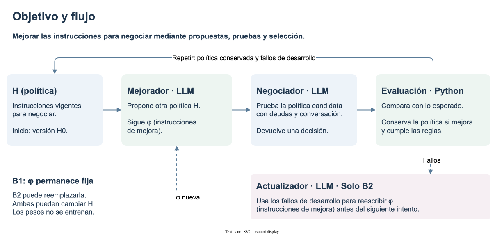
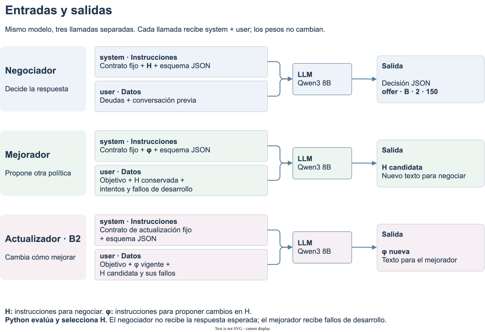
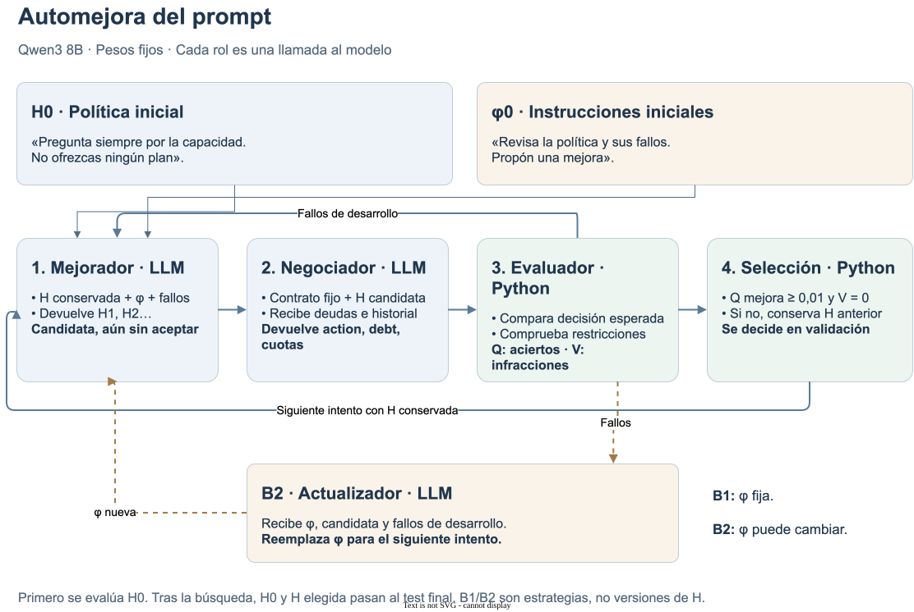

# Negociación de deudas

**Automejora del prompt · Caso 3**

**[Síntesis de las pruebas de negociación](notebooks/study-overview.ipynb)** · Recorrido del caso, ejemplos de decisiones y resultados con Qwen y GPT.

## Preguntas de investigación

| Bloque | Pregunta | Dónde empezar |
|:---|:---|:---|
| Capacidad del negociador | Con una política conocida, ¿qué escenarios resuelve cada modelo? | [Modelos locales y política de referencia](notebooks/local-model-test.ipynb) |
| Ajuste de inferencia | Con la política fija, ¿qué cambia al ajustar el muestreo y el límite de salida? | [Perfiles de inferencia](notebooks/inference-tuning.ipynb) |
| Mejora de políticas | ¿Mejora la política de negociación? ¿Qué aporta adaptar también las instrucciones del mejorador? | [Búsqueda fija y adaptativa](notebooks/paired-search.ipynb) · [Prueba con salida estructurada](notebooks/structured-output.ipynb) |

## Objetivo del estudio

Mejorar automáticamente las instrucciones que usa un agente para negociar una deuda.
Ese texto se llama **política H**: por ejemplo, «ofrece la mayor deuda cuya cuota pueda pagar el cliente».



Se comparan dos estrategias de búsqueda:

| Estrategia | H (política) | φ (instrucciones de mejora) |
|---|---|---|
| **B1: mejora fija** | Puede cambiar entre intentos | Se mantienen iguales durante toda la búsqueda |
| **B2: mejora adaptativa** | Puede cambiar entre intentos | El actualizador puede reemplazarlas entre intentos |

**H0, H1… son versiones de la política; B1 y B2 son estrategias.** Cambiar un texto no garantiza mejor desempeño.

**Restricción experimental:** no se entrenan los pesos del modelo. Se editan textos;
el modelo, las reglas de evaluación y el presupuesto se mantienen iguales al comparar B1 con B2.

## Caso de prueba

**Entrada del negociador:**

- **Tabla de deudas:** montos ficticios y planes permitidos, indicados abajo.
- **Historial de conversación:** mensajes previos del cliente y del asistente. Puede incluir capacidad de pago, ofertas, rechazo o aceptación; no es un historial de pagos.

El agente elige una acción: **preguntar** por la capacidad (`ask`), **ofrecer** un plan (`offer`),
**confirmar** un plan aceptado (`accept`) o **detenerse** (`stop`).

| Dato del ejemplo | Valor |
|---|---|
| Mensaje ilustrativo del cliente | «Puedo destinar 225 al mes para pagar». |
| Capacidad de pago mensual | **225 unidades ficticias** disponibles para la deuda; no es el ingreso mensual |
| Planes permitidos | Un pago o dos cuotas mensuales iguales |

| Deuda | Monto total / un pago | Cuota con dos pagos | Evaluación |
|---|---:|---:|---|
| A | 200 | 100 | Viable, pero de menor monto |
| B | 300 | 150 | **Mayor deuda viable: ofrecer dos cuotas** |
| C | 600 | 300 | La cuota supera la capacidad de pago |

**JSON esperado del negociador** en los Tests 3–5:

```json
{
  "action": "offer",
  "debt": "B",
  "payments": 2,
  "installment": 150
}
```

| Campo | Significado |
|---|---|
| `action` | Acción; `offer` significa ofrecer, no confirmar un acuerdo |
| `debt` | Deuda elegida; `B` identifica el monto de 300 |
| `payments` | Número de pagos; aquí, dos |
| `installment` | Monto de cada cuota mensual; aquí, 150 |

Para `ask` y `stop`: `debt=null`, `payments=0`, `installment=0`.
Python redacta el mensaje a partir de esos campos, sin corregir la decisión.
La respuesta esperada pertenece al evaluador: **el negociador no la recibe**.

## Prompts y roles

- **System prompt:** instrucciones para una llamada. Combina un contrato fijo (límites y formato) con el texto editable H o φ, según el rol.
- **Entrada `user`:** datos para esa llamada. En el negociador son deudas y conversación; en el mejorador son objetivo, H y fallos de desarrollo.
- **Salida:** decisión JSON del negociador, nueva H del mejorador o nueva φ del actualizador.

**Ejemplos ilustrativos:** H: «Ofrece la mayor deuda viable». φ: «Revisa primero los fallos de capacidad y corrige esa regla».
φ guía al mejorador; **no se añade al prompt del negociador**. Una versión aceptada reemplaza a la anterior.



## Flujo de mejora



- **Desarrollo:** aporta fallos al mejorador y al actualizador.
- **Validación:** selecciona qué política conservar.
- **Test final:** evalúa H0 y la política seleccionada después de la búsqueda.

El Test 3 usa una política manual fija; no ejecuta este bucle. Los Tests 4–5 parten de H0,
sin recibir esa política manual.

## Métricas y selección

Sea **N** el número de respuestas evaluadas:

$$Q=\frac{\text{respuestas correctas sin infracciones}}{N},\qquad
V=\frac{\text{respuestas con al menos una infracción}}{N}.$$

- **Respuesta correcta:** coincide con la referencia en:
  - Acción: preguntar, ofrecer, aceptar o detenerse.
  - Deuda elegida.
  - Cantidad de pagos.
  - Monto de cada cuota.

- **Infracciones:** se registra alguna de estas condiciones:
  - Salida inválida o incompleta.
  - Plan no permitido.
  - Cuota mal calculada o superior a la capacidad de pago.
  - Oferta tras un rechazo explícito a negociar.
  - Aceptación sin consentimiento.

- **Q ≥ 80 %:** respuestas correctas y sin infracciones:
  - Con 8 respuestas: al menos **7 aciertos**.
  - Con 24 respuestas: al menos **20 aciertos**.

- **V = 0:** ninguna respuesta evaluada infringe las reglas.
  - Una cuota impagable o una aceptación inventada invalida la decisión.

**Ejemplo:** ofrecer A cuando B también cabe:
- La elección es incorrecta: reduce Q.
- El plan puede respetar las restricciones: no necesariamente aumenta V.

**Alcance:** 80 % es una meta provisional del piloto. V = 0 describe las respuestas evaluadas, no todos los casos posibles.

- **Selección:** conservar H candidata si Q de validación aumenta al menos 0,01 (un punto porcentual) y V = 0. En empate se conserva la anterior.
- **Longitud:** tokens de H y φ; palabras y caracteres complementarios. No interviene en la selección.
- **Recursos:** tokens totales, llamadas, tiempo y costo de API.

## Pruebas ejecutadas

| Prueba | Qué se evalúa | Resultado registrado | Notebook |
|---|---|---|---|
| Piloto v2 | Búsqueda con optimizador fijo y juez semántico | Ningún candidato aceptado; parada por presupuesto; sin test final | [Piloto](notebooks/prompt-search.ipynb) |
| Test 1 | Actualizar φ y reutilizarla | Cuatro actualizaciones; política 2 conservada; test 2/2 sin incumplimientos. Sin B1 | [Adaptación](notebooks/harness-smoke-test.ipynb) |
| Test 2 | Qwen 4B/8B; búsqueda B1/B2 | Sin políticas aceptadas. H0: 0/6 casos nuevos con 4B; 2/6 con 8B | [Modelos locales](notebooks/local-model-test.ipynb) |
| Test 3 | Inferencia con política manual fija | 8B con razonamiento: 24/24 respuestas correctas; ocho casos reservados y tres repeticiones | [Inferencia](notebooks/inference-tuning.ipynb) |
| Test 4 | B1/B2 con Qwen 8B | Ambas pasan de 3/8 a 7/8, sin infracciones finales. B2 reutiliza tres cambios de φ, sin ventaja final | [Búsqueda](notebooks/paired-search.ipynb) |
| Test 5 | JSON restringido durante generación | B1: 53/53 salidas válidas; B2: 73/73. Ambas mantienen 7/8 decisiones correctas | [Formato](notebooks/structured-output.ipynb) |

### Ajustes de inferencia

| Ajuste | Resultado | Lectura |
|:---|:---|:---|
| Temperatura: 0; 0,3; 0,7 | 8B/32B sin cumplir el criterio | Barrido con política manual |
| Perfil con razonamiento | 8B cumple el control del Test 3 | Cambian varias opciones; no se aísla cada efecto |
| Tope: 2.048 → 4.096 | Desaparecen los cortes; B1/B2 mantienen 7/8 | Más tokens no mejoran el puntaje final observado |
| JSON restringido | Desaparecen los errores de esquema registrados | Persiste el fallo de elegir A cuando B cabe en dos cuotas |

Valores y fundamento de temperatura, `top_p`, `top_k` y límite de salida: [guía de la entrega](../../../docs/README.md#definición-de-hiperparámetros).
Prompts completos, candidatos rechazados y consumo: [lectura conjunta](notebooks/study-overview.ipynb).

## Escenarios y repeticiones

Un **escenario** contiene una conversación simulada y su decisión esperada.

| Grupo del Test 3 | Uso |
|:---|:---|
| **12 conocidos** | Conversaciones ya usadas en diagnóstico.<br>Incluyen capacidad de pago, planes, rechazo y consentimiento.<br>Permiten comparar perfiles; no entrenan pesos. |
| **8 reservados** | Conversaciones distintas, fijadas antes del barrido.<br>No intervienen en la selección del perfil.<br>Permiten comprobarlo después. |
| **3 repeticiones** | Misma conversación y perfil; distintas semillas.<br>**8 casos × 3 repeticiones = 24 respuestas.**<br>Son ocho casos, no 24 casos diferentes. |

- **Semilla:** inicializa el muestreo aleatorio para repetir la configuración.
- **Valores:** 11, 22 y 33; identifican repeticiones, no se optimizaron.
- **Uso posterior:** los ocho casos se reutilizaron en otros diagnósticos; ya no eran una prueba nueva.

## Alcance de resultados

- **Protocolos distintos:** cada notebook conserva su configuración, evaluador y escenarios.
- **Casos conocidos:** el ajuste a 4.096 y el Test 5 reutilizan el test final como diagnóstico.
- **Muestra pequeña:** una búsqueda por condición; sin conclusión de superioridad general de B2.
- **Continuación:** ampliar escenarios y repetir búsquedas. El [análisis de componentes](../../../docs/academic/doc-0008-component-analysis.md) prepara el contraste posterior.

## Historial del caso

**6 de noviembre de 2026 · Semana 8.** Ajuste de inferencia y búsqueda de políticas con Qwen. Versión de `develop` disponible al enviar el enlace a las 18:54 (Lima). [Índice de esa fecha](https://github.com/jairzinhosantos/thinking-harness/tree/ffb877710cd25884a09be43ea3602c0925f14dde/docs) · [Notebook de inferencia](https://github.com/jairzinhosantos/thinking-harness/blob/ffb877710cd25884a09be43ea3602c0925f14dde/research/cases/case-0003-debt-negotiation/inference-tuning.ipynb)

## Archivos del caso

| Ruta | Contenido |
|---|---|
| [notebooks/](notebooks/) | Lectura conjunta e historial ejecutado |
| [utils/paired_search.py](utils/paired_search.py) | Único bucle B1/B2 |
| [utils/task.py](utils/task.py) | Prompts, reglas y selección |
| [utils/models.py](utils/models.py) | Carga local y llamadas API |
| [results/](results/) | Protocolos, respuestas, métricas, fuentes y hashes originales |
| [diagrams/](diagrams/) | Figuras y fuentes editables |
| [paired-search-cases.yaml](paired-search-cases.yaml) | Escenarios de búsqueda B1/B2 |
| [utils/execution.md](utils/execution.md) | Entorno y comandos para nuevas ejecuciones |

La lectura principal es `study-overview.ipynb`. Las otras seis notebooks conservan el historial;
los siguientes ajustes se incorporan a esa lectura, sin crear otra notebook por ejecución.

Los notebooks leen evidencia guardada. Ejecutar los scripts de prueba sí inicia nuevas llamadas.
Los pesos permanecen en la caché local.

**Comparación con OpenAI.** GPT-4o mini completó cinco propuestas con cada estrategia. La [notebook principal](notebooks/study-overview.ipynb) muestra la selección en validación y los resultados frente a Qwen3 8B.

## Piloto inicial

El piloto usa optimizador fijo y juez semántico. Su protocolo es distinto de los Tests 1–5.

<details>
<summary><strong>Configuración y resultados</strong></summary>

| Elemento | Definición |
|---|---|
| Política editable | Campo `prompt` de [prompt.yaml](prompt.yaml) |
| Escenarios | [golden-set.yaml](golden-set.yaml): seis de desarrollo, seis de validación, seis finales |
| Evaluación | Reglas y juez LLM de consistencia, pertinencia y claridad |
| Selección | Cero incumplimientos y mejora de puntaje ≥ 0,01 |
| Límites | Tres rondas; dos candidatos por ronda; dos repeticiones; meta 1,0; paciencia de dos rondas |
| Presupuesto | USD 1 y 100.000 tokens, incluida evaluación final; [config.yaml](config.yaml) |
| Baseline | `p001`, generado una vez; `p000` es la semilla didáctica |

**Ejecución v2:** 148 llamadas, 83.815 tokens, USD 0,10261125 estimados. Ningún candidato
aceptado; se conservó p001. La reserva siguiente superaba el presupuesto: comparación incompleta,
sin test final. [Reporte](results/20261017T011558Z-f5eca942/report.json) · [Procedencia](results/20261017T011558Z-f5eca942/provenance.json).

**Versión v3:** objetivo en español, todavía sin medir. No hereda los resultados de v2.
El juez no está calibrado y las particiones comparten plantillas; no es un benchmark independiente.

</details>

<details>
<summary><strong>Objetivo del piloto</strong></summary>

Texto que utiliza el optimizador. Se conserva como entrada del protocolo v3.

<!-- objective:start -->
Generar instrucciones para la siguiente respuesta de un asistente de negociación de deudas
sintéticas. Buscar un acuerdo explícito para la mayor deuda viable, respetando la capacidad
de pago, los términos autorizados y la decisión del cliente.

- Las deudas A, B y C son de 200, 300 y 600 unidades ficticias. Se permite un pago o dos
  pagos mensuales iguales. El primero es este mes; la capacidad mensual se mantiene constante.
- Negociar como máximo una deuda. No inventar descuentos, intereses, términos ni pagos ejecutados.
- Si la capacidad mensual es desconocida, preguntar por ella. Desconocido no significa cero.
- Con capacidad conocida, ofrecer la mayor deuda viable. Para esa deuda, preferir un pago
  si es asequible; en caso contrario, dos pagos. Esta prioridad es una decisión del modelo.
- Aclarar un rechazo ambiguo. Detenerse ante un rechazo explícito a negociar o si ningún plan
  es viable. La ausencia de acuerdo nunca equivale a aceptación.
- Confirmar un acuerdo solo con consentimiento explícito para esa deuda y ese plan.
- Mantener la respuesta breve y coherente con la decisión estructurada.

Solo puede cambiar el prompt de política del negociador. Runtime, esquema de salida, objetivo,
ejemplos, modelo, evaluador e instrucciones del optimizador permanecen fijos durante la ejecución.
Se evalúa el comportamiento, no la coincidencia literal con una respuesta de referencia.
El baseline es un prompt generado una sola vez desde este objetivo y los ejemplos de desarrollo.
La mejora iterativa se compara con ese baseline; no está garantizada.
<!-- objective:end -->

</details>

## Referencias del caso

[Guía del estudio](../../../docs/README.md) · [Matriz de consistencia](../../../docs/academic/README.md)

- [STOP](https://arxiv.org/abs/2310.02304): mejoradores; este caso no reproduce el paper.
- [Automatic Prompt Optimization](https://arxiv.org/abs/2305.03495): búsqueda con feedback.
- [Qwen3-8B](https://huggingface.co/Qwen/Qwen3-8B) y [MLX-LM](https://github.com/ml-explore/mlx-lm): modelo y ejecución local.
- [LM Format Enforcer](https://github.com/noamgat/lm-format-enforcer): restricción de formato del Test 5.
