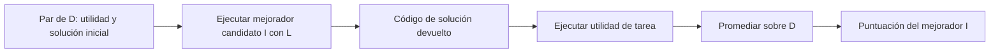
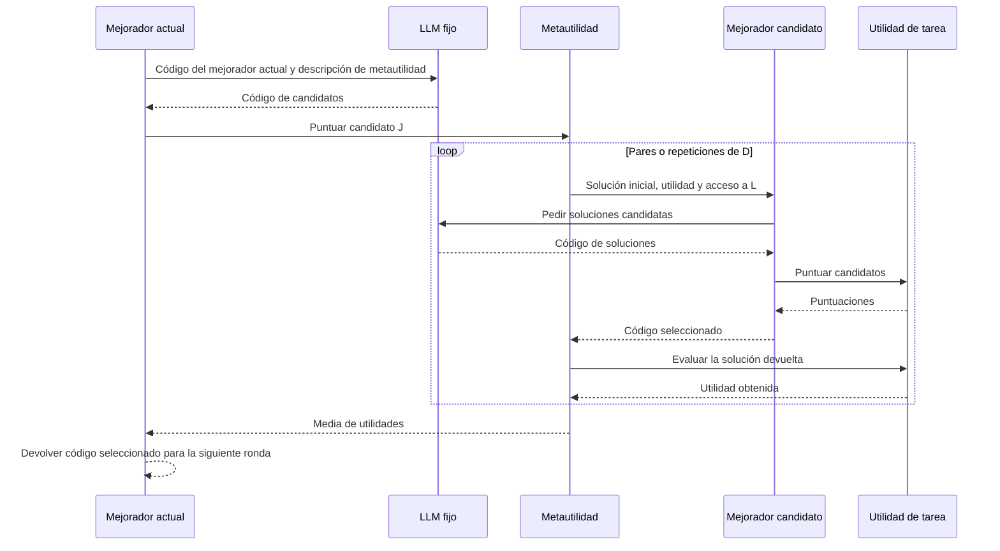
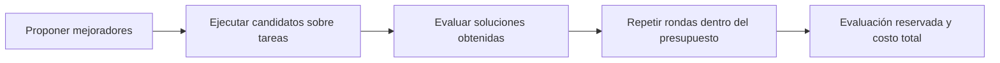

# STOP: mecanismo, código y evidencia

STOP utiliza un programa mejorador para proponer cambios a su propio código. **El modelo de
lenguaje permanece fijo.** Su valor para thinking-harness está en separar mejorar una solución
de mejorar el procedimiento que produce soluciones. No es todavía el método elegido para la tesis.

## 1. Fuentes y estado

**Paper:** Eric Zelikman, Eliana Lorch, Lester Mackey y Adam Kalai,
*Self-Taught Optimizer (STOP): Recursively Self-Improving Code Generation*.
[Versión 3, 16 de agosto de 2024, COLM 2024](https://arxiv.org/abs/2310.02304v3).
La clave bibliográfica es `zelikman2023stop` y conserva el año del preprint inicial.

**Afiliaciones indicadas en la página 1 de la v3:**

| Autor | Afiliación indicada | Tipo de institución / nota |
|---|---|---|
| Eric Zelikman | Stanford University | Universidad; nota con asterisco: trabajo realizado en Microsoft Research New England |
| Eliana Lorch | No indicada en la cabecera del paper | No se deduce una afiliación del propietario del repositorio |
| Lester Mackey | Microsoft Research | Organización de investigación de la industria |
| Adam Kalai | OpenAI | Empresa de investigación en IA; nota con asterisco: trabajo realizado en Microsoft Research New England |

Son las afiliaciones de esta versión del paper, no una afirmación sobre su empleo actual.
El espacio `microsoft` del repositorio no convierte a todos los autores en empleados de Microsoft.
Fuente: [portada y nota de afiliación de la v3](https://arxiv.org/pdf/2310.02304v3#page=1).

**Código:** [microsoft/stop](https://github.com/microsoft/stop/tree/0d6780c54306b2486dd36e9c4ae9b49aceb27ea4),
commit `0d6780c54306b2486dd36e9c4ae9b49aceb27ea4`. Todos los enlaces al código apuntan a esta versión.

| Actividad | Estado y alcance |
|---|---|
| Inspección asistida de fuentes | Resumen, introducción, secciones 3-8, algoritmo 1, figuras 2 y 4, tabla 1 y apéndice K; inspección parcial de A.1-A.2 |
| Lectura completa del paper | Parcial; falta profundizar en los trabajos relacionados, las demostraciones y los demás apéndices |
| Inspección estática del código | Ejecutor, mejoradores iniciales, metautilidad, utilidad de paridad, interfaz del modelo, cargador, configuración y punto de entrada de la evaluación de transferencia |
| Ejecución | Código original no ejecutado; sin importar módulos de terceros, invocar modelos ni realizar experimentos científicos. En la revisión anterior se comprobaron ejemplos didácticos deterministas, no el método original |
| Discusión guiada | Pendiente; preparar el documento no acredita haber completado la lectura personal |
| Reproducción | Sin resultados reproducidos |


## 2. Aporte y evidencia del paper

| Parte | Aporte | Límite |
|---|---|---|
| Secciones 3-4, algoritmo 1 | Formaliza tarea, mejorador y metautilidad; aplica el mejorador a su propio código | Modifica software, no pesos; los autores lo distinguen de RSI completo |
| Sección 5.1, figura 4 | Con GPT-4, mejora el rendimiento medio en paridad con ruido frente a referencias | No garantiza mejora monótona en cada trayectoria |
| Sección 5.2, tabla 1 | Evalúa transferencia de un mejorador seleccionado a cinco tareas nuevas | No caracteriza todos los mejoradores obtenidos |
| Sección 5.3 | Rendimiento decreciente con GPT-3.5 y Mixtral | La capacidad del modelo condiciona el método |
| Secciones 6-7 y apéndice A | Examina explotación de utilidades, restricciones y generalización bajo supuestos | No ofrece garantía práctica incondicional de seguridad ni convergencia |

Son **resultados de los autores**, no reproducciones del proyecto. En la sección 5.1 hay
20 instancias de desarrollo por evaluación de tarea, cinco mejoras repetidas del mismo par
tarea/solución inicial, 50 instancias reservadas y cinco ejecuciones independientes de STOP.
Esos cuatro niveles no representan cinco familias de tareas.

## 3. Modelo: qué devuelve cada función

El paper trata programas como cadenas de código. Una utilidad contiene una función ejecutable
`u_func` y una descripción `u_str`. En las ecuaciones, `u(s)` abrevia ejecutar la función sobre `s`.
La descripción ayuda al LLM a proponer código; **no convierte al LLM en quien asigna la puntuación**.

| Símbolo | Significado | Tipo de salida |
|---|---|---|
| `s`, `s'` | Solución inicial y devuelta | Código fuente |
| `u` | Utilidad de una tarea | Número acotado; no necesariamente binario |
| `L` | Modelo de lenguaje fijo | Texto, del que se extrae código |
| `I` | Programa mejorador | Código de una solución |
| `D` | Colección de pares tarea/solución inicial `(u, s)` | Datos de metaevaluación |
| `û` | Metautilidad empírica de un mejorador | Media de utilidades de sus soluciones |

### Paso 1. Mejorar una solución

Ecuación 1 del paper:

$$
s' = I(u,s,L).
$$

El mejorador recibe la solución y la utilidad, consulta al modelo y devuelve código.
Después, `u(s')` mide la solución obtenida. La prima indica una nueva solución, no una derivada.
El objetivo es obtener mayor utilidad; la ecuación no garantiza que ocurra.

### Paso 2. Evaluar al mejorador

Ecuación 2 del paper:

$$
\widehat{u}(I)=\frac{1}{|D|}\sum_{(u,s)\in D}u\bigl(I(u,s,L)\bigr).
$$

Se lee de dentro hacia fuera:

1. Ejecutar `I` sobre una solución inicial `s` usando `u` y `L`.
2. Puntuar el código devuelto con la utilidad de esa tarea.
3. Repetir para los pares de `D` y promediar. La media puntúa al **mejorador por sus resultados**.

El sombrero identifica una estimación basada en la colección disponible. El objetivo
poblacional del paper es la utilidad esperada sobre una distribución de tareas; la media
empírica no garantiza por sí sola generalización a tareas nuevas.



### Paso 3. Aplicar el proceso al propio mejorador

La sección 4 define:

$$
I_t=I_{t-1}\bigl(\widehat{u},I_{t-1},L\bigr).
$$

El mismo símbolo tiene dos roles: el `I` exterior es el programa que **se ejecuta**; el `I`
interior representa el programa cuyo **código se intenta mejorar**. Se cambia la utilidad de
tarea por la metautilidad. La implementación devuelve texto y lo carga como función.
Esta distinción de representación no añade otra ecuación al método.



La utilidad interna ayuda a elegir; la externa mide lo que efectivamente devolvió el
mejorador. La segunda evaluación no es otra propuesta del LLM. En la implementación hay
modos de validación y prueba y llamadas estocásticas: no se debe asumir que ambas evaluaciones
son un caché idéntico. La recursión ocurre cuando el código mejorador obtenido participa
en rondas posteriores, no por repetir una evaluación.

## 4. Del modelo al código original

**Inspección estática** del commit fijado; fragmentos con contexto omitido, no scripts autónomos.
Los parámetros del código aparecen en otro orden que en la notación del paper.
Código original bajo [MIT](https://github.com/microsoft/stop/blob/0d6780c54306b2486dd36e9c4ae9b49aceb27ea4/LICENSE).

**A. La semilla propone y selecciona.**
[Mejorador inicial, líneas 18-23](https://github.com/microsoft/stop/blob/0d6780c54306b2486dd36e9c4ae9b49aceb27ea4/tasks/meta_optimization/secret_seed_algorithm.py#L18-L23):

```python
n_messages = min(language_model.max_responses_per_call, utility.budget)
new_solutions = language_model.batch_prompt(expertise, [message] * n_messages, temperature=0.7)
new_solutions = extract_code(new_solutions)
print("new_solutions:", new_solutions)
best_solution = max(new_solutions, key=utility)
return best_solution
```

`message` incluye `initial_solution` y `utility.str`. `max(..., key=utility)` **ejecuta el
evaluador**, no lee puntuaciones entregadas por el LLM. Devuelve código, no un número.
La semilla es deliberadamente simple: generación en lote y selección. STOP busca sustituir
ese procedimiento por otros más capaces; los autores describen búsqueda en haz, algoritmos
genéticos y recocido simulado. El código inicial no incluye automáticamente la solución de
partida entre los candidatos.

**B. La metautilidad ejecuta el mejorador candidato.**
[`get_improver`, líneas 33-35](https://github.com/microsoft/stop/blob/0d6780c54306b2486dd36e9c4ae9b49aceb27ea4/tasks/meta_optimization/secret_utility.py#L33-L35):

```python
new_improve_algorithm = temp_override(improve_str, "improve_algorithm")
improved_algorithm_str = new_improve_algorithm(base_algorithm_str, utility, language_model)
return improved_algorithm_str
```

Se carga `improve_str` y se ejecuta sobre una tarea. Su salida es código de solución.
Luego [`meta_utility`, líneas 123 y 138](https://github.com/microsoft/stop/blob/0d6780c54306b2486dd36e9c4ae9b49aceb27ea4/tasks/meta_optimization/secret_utility.py#L123-L138)
puntúa esa salida y acumula la media:

```python
# Two nonconsecutive statements from meta_utility.
new_utility_val = utility_wrapped(improved_algorithm_str, mode="val")
expected_utility_val += new_utility_val / n_tests
```

**C. El ejecutor activa la siguiente versión.**
[Ejecutor, líneas 175-179](https://github.com/microsoft/stop/blob/0d6780c54306b2486dd36e9c4ae9b49aceb27ea4/run_improver.py#L175-L179):

```python
if config["iterative"]:
    improver_str = new_algorithm_str
algorithm_to_improve = new_algorithm_str
previous_improve_algorithm = improve_algorithm
improve_algorithm = temp_override(improver_str, "improve_algorithm")
```

Con `iterative=True`, el código retornado se carga para la siguiente ronda. El control
externo inspeccionado rechaza puntuación cero, pero no exige superar al mejorador vigente.
**Activar una versión no demuestra que haya mejorado.**

## 5. Costo y límites de la evidencia



Cada evaluación de un mejorador puede invocar muchas llamadas al LLM. La sección 4 analiza
presupuestos anidados; el apéndice K reporta aproximadamente 3,000 llamadas a GPT-4 por
iteración y ejecución. No es un precio actual. La [interfaz del modelo](https://github.com/microsoft/stop/blob/0d6780c54306b2486dd36e9c4ae9b49aceb27ea4/language_model.py#L226-L356)
agrupa respuestas y puede reintentar solicitudes: invocaciones, solicitudes API, respuestas,
tokens, dinero y tiempo son unidades distintas.

Para el proyecto, comparar **costo de búsqueda + costo de uso** frente al mejorador fijo;
registrar aparte evaluación final e intervención humana. Una mejor puntuación no prueba
ahorro económico.

| Observación del código | Implicación |
|---|---|
| [Transferencia, líneas 207-214](https://github.com/microsoft/stop/blob/0d6780c54306b2486dd36e9c4ae9b49aceb27ea4/tasks/meta_optimization/transfer_eval.py#L207-L214): asigna `improve_algorithm_base` y abre `improve_algorithm_path` | Posible nombre no definido al alcanzar esa ruta; no ejecutado |
| [Transferencia, línea 21](https://github.com/microsoft/stop/blob/0d6780c54306b2486dd36e9c4ae9b49aceb27ea4/tasks/meta_optimization/transfer_eval.py#L21): solo `three_sat` | El punto de entrada no cubre automáticamente todas las tareas publicadas |
| [Protección, líneas 80-94](https://github.com/microsoft/stop/blob/0d6780c54306b2486dd36e9c4ae9b49aceb27ea4/helpers.py#L80-L94): no constituye un sandbox seguro | La separación de evaluadores requiere una frontera de ejecución, no solo nombres de archivos |
| API y dependencias históricas, sin lockfile | Compatibilidad y entorno original sin verificar; adaptar no equivale a reproducir |

## 6. Código local y siguiente lectura

El checkout original se obtuvo en `_local/upstream/`, ignorado por Git, al commit fijado.
No se copia automáticamente entre worktrees ni se entrega al clonar este repositorio.
Para recuperarlo **desde esta carpeta**, solo si no existe:

```sh
git clone --no-checkout https://github.com/microsoft/stop.git _local/upstream
git -C _local/upstream checkout --detach 0d6780c54306b2486dd36e9c4ae9b49aceb27ea4
git -C _local/upstream status --short
```

Leer `config.py`, mejorador inicial, metautilidad, ejecutor e interfaz del modelo.
Imports identificados: `numpy`, `pebble`, `tqdm`, `openai`, `jsonlines` y configuración local
`api_key.py`. No hay una instalación compatible validada. El análisis sintáctico previo no
acredita ejecución ni reproducción. Una prueba futura necesita entorno aislado y presupuesto.

**Comparación para thinking-harness:** mantener modelo, particiones, evaluador y presupuesto
comparables; contrastar un mejorador fijo con otro cuyo procedimiento evoluciona. Separar
mejoras del código de tarea, del harness y del optimizador. La lectura de
[Self-Harness](../pap-0011-self-harness/README.md) permite contrastar superficies editables y aceptación.

Pendiente: completar lectura personal, demostraciones y apéndices; discutir la comparación;
decidir si se ejecutará código original o una adaptación. No hay resultados reproducidos.
