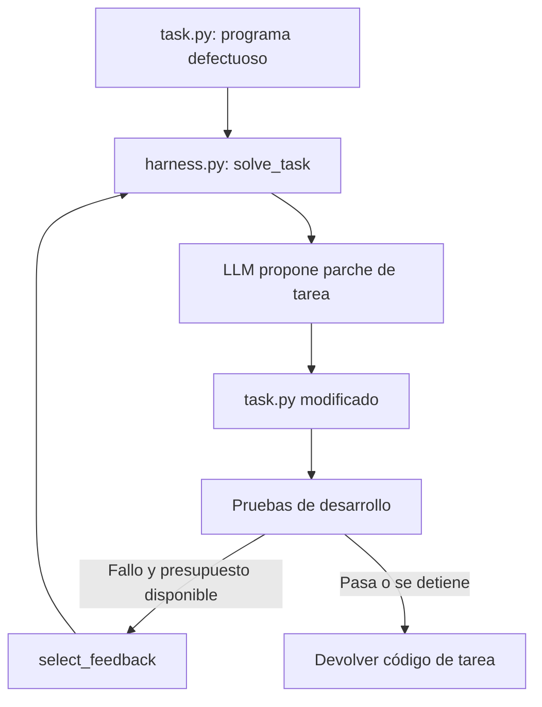
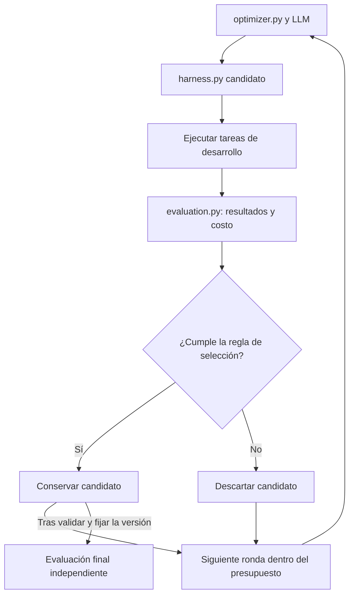
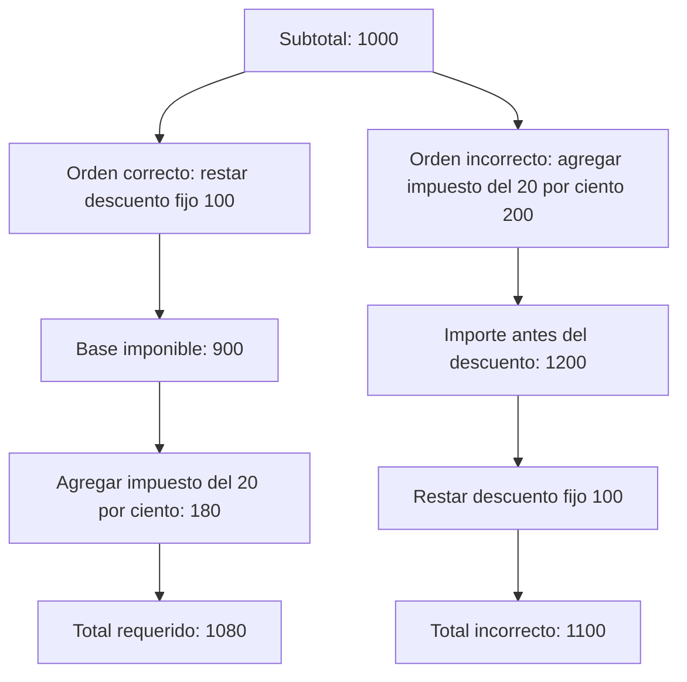

# Harness de corrección de código

[English](case-0001-code-repair-harness.md) | Español

[Matriz de escenarios y plan de EDA](doc-0005-code-repair-scenarios-and-eda.es.md)

## 1. Pregunta y alcance

¿Cómo evaluar cambios automáticos de un harness de corrección de código frente a un bucle simple de mejora con LLM?

**Code repair** significa corregir código defectuoso. El parche resuelve una tarea; el
**harness** organiza contexto, llamadas al modelo, pruebas y reintentos. La investigación
compara harnesses sobre varias tareas.

Caso candidato: ejemplos ficticios, sin implementación ni resultados. Empezar con un paquete
Python pequeño y local. El desarrollo de repositorios completos, despliegue, entrenamiento y
cambios recursivos del optimizador quedan fuera del primer piloto. Comparar con [case-0002](case-0002-service-workflow-harness.es.md).

## 2. Un diseño posible

**Pseudocódigo ilustrativo, no una implementación acordada.** Los nombres siguientes representan
roles, no archivos existentes. Se omiten funciones auxiliares, aislamiento y control del presupuesto.

| Artefacto | Función | Qué puede cambiar |
|---|---|---|
| `task.py` | Programa que se quiere corregir | Código permitido de la tarea |
| `harness.py` | Llama al modelo, prueba parches y prepara reintentos | Un componente acotado, como `select_feedback` |
| `optimizer.py` | Usa un LLM para proponer cambios al harness | Copias candidatas del componente permitido |
| `evaluation.py` | Mide resultados de tareas y recursos | Fijo en este ejemplo; los candidatos no pueden editarlo |

**A. Corregir una tarea.** Un modelo puede corregir esta aritmética en una llamada. Eso
modifica `task.py`, no `harness.py`.

```python
# task.py: faulty task code
def line_total(price, quantity):
    return price + quantity

# A task patch would replace the return with:
# return price * quantity
```

El harness organiza esa llamada y los reintentos. Pasar las pruebas de desarrollo detiene
el bucle interno; la aceptación protegida sigue determinando el resultado de la tarea.

```python
# harness.py: illustrative task-solving loop
def solve_task(task, model):
    code, feedback = task.code, ""
    for _ in range(3):
        patch = model.propose_patch(task.requirement, code, feedback)
        code = apply_allowed_task_patch(code, patch)
        results = run_development_tests(task, code)
        if results.passed:
            break
        feedback = select_feedback(results)  # Candidate edit target
    return code
```



**B. Proponer un cambio al harness.** Un optimizador separado podría pedir a un LLM que
modifique `select_feedback`: por ejemplo, seleccionar prueba fallida, valores esperado/obtenido
y ubicación relevante en vez de reenviar la salida completa. Podría ayudar o perder información
útil; hay que medirlo. Los roles de resolución y optimización pueden usar el mismo modelo fijo.

```python
# harness.py: initial feedback function
def select_feedback(results):
    return results.raw_output

# Candidate replacement proposed by the optimizer
def select_feedback(results):
    return format_failures(results.failed_tests)
```

`format_failures` conservaría los campos indicados arriba. Aquí se reemplaza una función
del harness, no la función aritmética de la tarea.

```python
# optimizer.py: illustrative search over harness versions
best = initial_harness
report = evaluate_development(best, tasks, limits)
for _ in range(search_rounds):
    candidate = llm.propose_harness_edit(best, report)
    if not changes_only_allowed_harness_parts(best, candidate):
        continue
    candidate_report = evaluate_development(candidate, tasks, limits)
    if meets_predeclared_rule(candidate_report, report):
        best, report = candidate, candidate_report
```

`evaluate_development` ejecuta un harness sobre varias tareas de desarrollo de forma aislada,
comprueba los parches con reglas de aceptación protegidas y registra éxito y costo. Su informe
puede orientar la búsqueda; las tareas finales reservadas nunca entran en este bucle. La selección
debe respetar las mismas restricciones, incluir el costo de búsqueda y conservar evidencia de candidatos fallidos.



El optimizador edita una copia y selecciona una versión; el harness no se reescribe mientras
corrige una tarea. Ningún candidato modifica pruebas, referencias ni controles de presupuesto.
Si ambas versiones corrigen la aritmética de inmediato, esa tarea no demuestra mayor calidad de corrección.

## 3. Ejemplos paso a paso

**L1, aritmética local:** el programa inicial suma precio y cantidad en lugar de multiplicar.
Los valores son centavos enteros; estos ejemplos no son una batería completa de pruebas.

| Entrada | Resultado inicial | Resultado requerido | Significado |
|---|---|---|---|
| Precio de 250 céntimos, cantidad 3 | 253 | 750 | Tres unidades a 250 céntimos cada una |
| Precio de 250 céntimos, cantidad 0 | 250 | 0 | Si no hay unidades, no hay cargo |
| Precio de 0 céntimos, cantidad 4 | 4 | 0 | Las unidades gratuitas siguen sin generar cargo |

**L2, reglas relacionadas:** descontar un importe fijo antes del impuesto da 1,080 centavos;
invertir el orden da 1,100. Dos ajustes proporcionales no detectarían este defecto de orden.
Es una regla de precios ficticia; las restricciones de entrada están en el plan de EDA enlazado.



**L3, contrato entre módulos:** preservar el total numérico, incluido cero, entre cálculo
y serialización. Agregar pruebas de integración y regresión si L1/L2 siguen siendo viables.
Son niveles de complejidad propuestos, no dificultades medidas.

## 4. Comparación y aceptación

Un bucle LLM → editar → evaluar → conservar es el **comparador básico**, no una novedad por sí mismo.
La mejora del mecanismo que propone cambios requeriría modificar también `optimizer.py` y demostrar
una ventaja frente a ese comparador. Eso queda fuera del primer piloto; no se afirma RSI por repetir el bucle.

| Comparación | Pregunta |
|---|---|
| Harness fijo frente a candidato | ¿Mejora la resolución de tareas bajo límites equivalentes? |
| Optimizador LLM simple frente a otro método | ¿Encuentra mejores harnesses con el mismo presupuesto total de búsqueda? Método pendiente |

La evaluación que orienta la búsqueda podría evolucionar en otro estudio. Para demostrar avances,
la referencia de comparación debe seguir siendo estable e independiente; cambiar la puntuación no prueba mejora.

- **Hipótesis candidata:** seleccionar feedback relevante resuelve más tareas que una política fija; aún no se ha elegido como contribución.
- **Comparación:** cambiar solo la selección del feedback; igualar modelo, tareas, reintentos y presupuesto.
- **Éxito:** pasan todas las comprobaciones de aceptación, solo cambian archivos permitidos y se respetan
  los límites. Una edición prohibida invalida la tarea; las puntuaciones parciales son solo diagnósticas.
- **Medidas:** éxito por tarea, variabilidad entre repeticiones, llamadas, tokens, intentos y duración.
  Registrar búsqueda, ediciones manuales y revisión humana por separado como esfuerzo de construcción.
- **Evidencia:** conservar intentos fallidos. Una referencia revisada demuestra que la tarea tiene solución;
  no se exige copiar su parche. Separar desarrollo, validación y evaluación final por familia; las
  repeticiones no son tareas independientes. Usar igual peso por tarea salvo justificación.

## 5. Siguiente decisión

Usar la [matriz de escenarios y plan de EDA](doc-0005-code-repair-scenarios-and-eda.es.md)
para revisar cobertura, calidad del evaluador, fallos del baseline y costo antes de elegir una intervención.
Continuar si hay un problema medible y una comparación viable. Ajustar o descartar si el evaluador
es poco fiable, el baseline ya resuelve las tareas o las mejoras dependen de filtraciones de pruebas.

Siguen pendientes las familias de tareas, modelo, método de búsqueda y presupuesto. Implementar y
ejecutar requiere un [protocolo](../../templates/experiment-protocol.md) separado. Ubicaciones futuras:
`benchmarks/case-0001/` para tareas/evaluadores, `data/` para procedencia, `experiments/` para evidencia.

Referencia de método: [STOP](../literature/reviews/pap-0001-stop.es.md).
Otras líneas: [opciones de investigación](../synthesis/research-options.md).
