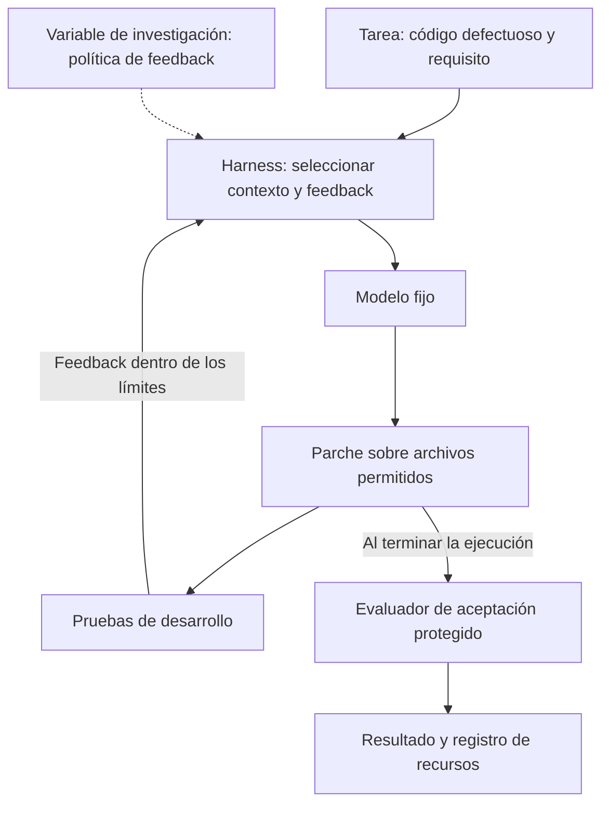
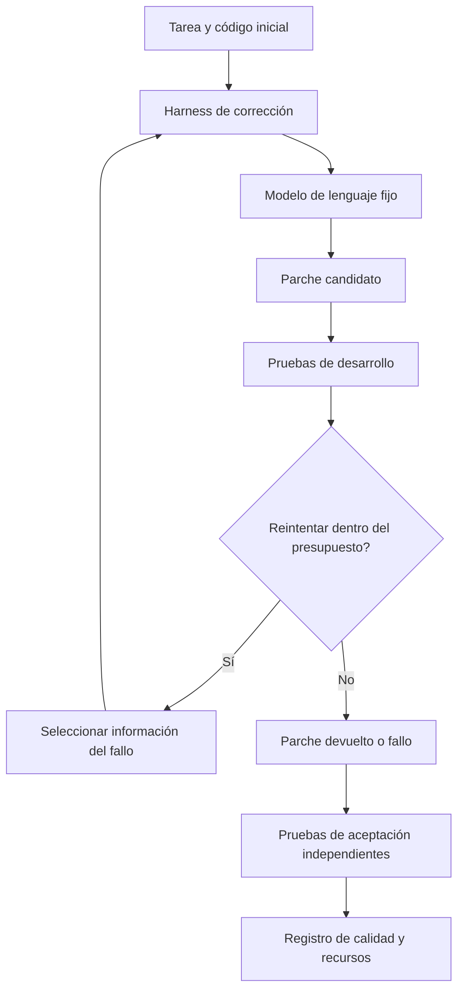
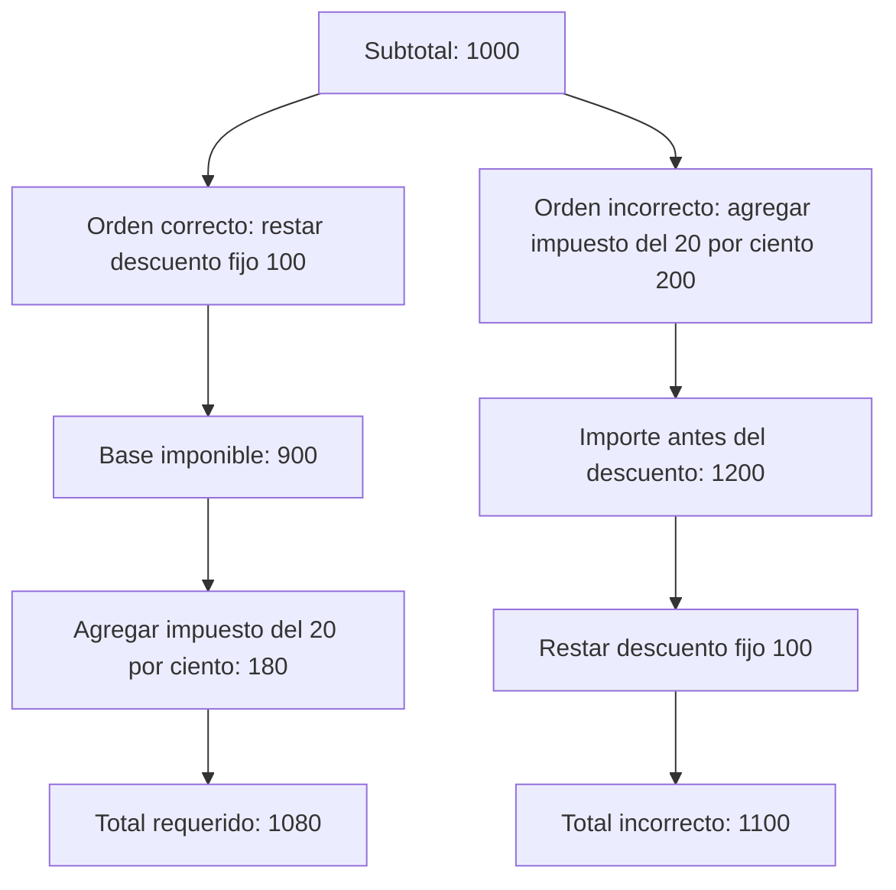

# Harness de corrección de código

[English](case-0001-code-repair-harness.md) | Español

[Matriz de escenarios y plan de EDA](doc-0005-code-repair-scenarios-and-eda.es.md)

## 1. Pregunta y alcance

¿Seleccionar mejor el feedback de las pruebas permite corregir más programas con el mismo presupuesto?

**Code repair** significa corregir código defectuoso. El parche resuelve una tarea; el
**harness** organiza contexto, llamadas al modelo, pruebas y reintentos. La investigación
compara harnesses sobre varias tareas.

Caso candidato: ejemplos ficticios, sin implementación ni resultados. Empezar con un paquete
Python pequeño y local. El desarrollo de repositorios completos, despliegue, entrenamiento y
cambios recursivos del optimizador quedan fuera del primer piloto. Comparar con [case-0002](case-0002-service-workflow-harness.es.md).

## 2. Límites de la investigación

| Puede cambiar | Debe permanecer fijo |
|---|---|
| Inicialmente: selección del feedback; retención de contexto y reintentos quedan como alternativas | Modelo/configuración, entradas, contratos de herramientas, ejecutor de pruebas, evaluador y límites de recursos equivalentes |
| Parche de la tarea: solo archivos de solución permitidos | Pruebas de aceptación, referencias, control del presupuesto y tareas finales |

Elegir después un método de búsqueda fijo. Las pruebas de desarrollo alimentan el bucle;
las de aceptación protegidas no. Los permisos deben hacer efectiva esta separación.

## 3. Ejemplos paso a paso

**L1, aritmética local:** el programa inicial suma precio y cantidad en lugar de multiplicar.
Los valores son centavos enteros; estos ejemplos no son una batería completa de pruebas.

| Entrada | Resultado inicial | Resultado requerido | Significado |
|---|---|---|---|
| Precio de 250 céntimos, cantidad 3 | 253 | 750 | Tres unidades a 250 céntimos cada una |
| Precio de 250 céntimos, cantidad 0 | 250 | 0 | Si no hay unidades, no hay cargo |
| Precio de 0 céntimos, cantidad 4 | 4 | 0 | Las unidades gratuitas siguen sin generar cargo |

El harness propone un parche, lo prueba y reintenta dentro de los límites. Un evaluador
independiente comprueba la solución final. Resolver un ejemplo no demuestra una mejora del harness.

**L2, reglas relacionadas:** descontar un importe fijo antes del impuesto da 1,080 centavos;
invertir el orden da 1,100. Dos ajustes proporcionales no detectarían este defecto de orden.
Es una regla de precios ficticia; las restricciones de entrada están en el plan de EDA enlazado.

**L3, contrato entre módulos:** preservar el total numérico, incluido cero, entre cálculo
y serialización. Agregar pruebas de integración y regresión si L1/L2 siguen siendo viables.
Son niveles de complejidad propuestos, no dificultades medidas.

## 4. Comparación y aceptación

- **Hipótesis:** seleccionar feedback relevante resuelve más tareas que una política fija.
- **Comparación:** cambiar solo la selección del feedback; igualar modelo, tareas, reintentos y presupuesto.
- **Éxito:** pasan todas las comprobaciones de aceptación, solo cambian archivos permitidos y se respetan
  los límites. Una edición prohibida invalida la tarea; las puntuaciones parciales son solo diagnósticas.
- **Medidas:** éxito por tarea, variabilidad entre repeticiones, llamadas, tokens, intentos y duración.
  Registrar búsqueda, ediciones manuales y revisión humana por separado como esfuerzo de construcción.
- **Evidencia:** conservar intentos fallidos. Una referencia revisada demuestra que la tarea tiene solución;
  no se exige copiar su parche. Separar desarrollo, validación y evaluación final por familia; las
  repeticiones no son tareas independientes. Usar igual peso por tarea salvo justificación.

## 5. Siguiente decisión

Usar la [matriz de escenarios y plan de EDA](doc-0005-code-repair-scenarios-and-eda.es.md)
para revisar cobertura, calidad del evaluador, fallos del baseline y costo antes de elegir una intervención.
Continuar si hay un problema medible y una comparación viable. Ajustar o descartar si el evaluador
es poco fiable, el baseline ya resuelve las tareas o las mejoras dependen de filtraciones de pruebas.

Siguen pendientes las familias de tareas, modelo, método de búsqueda y presupuesto. Implementar y
ejecutar requiere un [protocolo](../../templates/experiment-protocol.md) separado. Ubicaciones futuras:
`benchmarks/case-0001/` para tareas/evaluadores, `data/` para procedencia, `experiments/` para evidencia.

Referencia de método: [STOP](../literature/reviews/pap-0001-stop.es.md).
Otras líneas: [opciones de investigación](../synthesis/research-options.md).
