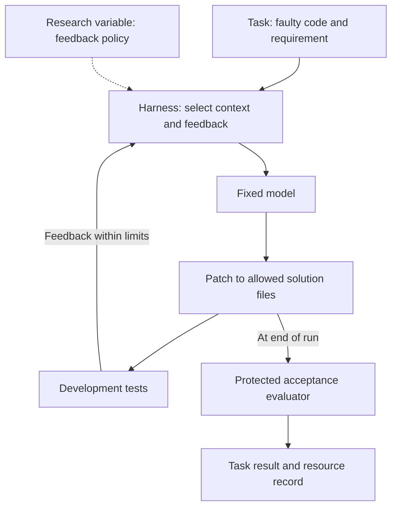
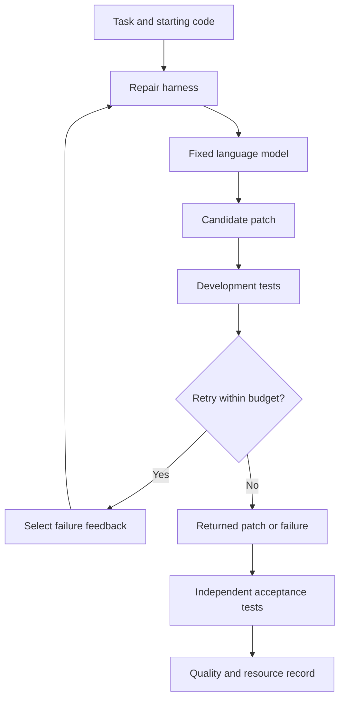
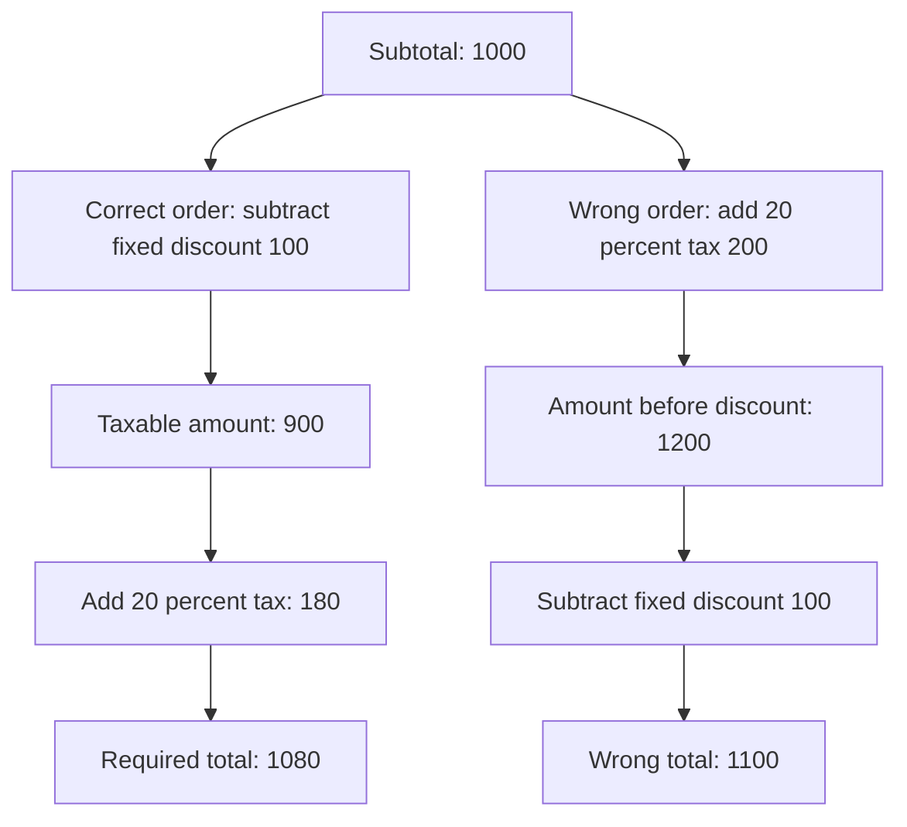

# Code repair harness

English | [Español](case-0001-code-repair-harness.es.md)

[Scenario matrix and EDA plan](doc-0005-code-repair-scenarios-and-eda.md)

## 1. Question and scope

Can better test-feedback selection help a coding agent repair more programs within the same budget?

**Code repair** means correcting faulty code. The patch solves one task; the **harness**
organizes context, model calls, tests, and retries. The research compares harnesses across tasks.

Candidate case only: fictional examples, no implementation or results. Start with a small
local Python package. Full-repository development, deployment, training, and recursive
optimizer changes are outside the first pilot. Compare with [case-0002](case-0002-service-workflow-harness.md).

## 2. Research boundary

| Can change | Must stay fixed |
|---|---|
| Initially: selection of test feedback; context retention and retries remain alternatives | Model/settings, task inputs, tool contracts, test runner, evaluator, and matched resource limits |
| Task patch: permitted solution files only | Acceptance tests, references, budget enforcement, and final tasks |

Choose one fixed search method later. Development tests feed the repair loop; protected
acceptance tests do not. Permissions must enforce this boundary.

## 3. Worked examples

**L1, local arithmetic:** the starting program adds price and quantity instead of multiplying.
Values are integer cents; these examples are not a complete test suite.

| Input | Starting output | Required output | Meaning |
|---|---|---|---|
| Price 250 cents, quantity 3 | 253 | 750 | Three units at 250 cents each |
| Price 250 cents, quantity 0 | 250 | 0 | No units produce no charge |
| Price 0 cents, quantity 4 | 4 | 0 | Free units remain free |

The harness proposes a patch, tests it, and retries within limits. An independent evaluator
checks the returned solution. Passing one example does not demonstrate harness improvement.

**L2, interacting rules:** a fixed discount before tax gives 1,080 cents; reversing the order
gives 1,100. Two proportional adjustments would not detect this ordering defect.
This is a fictional pricing rule; input restrictions are in the linked EDA plan.

**L3, module contract:** preserve the numeric total, including zero, across pricing and
serialization. Add integration and regression checks only if L1/L2 remain affordable.
These are planned complexity levels, not measured difficulty rankings.

## 4. Comparison and acceptance

- **Hypothesis:** selecting relevant test feedback resolves more tasks than a fixed feedback policy.
- **Comparison:** change feedback selection only; match model, tasks, retry limits, and budget.
- **Success:** all acceptance checks pass, only permitted files change, and limits are respected.
  Any prohibited edit fails the task; partial test scores are diagnostic only.
- **Measures:** task success, repeated-run variability, calls, tokens, attempts, and duration.
  Record search cost, manual edits, and human review separately as construction effort.
- **Evidence:** preserve failed attempts. A reviewed reference establishes solvability;
  matching its patch text is not required. Separate development, validation, and final tasks
  by family; repetitions are not independent tasks. Use equal task weights unless justified.

## 5. Next decision

Use the [scenario matrix and EDA plan](doc-0005-code-repair-scenarios-and-eda.md) to review
coverage, evaluator quality, baseline failures, and cost before selecting an intervention.
Continue if there is a measurable problem and an affordable comparison. Revise or discard
if the evaluator is unreliable, the baseline already solves the tasks, or gains depend on test leakage.

Task families, model, search method, and budget remain open. Implementation and execution
require a separate [protocol](../../templates/experiment-protocol.md). Future locations:
`benchmarks/case-0001/` for tasks/evaluators, `data/` for provenance, `experiments/` for evidence.

Method reference: [STOP](../literature/reviews/pap-0001-stop.md).
Other directions: [research options](../synthesis/research-options.md).
