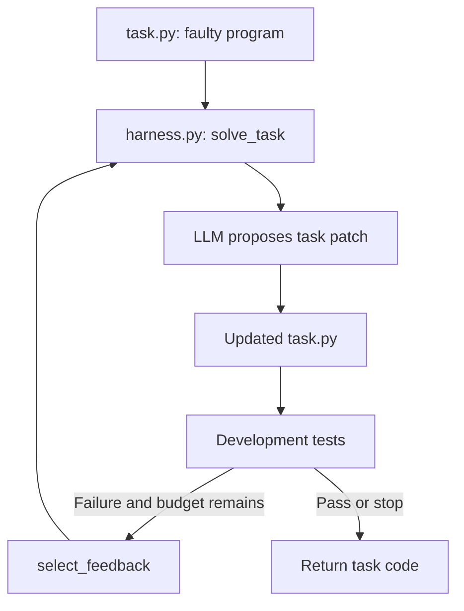
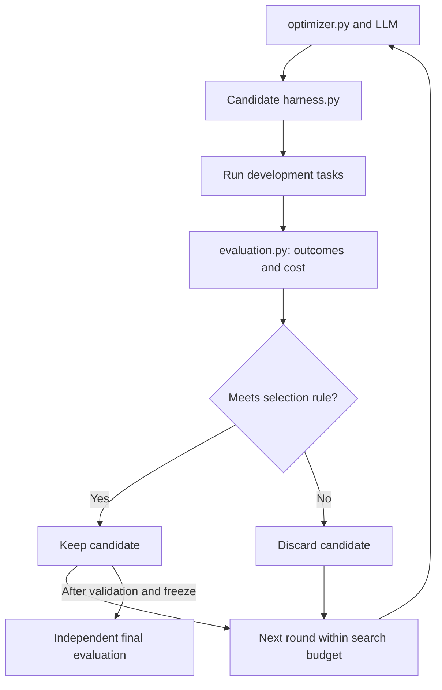
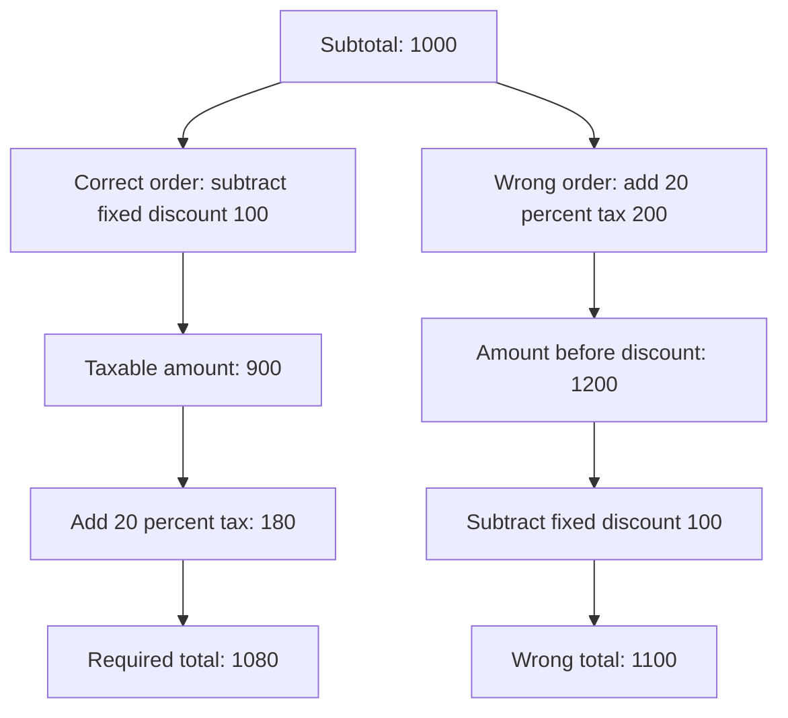

# Code repair harness

English | [Español](README.es.md)

[Scenario matrix and EDA plan](doc-0005-code-repair-scenarios-and-eda.md)

## 1. Question and scope

How can automatic code-repair harness changes be evaluated against a simple LLM improvement loop?

**Code repair** means correcting faulty code. The patch solves one task; the **harness**
organizes context, model calls, tests, and retries. The research compares harnesses across tasks.

Candidate case only: fictional examples, no implementation or results. Start with a small
local Python package. Full-repository development, deployment, training, and recursive
optimizer changes are outside the first pilot. Compare with [case-0003](../case-0003-debt-negotiation/README.es.md).

## 2. One possible design

**Illustrative pseudocode, not an implementation commitment.** The filenames below describe
roles, not existing files. Helper functions, isolation, and budget enforcement are omitted.

| Artifact | Role | What it may change |
|---|---|---|
| `task.py` | Program to repair | Permitted task code |
| `harness.py` | Calls the model, tests patches, and prepares retries | A bounded component, such as `select_feedback` |
| `optimizer.py` | Uses an LLM to propose harness edits | Candidate copies of the allowed harness component |
| `evaluation.py` | Measures task outcomes and resources | Fixed in this example; candidates cannot edit it |

**A. Repair a task.** A model can fix this arithmetic in one call. That changes `task.py`,
not `harness.py`.

```python
# task.py: faulty task code
def line_total(price, quantity):
    return price + quantity

# A task patch would replace the return with:
# return price * quantity
```

The harness organizes that call and any retries. Passing development tests stops the
inner loop; protected acceptance checks still determine the task result.

```python
# harness.py: illustrative task-solving loop
def solve_task(task, model):
    code, feedback = task.code, ""
    for _ in range(3):
        patch = model.propose_patch(task.requirement, code, feedback)
        code = apply_allowed_task_patch(code, patch)
        results = run_development_tests(task, code)
        if results.passed:
            break
        feedback = select_feedback(results)  # Candidate edit target
    return code
```



**B. Propose a harness change.** A separate optimizer could ask an LLM to replace
`select_feedback`: for example, select the failed test, expected/actual values, and relevant
location instead of forwarding raw output. This might help or discard useful information;
it must be measured. The solving and optimizing roles may use the same fixed model.

```python
# harness.py: initial feedback function
def select_feedback(results):
    return results.raw_output

# Candidate replacement proposed by the optimizer
def select_feedback(results):
    return format_failures(results.failed_tests)
```

`format_failures` would retain the fields listed above. This replaces a harness function,
not the arithmetic function in the task.

```python
# optimizer.py: illustrative search over harness versions
best = initial_harness
report = evaluate_development(best, tasks, limits)
for _ in range(search_rounds):
    candidate = llm.propose_harness_edit(best, report)
    if not changes_only_allowed_harness_parts(best, candidate):
        continue
    candidate_report = evaluate_development(candidate, tasks, limits)
    if meets_predeclared_rule(candidate_report, report):
        best, report = candidate, candidate_report
```

`evaluate_development` runs a harness on multiple development tasks in isolation, checks
returned patches with protected acceptance rules, and records success and cost. Its report
may guide search; reserved final tasks never enter this loop. Selection must obey the same
constraints, include search cost, and retain failed candidates in the evidence.



The optimizer edits a copy and selects a version; the harness does not rewrite itself
while repairing one task. No candidate edits tests, reference outcomes, or budget controls.
If both versions fix the simple arithmetic immediately, that task shows no repair-quality gain.

## 3. Worked examples

**L1, local arithmetic:** the starting program adds price and quantity instead of multiplying.
Values are integer cents; these examples are not a complete test suite.

| Input | Starting output | Required output | Meaning |
|---|---|---|---|
| Price 250 cents, quantity 3 | 253 | 750 | Three units at 250 cents each |
| Price 250 cents, quantity 0 | 250 | 0 | No units produce no charge |
| Price 0 cents, quantity 4 | 4 | 0 | Free units remain free |

**L2, interacting rules:** a fixed discount before tax gives 1,080 cents; reversing the order
gives 1,100. Two proportional adjustments would not detect this ordering defect.
This is a fictional pricing rule; input restrictions are in the linked EDA plan.



**L3, module contract:** preserve the numeric total, including zero, across pricing and
serialization. Add integration and regression checks only if L1/L2 remain affordable.
These are planned complexity levels, not measured difficulty rankings.

## 4. Comparison and acceptance

An LLM → edit → evaluate → retain loop is the **basic comparator**, not a novelty claim.
Improving the mechanism that proposes changes would also require modifying `optimizer.py` and
showing an advantage over that comparator. This is outside the first pilot; repeating a loop does not establish RSI.

| Comparison | Question |
|---|---|
| Fixed harness versus candidate | Does task resolution improve under matched limits? |
| Simple LLM optimizer versus another method | Does it find better harnesses under the same total search budget? Method pending |

Search-guiding evaluation could evolve in another study. Evidence of progress still needs a
stable, independent comparison reference; changing the score does not establish improvement.

- **Candidate hypothesis:** selecting relevant test feedback resolves more tasks than a fixed policy; it is not yet the selected contribution.
- **Comparison:** change feedback selection only; match model, tasks, retry limits, and budget.
- **Success:** all acceptance checks pass, only permitted files change, and limits are respected.
  Any prohibited edit fails the task; partial test scores are diagnostic only.
- **Measures:** task success, repeated-run variability, calls, tokens, attempts, and duration.
  Record search cost, manual edits, and human review separately as construction effort.
- **Evidence:** preserve failed attempts. A reviewed reference establishes solvability;
  matching its patch text is not required. Separate development, validation, and final tasks
  by family; repetitions are not independent tasks. Use equal task weights unless justified.

## 5. Next decision

Use the [scenario matrix and EDA plan](doc-0005-code-repair-scenarios-and-eda.md) to review
coverage, evaluator quality, baseline failures, and cost before selecting an intervention.
Continue if there is a measurable problem and an affordable comparison. Revise or discard
if the evaluator is unreliable, the baseline already solves the tasks, or gains depend on test leakage.

Task families, model, search method, and budget remain open. Implementation and execution
require a separate [protocol](../../../templates/experiment-protocol.md). Future locations:
`benchmarks/case-0001/` for tasks/evaluators, `data/` for provenance, `experiments/` for evidence.

Method reference: [STOP](../../literature/reviews/pap-0001-stop/README.md).
Other directions: [research options](../../synthesis/research-options.md).

## Related proposal

[Harness participation in self-improvement](doc-0007-harness-participation-proposal.md)
is studied as a separate extension. It remains a draft and does not change this case's scope.
