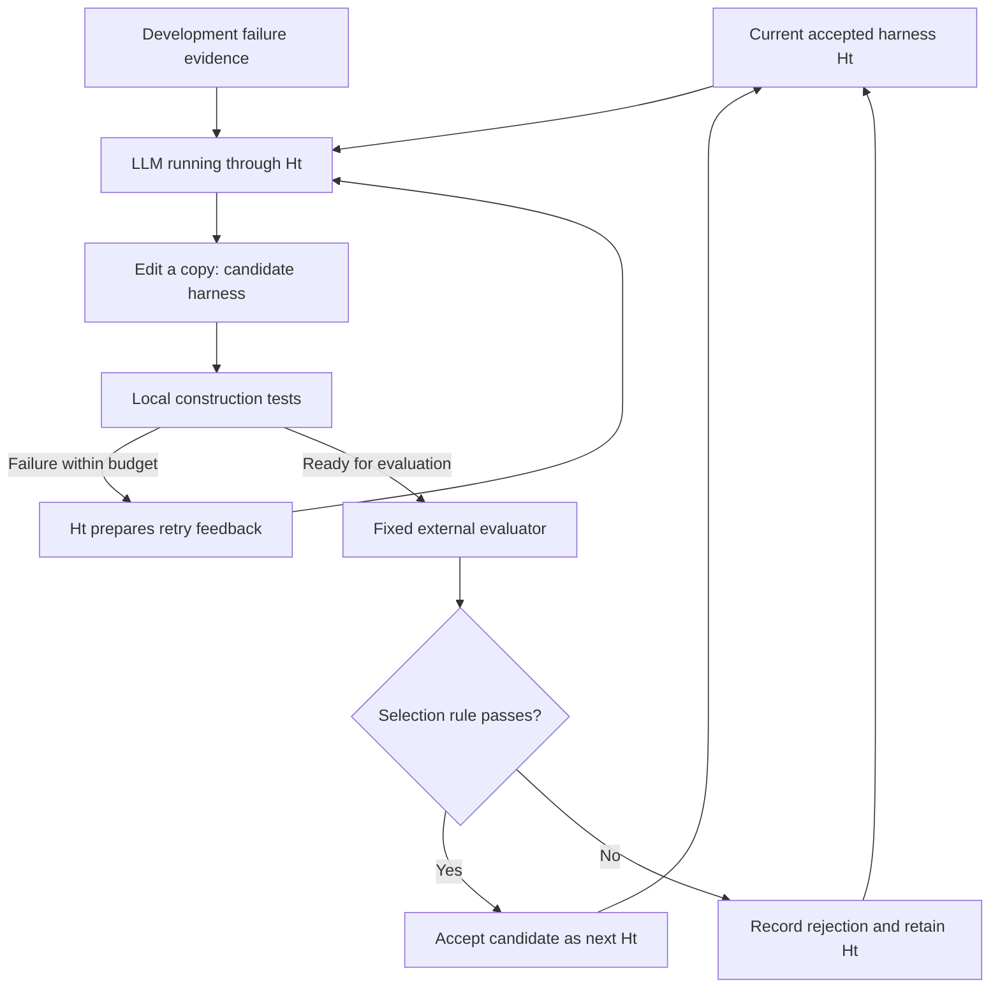
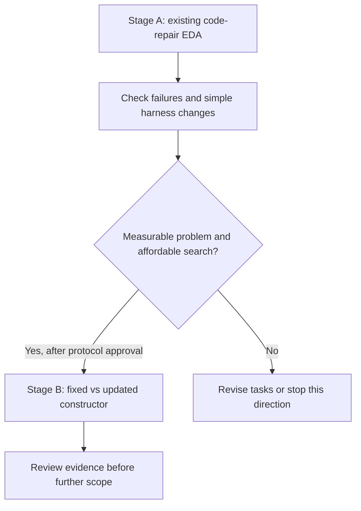

# Harness participation in self-improvement

English | [Español](doc-0007-harness-participation-proposal.es.md)

**Separate proposal for review.** This document explores an extension of
[case-0001](README.md). It does not replace that case, select a thesis
method, or assign another case number. Examples are hypothetical; no code or experiment has run.

## 1. Proposed question

Does using the current accepted harness to construct its next version produce better
code-repair harnesses than always using the initial harness as the constructor?

The task remains repairing faulty programs. The added question concerns **how the harness
is constructed**. A fixed LLM operates through the harness in both roles: repairing task
code and proposing changes to a copy of the harness code.

| Role | Example artifact | Boundary |
|---|---|---|
| Program to repair | `task.py` | Task patches solve individual problems |
| Agent harness | `harness.py` | Only `select_feedback` may change initially |
| Search coordinator | `optimizer.py` | Fixed: launches construction, evaluation, and selection |
| External evaluator | `evaluation.py` | Fixed: checks outcomes, regressions, and resource use |

Filenames illustrate roles, not existing implementations. The coordinator can remain fixed:
the changing harness can still participate in constructing its successor. No change to model
weights or evaluator is required.

## 2. One possible example

Suppose a small invoice package incorrectly omits a zero total from its serialized output.
Its requirement is to preserve the numeric total, including zero.

- **Task repair:** change the serialization condition so that zero is preserved.
- **Harness improvement:** change how failed tests are presented to the LLM, potentially
  helping it repair this and other programs.

Call the initial harness `H0`. Its feedback function forwards raw test output. The same
function serves retries during task repair and retries during harness construction.

| Step | What could happen | What it establishes |
|---|---|---|
| Observe | Development traces contain repeated logs obscuring the failed assertion | A candidate explanation, not proof of the cause |
| Construct H1 | An agent running H0 edits a copy of H0 to retain failed-test names, locations, and expected/actual values | H0 participates in constructing H1 |
| Evaluate | A fixed evaluator runs H1 across multiple development and validation tasks | Whether the candidate meets the selection rule |
| Construct H2 | If H1 is accepted, an agent running H1 edits a copy of H1, for example to remove duplicate failures without dropping locations | The accepted version now governs construction of its successor |

If constructing H2 causes a local test failure, H1's feedback function prepares that failure
for the next LLM attempt. This is where the previous improvement could help construction.
Simply passing H1's source code to a fixed proposer would not exercise this mechanism.



Each round uses an immutable running version and a separate candidate copy. Candidates cannot
edit protected tests, reference outcomes, or budget controls. The loop ends at the declared
budget or stopping rule; an operational stop does not prove mathematical convergence.

## 3. The comparison that matters

Both arms start at H0 and improve their current candidate. Only the harness **executing the
constructor** differs.

| Arm | Constructor runs through | Source being edited |
|---|---|---|
| Fixed constructor | H0 in every round | Copy of that arm's current accepted harness |
| Updated constructor | That arm's current accepted Ht | Copy of that arm's current accepted harness |

Illustrative pseudocode, not executable code. `run_agent` returns a candidate snapshot;
its `harness` argument configures the running agent, not just its prompt.

```python
constructor = initial_harness if mode == "fixed" else current_harness
candidate = run_agent(
    model=fixed_model,
    harness=constructor,
    workspace=copy_of(current_harness),
    task=change_request(development_evidence),
    editable_surface="select_feedback",
    limits=construction_limits,
)
# A protected coordinator evaluates the candidate and applies the selection rule.
```

The arms have the same configuration in round one. The mechanism can differ after an accepted
change is used in a later construction round. Record constructor and target version hashes,
feedback-hook calls, and failed attempts. If the changed hook never runs during construction,
the experiment has not exercised the proposed feedback mechanism.

## 4. Evaluation and acceptance

- **Controls:** same model/version, starting harness, task splits, editable surface, prompts,
  per-run limits, and total search budget. Different harness behavior is the intervention.
- **Candidate gate:** valid bounded edit, protected checks pass, limits respected, no decrease
  in success on either development or validation tasks, and an increase on at least one.
  Fix repeat counts and denominators before running; this gate is not a significance test.
- **Final comparison:** freeze one selected harness per arm, then evaluate on reserved task
  families never used for construction or selection. Compare task success and variability;
  record total construction/evaluation cost, tokens, time, and regressions.
- **Evidence of benefit:** an advantage over the fixed-constructor arm under the matched
  budget, across independent search repetitions. A better task patch or one accepted H1
  alone does not establish this. Valid-candidate rate is a diagnostic, not the final outcome.

Both development and validation scores influence selection, so neither is an untouched final
test. Sample sizes, cost limits, stopping thresholds, and uncertainty analysis remain for an
execution protocol. Retain negative results and do not assume improvement at every round.

## 5. Where this could fit

**Suggested placement for review: two stages within the code-repair case.** They share the
environment but answer different questions. The service workflow remains a separate candidate.



The existing [EDA plan](doc-0005-code-repair-scenarios-and-eda.md) proposes 36 baseline runs.
Those runs do not fund or validate Stage B; repeated search trajectories require a separate
budget. A trivial sum fixed in one call may serve as a control but cannot demonstrate the
proposed benefit when both arms already succeed.

| Editorial option | Consequence |
|---|---|
| Extend case-0001 with stages A/B | Preserve the current baseline and add this research question |
| Replace case-0001 | Rewrite its main question, scope, and linked EDA plan around this mechanism |
| Keep a separate case | Assign a case ID only after approval; keep the service-workflow ID stable |

Placement remains pending review. This draft changes none of the existing case specifications
or EDA plans. No implementation is authorized by this document.

## 6. Relation to Self-Harness

This is a bounded adaptation of the current-harness construction idea discussed in
[Self-Harness, section 3](https://arxiv.org/html/2606.09498v3), with a fixed model and external
evaluation. The fixed-versus-updated constructor comparison and the invoice example are
proposals for this project, not reported paper experiments or a reproduction.

See the [partial review](../../literature/reviews/pap-0011-self-harness.md) for paper/code
version differences and evidence limits. Alignment with prior work does not establish novelty;
the contribution still needs a measurable limitation and comparative evidence.
