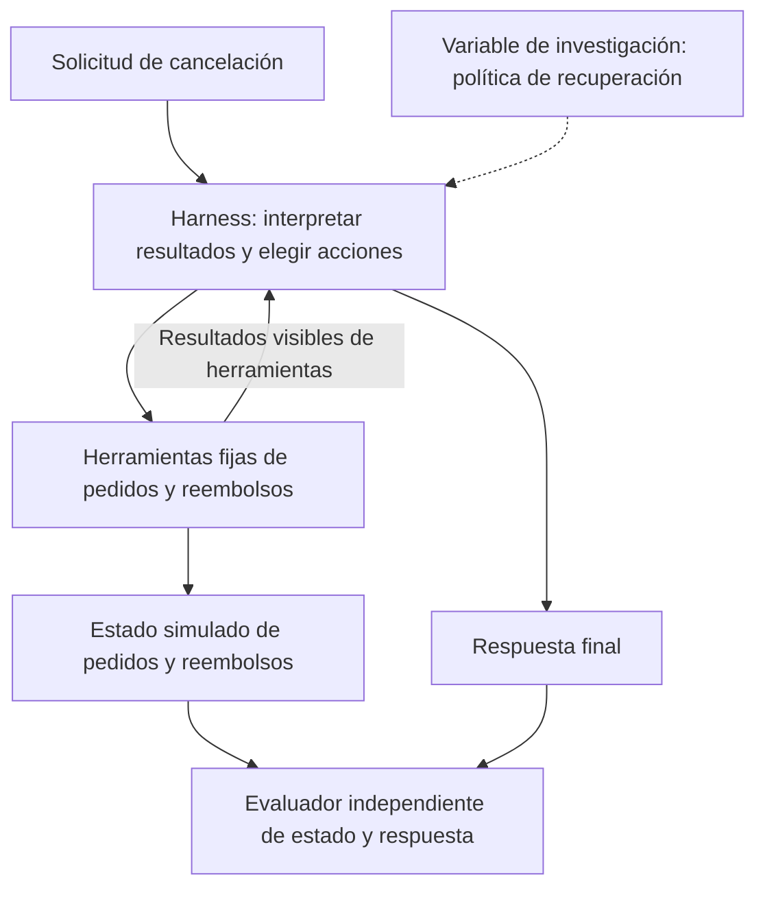
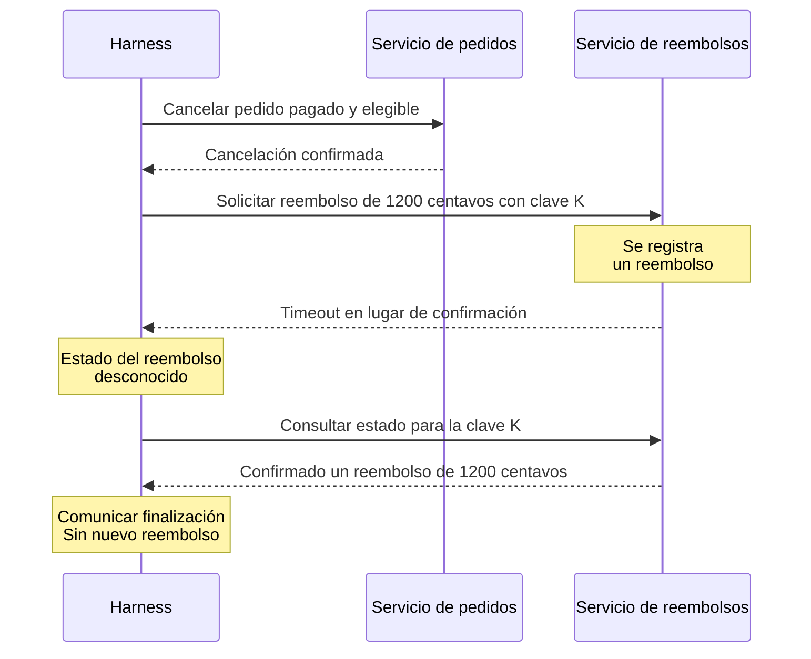
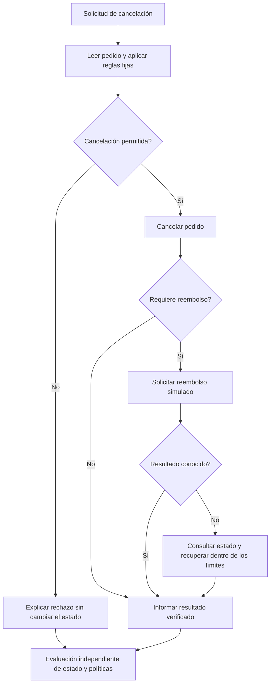

# Harness de un flujo de servicio simulado

[English](README.md) | Español

[Matriz de escenarios y plan de EDA](doc-0006-service-workflow-scenarios-and-eda.es.md)

**Referencia sustituida.** Se conservan su identidad y supuestos originales. El trabajo activo
del caso de negocio continúa en [case-0003: negociación de deudas](../case-0003-debt-negotiation/README.es.md).
La matriz de escenarios de servicio no se aplica a negociación; no se implica implementación ni resultados.

## 1. Pregunta y alcance

¿Una mejor política de recuperación resuelve resultados inciertos de herramientas sin duplicar acciones ni escalar innecesariamente?

El caso simula cancelaciones y reembolsos de pedidos. El **harness** interpreta resultados
y decide si consulta el estado, reintenta o escala. Una cancelación exitosa es el resultado
de una tarea, no evidencia de mejora del harness.

Caso candidato: registros sintéticos, sin pagos reales, datos privados, implementación
ni resultados. Comparar con [corrección de código](../case-0001-code-repair-harness/README.es.md).

## 2. Límites de la investigación

| Puede cambiar | Debe permanecer fijo |
|---|---|
| Política de recuperación: consultar estado, reintentar o escalar | Modelo/configuración, herramientas, reglas de negocio, secuencia de fallos, límites y evaluador |
| Acciones mediante herramientas permitidas | Protecciones del backend, resultados de referencia, registros ajenos y escenarios reservados |

Elegir después un método de búsqueda fijo. Evaluar estado y respuesta juntos: un mensaje
de finalización no demuestra por sí solo que exista un reembolso.

## 3. Ejemplo paso a paso

**Traza L3 ficticia:** el pedido `order-042` está pagado y no enviado. Cancelarlo requiere
exactamente un reembolso simulado de 1,200 centavos. Se registra el reembolso, pero la respuesta termina en timeout.

Un timeout no indica si se realizó la escritura. Probar también fallos previos al registro
e indisponibilidad persistente. Una **clave de idempotencia** identifica una operación:
reutilizarla no debe crear otro reembolso. Mantener fijo este comportamiento del backend;
medir por separado las llamadas desperdiciadas y los intentos con claves nuevas.

El flujo general incluye **L1**, cancelación sin reembolso o rechazo correcto, y **L2**,
cancelación con reembolso normal. L3 añade resultados inciertos, no demuestra mayor dificultad.

Si no se puede verificar el resultado, detenerse dentro de los límites y comunicar la incertidumbre.
Escalar es correcto solo cuando el escenario lo permite; no equivale a finalización autónoma.

## 4. Comparación y aceptación

- **Hipótesis:** una mejor recuperación basada en estado reduce acciones redundantes y preserva la finalización.
- **Comparación:** cambiar solo la recuperación; igualar herramientas, protecciones, entradas, modelo y presupuesto.
  Inyectar fallos en operaciones identificadas para que la velocidad no cambie el tratamiento.
- **Éxito:** se cumplen estado requerido, reglas, respuesta veraz y límites. Cualquier efecto prohibido
  invalida la tarea; las puntuaciones parciales no lo compensan.
- **Medidas:** finalización, rechazo/escalación correctos, efectos secundarios, llamadas, reintentos, tokens y duración.
  Registrar búsqueda, ediciones manuales y revisión por separado como esfuerzo de construcción.
- **Evidencia:** comprobar registros afectados y ajenos, y afirmaciones del mensaje. Calibrar cualquier juez
  basado en modelos; no usar uno sin validar como única autoridad. Agrupar plantillas/fallos relacionados
  al separar desarrollo, validación y evaluación final; reiniciar el estado entre ejecuciones.
  Las repeticiones no son escenarios independientes.

## 5. Siguiente decisión

Usar la [matriz de escenarios y plan de EDA](doc-0006-service-workflow-scenarios-and-eda.es.md)
para evaluar cobertura, referencias, fallos de recuperación y costo. Continuar si los resultados
son verificables y el baseline deja margen de mejora. Ajustar o descartar si la ambigüedad,
el costo de preparación o cambios del backend explican las aparentes mejoras.
La cobertura sintética no representa la frecuencia de producción.

Siguen pendientes los detalles de política, baseline, modelo y presupuesto. Puede bastar un simulador
local; Compose es opcional y Azure/Kubernetes no son requisitos. Ejecutar requiere un
[protocolo](../../../templates/experiment-protocol.md) separado.

Ubicaciones futuras: `benchmarks/case-0002/` para escenarios/evaluadores, `data/` para procedencia,
`experiments/` para evidencia y `environments/compose/` para servicios opcionales.
Referencia de método: [Self-Harness](../../literature/reviews/pap-0011-self-harness.es.md).
Otras líneas: [opciones de investigación](../../synthesis/research-options.md).
