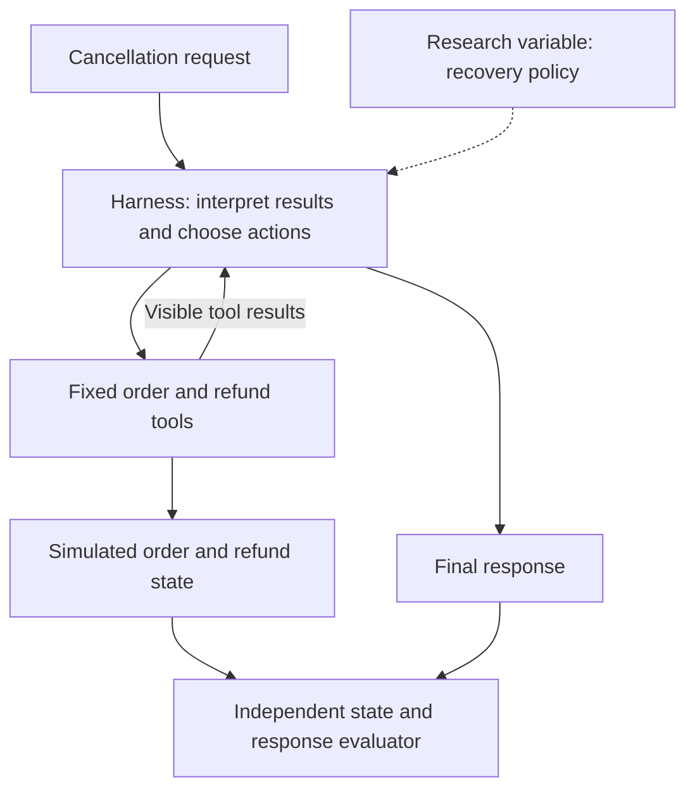
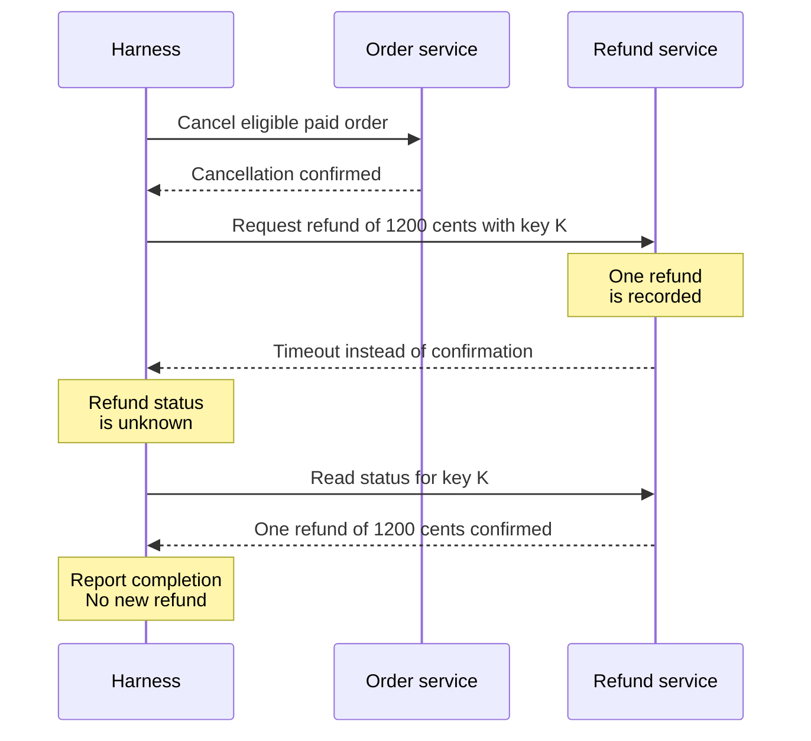
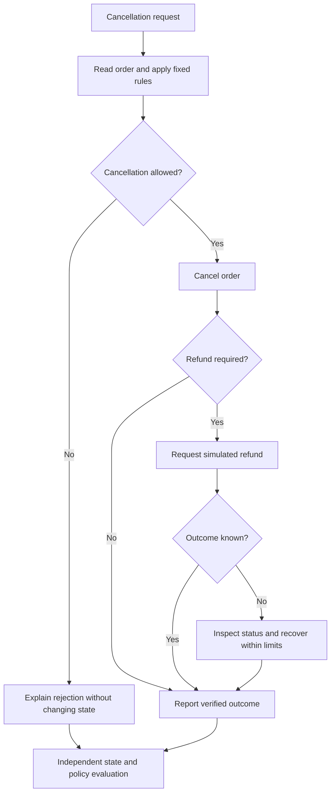

# Simulated service workflow harness

English | [Español](README.es.md)

[Scenario matrix and EDA plan](doc-0006-service-workflow-scenarios-and-eda.md)

**Superseded reference.** Retained with its original identity and assumptions. Active business-case
work continues in [case-0003: debt negotiation](../case-0003-debt-negotiation/README.es.md).
The scenario matrix below does not apply to negotiation; no implementation or results are implied.

## 1. Question and scope

Can a better recovery policy resolve uncertain tool outcomes without duplicate actions or unnecessary escalation?

The case simulates order cancellations and refunds. The **harness** interprets tool results
and chooses whether to inspect status, retry, or escalate. One successful cancellation
is a task result, not evidence of harness improvement.

Candidate case only: synthetic records, no real payments, private data, implementation,
or results. Compare with [code repair](../case-0001-code-repair-harness/README.md).

## 2. Research boundary

| Can change | Must stay fixed |
|---|---|
| Recovery policy: status check, retry, or escalation | Model/settings, tools, business rules, fault schedules, resource limits, and evaluator |
| Actions through permitted tools | Backend protections, reference outcomes, unrelated records, and reserved scenarios |

Select a fixed search method later. Evaluate state and response together; a completion
message alone does not prove that a refund exists.

## 3. Worked example

**Fictional L3 trace:** order `order-042` is paid and unshipped. Cancellation requires
exactly one simulated refund of 1,200 cents. The refund is recorded, but its response times out.

A timeout does not reveal whether a write occurred. Also test timeouts before a write
and persistent status failures. An **idempotency key** identifies one operation: reusing
it must not create another refund. Keep this backend behavior fixed; measure wasted calls
and new-key attempts separately.

The broader workflow also covers **L1**, cancellation without a refund or correct rejection,
and **L2**, cancellation plus a normal refund. L3 adds uncertain outcomes, not proof of greater difficulty.

If the outcome cannot be verified, stop within limits and report uncertainty. Escalation
counts as correct only where the scenario permits it; it is not autonomous completion.

## 4. Comparison and acceptance

- **Hypothesis:** better state-based recovery reduces redundant actions while preserving completion.
- **Comparison:** change only recovery policy; match tools, backend protections, inputs, model, and budget.
  Inject faults on named operations so execution speed does not change the treatment.
- **Success:** required state, business rules, truthful response, and resource limits all hold.
  Any prohibited side effect fails the task; partial scores cannot override it.
- **Measures:** completion, correct rejection/escalation, side effects, calls, retries, tokens, and duration.
  Record search, manual edits, and review separately as construction effort.
- **Evidence:** check affected and unrelated records and free-text claims. Calibrate any model judge;
  do not use an unvalidated judge alone. Group related templates/faults across development,
  validation, and final splits; reset state between runs. Repetitions are not independent scenarios.

## 5. Next decision

Use the [scenario matrix and EDA plan](doc-0006-service-workflow-scenarios-and-eda.md) to assess
coverage, reference quality, recovery failures, and cost. Continue if outcomes are checkable
and the baseline leaves room to improve. Revise or discard if ambiguity, setup cost, or
changes to backend protections explain apparent gains. Synthetic coverage is not production frequency.

Policy details, baseline, model, and budget remain open. A local simulator may suffice;
Compose is optional, and Azure/Kubernetes are not prerequisites. Execution requires a
separate [protocol](../../../templates/experiment-protocol.md).

Future locations: `benchmarks/case-0002/` for scenarios/evaluators, `data/` for provenance,
`experiments/` for evidence, and `environments/compose/` for optional services.
Method reference: [Self-Harness](../../literature/reviews/pap-0011-self-harness.md).
Other directions: [research options](../../synthesis/research-options.md).
