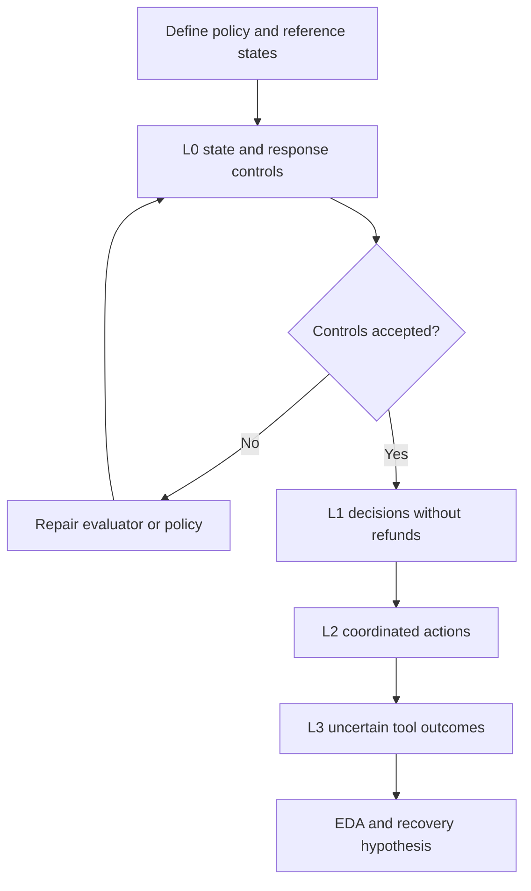
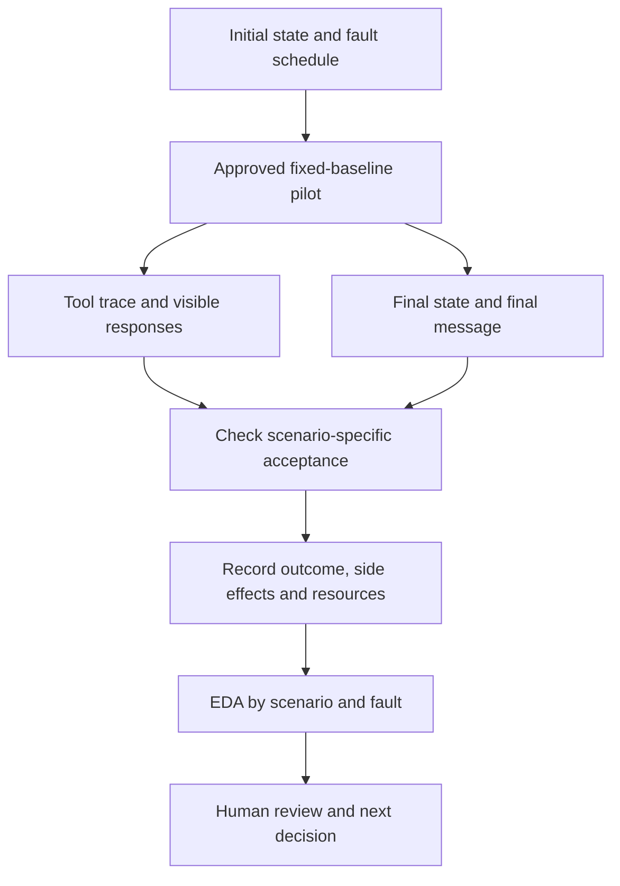

# Service workflow scenario matrix and EDA plan

English | [Español](doc-0006-service-workflow-scenarios-and-eda.es.md)

**Superseded reference.** Retained with its original identity and assumptions. Active business-case
work continues in [case-0003: debt negotiation](../case-0003-debt-negotiation/README.es.md).
The scenario matrix below does not apply to negotiation; no implementation or results are implied.

## 1. Objective

For [case-0002](README.md), assess scenario coverage, recovery failures,
and baseline cost through exploratory data analysis (EDA).
**Planned only:** fictional references, no simulator, validated golden set, or results.
EDA does not prove improvement or production economics. The [code case](../case-0001-code-repair-harness/doc-0005-code-repair-scenarios-and-eda.md) remains a separate alternative.

## 2. Policy and scenario matrix

Unshipped orders can be cancelled; shipped orders cannot. An unpaid cancellation needs no refund;
a paid cancellation needs exactly one full refund. Repeating a completed cancellation changes nothing.
Keep backend idempotency fixed. Exclude partial refunds, multiple currencies, real payments, and private records.

Each row is a planned template with future instance IDs. L0 validates measurement and is excluded from performance scores.

| ID | Level and initial condition | Event or request | Required result and acceptance evidence |
|---|---|---|---|
| SW-00A | L0: reference-state controls | Supply one valid final ledger and one with two refunds | Accept the valid outcome and reject the duplicate, even if the order is cancelled |
| SW-00B | L0: response consistency | Supply a cancelled order with no refund and a message claiming a completed refund | Reject the false claim; state-only checking is insufficient |
| SW-01A | L1: unpaid, unshipped order | Request cancellation | Cancel the order, create no refund, and report the cancellation accurately |
| SW-01B | L1: shipped order | Request cancellation | Reject under policy; preserve the order, ledger, and unrelated records; explain the rejection |
| SW-02A | L2: paid, unshipped order; paid amount 1,200 cents | Request cancellation with tools operating normally | Cancel and record exactly one 1,200-cent refund; report both outcomes accurately |
| SW-02B | L2: cancelled order with an existing full refund | Repeat the cancellation request | Preserve the completed state; create no additional refund and report that cancellation and refund are already complete |
| SW-03A | L3: SW-02A initial state | Refund write commits, then its response times out | Resolve the uncertain result; final ledger has exactly one 1,200-cent refund, with a truthful completion message |
| SW-03B | L3: SW-02A initial state | Refund times out before any write; status lookup is available | Establish that no refund exists and complete one refund within the budget; do not assume the first call succeeded |
| SW-03C | L3: cancellation completed, refund outcome unknown to the agent | Refund request times out and subsequent refund/status endpoints remain unavailable | Stop within limits and flag manual follow-up; report the refund as unverified, not complete; create no duplicate or unauthorized effect |

- SW-03C needs committed/uncommitted variants: the evaluator knows the state; the agent does not.
  Only SW-03C accepts escalation. In other rows it fails the required resolution.
- SW-03A/B share a family; inject faults on named operations, not wall time alone.
- Vary amounts and IDs. Different action sequences are valid if state, rules, and limits hold.

## 3. Acceptance

| Level | Required evidence |
|---|---|
| Evaluator | Unambiguous rules, reviewed valid/invalid states and messages, checks on affected/unrelated records, reproducible resets/fault injection, versions and ambiguity log |
| Run | Expected outcome, no prohibited effects, truthful response, limits respected; retain before/after state, tool trace/keys, message, status, and resources |
| Improvement claim | Separate protocol, fixed baseline/backend protections, reserved final scenarios, and matched constraints; outside EDA |

Keep four outcomes: **completed**, **correctly_rejected**, **correctly_escalated**, **failed**.
Prohibited effects or a cap reached in a completion-required scenario mean failure. Partial scores
are diagnostic. Check message claims against state and available evidence using a structured outcome;
calibrate any semantic judge on reviewed examples, never use an unvalidated model judge alone.

Injected timeouts are task conditions, not infrastructure exclusions. Log unrelated simulator
failures separately. Preserve side effects before reset and justify reruns/exclusions.

## 4. Baseline and sample

**Baseline:** fixed prompt/tools and bounded recovery. After an ambiguous refund, inspect status;
if absent, retry with the same key; if unknown, follow a fixed retry/escalation rule. Set model,
attempt/time caps and memory restrictions in the execution protocol. No candidate optimization during EDA.

**Provisional sample:** 7 non-L0 templates × 2 instances × 3 repetitions = **42 runs**.
SW-03C includes one instance per hidden-state variant. L0 and documented reruns are additional.
This is a feasibility sample, not statistical power or production representativeness.

Keep related templates/fault variants together across development/validation/final splits.
All inspected pilot data become development data; final scenarios stay untouched. Repetitions
are not independent coverage. Reset relevant state and verify unrelated records before each run.
Retain earlier levels for regression; report new cohorts separately. Fixed rules and protections
allow progression, but the proposed levels are not measured difficulty rankings.

## 5. Records and EDA

| Record | Fields to collect |
|---|---|
| Scenario instance | Case/scenario/instance IDs, level, template family, initial-state hash, request, amount, intended fault event, expected outcome, policy/evaluator version, provenance, and split |
| Run | Run ID, scenario ID, baseline revision/commit, model/provider/settings, supported seed, environment/reset version, budgets, start/end, and terminal status |
| Tool event | Ordered event index, tool, relevant arguments and request key, injected fault, visible response, authoritative state transition, and elapsed time |
| Final evaluation | Policy outcome, side effects, response consistency, autonomous resolution, interventions, calls, retries, tokens, duration, and evidence references |

| When | Inspect | Output and decision |
|---|---|---|
| Before runs | State/fault coverage, references, messages, L0 verdicts | Coverage and disagreement tables; repair the measurement design |
| After baseline | Four outcomes by scenario; completion versus escalation | Counts with denominators; locate useful autonomy or avoidance |
| After baseline | Before/after-write fault pairs and tool traces | Paired outcome/sequence views; form a recovery hypothesis, not a causal claim |
| After baseline | Repeated outcomes, calls, retries, tokens, duration | Per-instance values and distributions; choose an affordable comparison |

Report completion on eligible scenarios, rejection on rejection scenarios, and escalation on SW-03C
separately. An always-escalate policy fails other rows. Acceptable-outcome rate is not autonomous completion.
Use equal instance weights unless justified; show raw counts, attempted/valid totals, and exclusion reasons.
Group repetitions by instance; small samples favor individual outcomes/ranges. Synthetic balance is not production frequency.

Separate runtime cost from construction effort: search, manual edits, and human review.
Monetary estimates need dated rates and currency. The diagram describes planned records, not observed results.

## 6. Review and execution gates

1. **Approve scope and instrument:** select cohort/policy/faults; review state/message evaluation; pass L0; verify resets and event-based injection.
2. **Approve execution:** an [exp-NNNN protocol](../../../templates/experiment-protocol.md) must set model, monetary cap,
   token/tool/time limits, sample/repetitions, reruns, and human review budget. This plan authorizes no simulator construction or calls.
3. **Stop:** at the first cap; stop the batch for evaluator leakage, bad resets, or corrupted state. Keep partial traces.
4. **Review EDA:** coverage, all outcomes with denominators, exclusions, fault traces, cost, uncertainty, and limitations;
   decide continue/revise/discard before one recovery intervention and a separate comparison protocol.

Accept traceable evidence, including negative findings. A baseline that already handles the cases
may leave no useful intervention. Sample size remains subject to variability, budget, and the intended claim.
Stages may become sprint goals, not fixed dates. A local simulator may suffice; Compose is optional.
Future paths: `benchmarks/case-0002/`, `data/`, `experiments/protocols/`,
`experiments/manifests/`, and `experiments/reports/`.

Agents stop at Review. Only Jairzinho decides integration, issue completion, Done, and Completed date;
passing checks or a prior merge do not authorize these actions. No completion automation.
