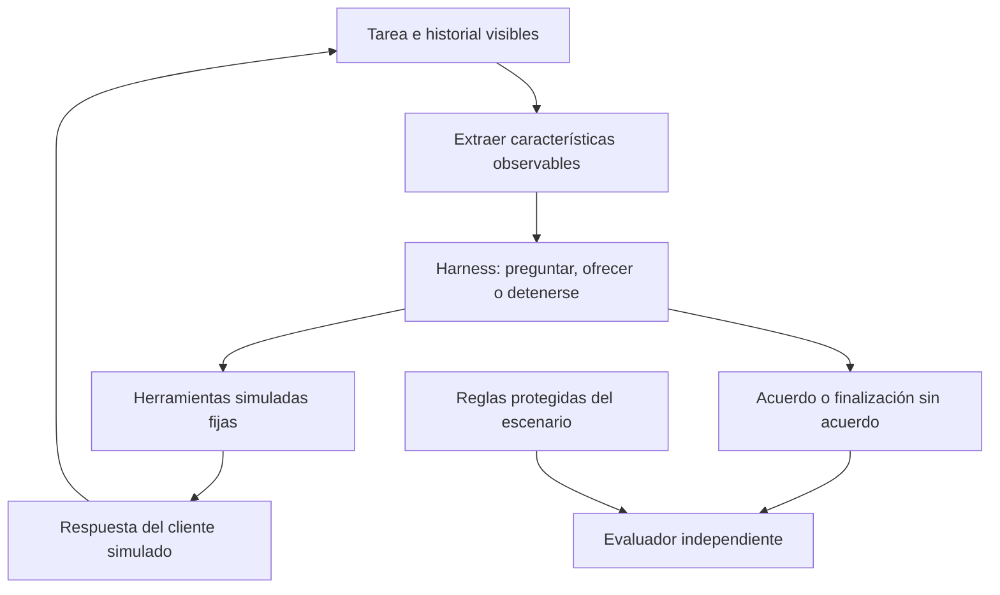
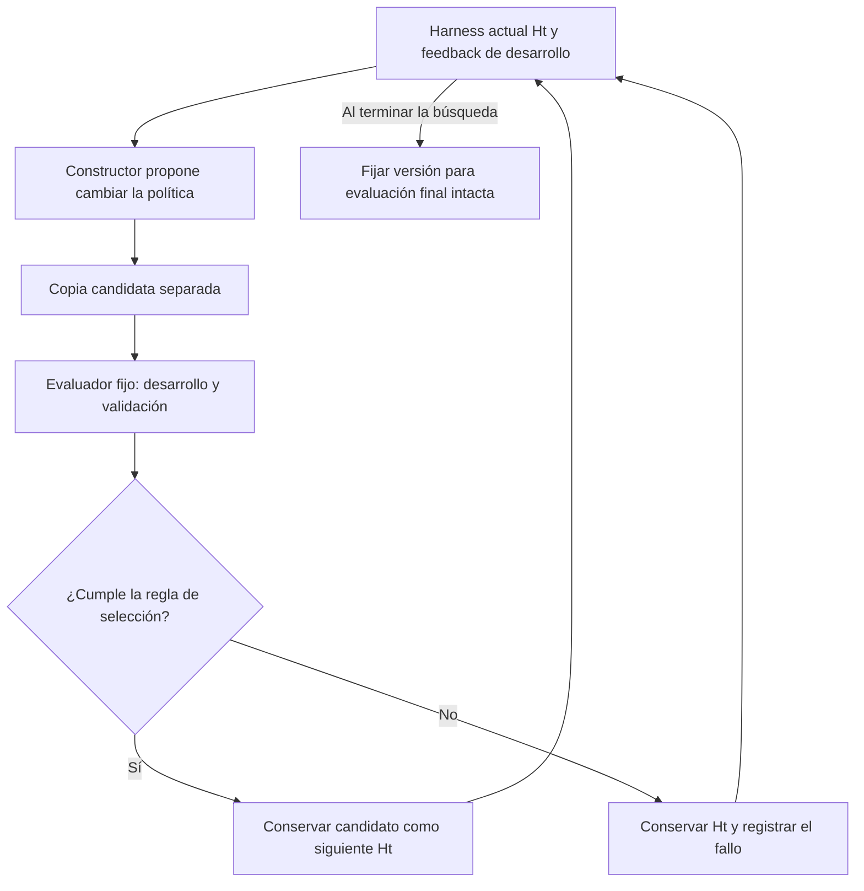

# Harness de negociación de deudas sintéticas

[English](README.md) | Español

## 1. Caso y objetivo

Una entidad ficticia ofrece planes de pago para tres deudas del año anterior. El asistente
busca un acuerdo explícito sobre la deuda de mayor importe que sea viable, respetando las
condiciones permitidas y la capacidad declarada del cliente. Ante un rechazo, puede ser
necesario aclarar el motivo u ofrecer otro plan antes de considerar una deuda menor.
Finalizar sin acuerdo es válido cuando el cliente no desea negociar o ningún plan es viable.

| Deuda | Importe en unidades ficticias | Un pago | Dos pagos mensuales iguales |
|---|---:|---:|---:|
| A | 200 | 200 | 100 cada uno |
| B | 300 | 300 | 150 cada uno |
| C | 600 | 600 | 300 cada uno |

Simplificación inicial: como máximo una deuda por acuerdo, primer pago en el periodo actual,
segundo en el siguiente, capacidad mensual constante, sin intereses, descuentos ni pagos reales.
Los importes, reglas y conversaciones son sintéticos; no se reutilizan datos ni implementación
institucionales. Un acuerdo mide importe comprometido, no dinero recuperado ni probabilidad de pago futuro.

**Pregunta de investigación:** ¿los cambios en un harness de negociación acotado pueden mejorar
los acuerdos válidos y la calidad de interacción frente a un harness fijo con los mismos recursos?
Es un candidato activo junto con [corrección de código](../case-0001-code-repair-harness.es.md),
no una selección definitiva del método de tesis. El [caso de servicios](../case-0002-service-workflow-harness.es.md)
anterior se conserva como referencia sustituida.

## 2. Modelamiento y características derivadas

| Parte | Definición inicial |
|---|---|
| Entradas visibles | Lista de deudas, planes autorizados, mensajes del cliente e historial de conversación |
| Características derivadas | Cuota propuesta, cuota menos capacidad declarada, motivo conocido del rechazo, planes permitidos restantes y turnos disponibles |
| Herramientas | `list_debts`, `get_allowed_plans`, `present_offer` y `record_acceptance` en un backend simulado |
| Salida | Deuda y plan aceptados explícitamente, o finalización veraz sin acuerdo |
| Harness modificable | Inicialmente una política acotada de selección de ofertas: preguntar, elegir un plan permitido o detenerse |
| Entorno fijo | Modelo/versión, contratos de herramientas, planes permitidos, comprobaciones de consentimiento, presupuestos, simulador de cliente y evaluador |
| Optimizador futuro | Propone cambios candidatos a esa política; no puede editar el entorno ni la evaluación final |

La capacidad es desconocida hasta que se comunica; un valor ausente no equivale a cero.
El agente no puede leer preferencias ocultas del simulador ni respuestas de referencia.
Ejemplo: una cuota de 300 y una capacidad declarada de 150 producen una diferencia de 150.
Esta transformación corresponde al feature engineering; definir entradas, herramientas y
salidas corresponde al modelamiento del sistema. No requiere entrenar el modelo.

## 3. Harness inicial y construcción

El harness no parte de la nada. `H0` es una estructura mínima ejecutable con interfaces de
herramientas fijas, estado de conversación, límites de parada y una política inicial sencilla.
Puede escribirse manualmente o generarse desde una especificación y después revisarse.
El modelo preentrenado ya aporta capacidad lingüística; no se reconstruyen sus pesos ni el backend.

Una primera política podría ofrecer C en un pago, aclarar un rechazo, intentar un plan
permitido asequible y después considerar B o A. Es una hipótesis de referencia, no una
conversación óptima prescrita. Por ejemplo, tras declarar una capacidad de 150, C en dos
pagos sigue siendo inviable, mientras que B en dos pagos sí encaja. Aun así, la aceptación
debe ser explícita.

Un candidato `H1` podría consultar la capacidad antes de seleccionar un plan o conservar
mejor el motivo del rechazo. Solo puede cambiar la parte declarada de la política de ofertas.
Una mejor redacción, un acuerdo válido o superar un escenario no demuestran por sí solos
que el harness sea mejor.

## 4. Escenarios de referencia propuestos y evaluador

El golden set definiría estado inicial, comportamiento oculto del cliente, información
comunicada, resultados permitidos y reglas de evaluación. No sería una única transcripción
obligatoria: distintas conversaciones pueden cumplir el mismo resultado. Son casos de
referencia propuestos, no un dataset construido ni validado. La capacidad se comunica
cuando se pregunta; los tres primeros perfiles aceptan una oferta válida y asequible,
mientras que el cuarto rechaza cualquier oferta.

| Perfil | Comportamiento de referencia bajo estos supuestos |
|---|---|
| Capacidad mensual de 300 | C en dos pagos es viable y preferida por el objetivo de la entidad |
| Capacidad mensual de 150 | B en dos pagos es el acuerdo viable de mayor importe |
| Capacidad mensual de 80 | Ningún plan autorizado encaja; finalización veraz sin acuerdo |
| No desea negociar | Detenerse sin acuerdo, independientemente de la capacidad |

El evaluador fijo lee la traza de conversación y el estado final del backend. Comprueba
primero condiciones permitidas, consentimiento explícito,
ausencia de resultados inventados, coherencia con la capacidad y límites de turnos. Una
infracción invalida el resultado. Entre ejecuciones válidas, se informan importe comprometido
y tasa de acuerdos en escenarios elegibles, separados de las finalizaciones correctas sin
acuerdo. También se registran ofertas rechazadas repetidas, turnos innecesarios, tokens y
latencia. Una rúbrica breve revisada por una persona evaluaría claridad, pertinencia y
respuesta al rechazo; un juez basado en modelos sin calibrar es insuficiente. Una política
que siempre se detiene no debe puntuar como éxito en perfiles elegibles y dispuestos.

Reservar escenarios de desarrollo para orientar la construcción, de validación para
seleccionar candidatos y finales intactos para la comparación final. Agrupar variantes
relacionadas al dividirlos. Las respuestas finales y el estado oculto quedan fuera de las
entradas del constructor. El comportamiento sintético demuestra desempeño en el simulador,
no eficacia con clientes reales.

## 5. Mejora y mejora recursiva

Los escenarios de referencia aportan evidencia; no construyen el workflow por sí mismos.
Un coordinador fijo entrega al constructor los fallos de desarrollo y el código editable
del harness. Un agente constructor con un LLM fijo propone un candidato; una evaluación protegida lo comprueba
sobre varios escenarios. Una regla de selección predefinida lo conserva o rechaza dentro
del presupuesto de búsqueda. La prueba final no participa en ese ciclo. No se garantiza mejora.

Deben distinguirse dos etapas futuras:

- **Mejora automática del harness:** un constructor fijo mejora la política de negociación.
- **Construcción recursiva:** el harness aceptado también ejecuta al constructor que crea
  su sucesor. Pasar únicamente su código a un constructor sin cambios no es suficiente.

La política de negociación por sí sola no necesariamente ayuda a construir código. Un
estudio recursivo necesitaría un componente compartido, como selección de feedback o
planificación, utilizado tanto al negociar como al construir. Compararía un constructor
que opera mediante `H0` con otro que opera mediante `Ht`, con el mismo presupuesto total.
Ese componente y el protocolo siguen abiertos. Un ciclo de negociación, por tanto, todavía
no demuestra RSI.

## 6. Entrega y siguientes pasos

En esta carpeta solo existen la especificación bilingüe y los diagramas. El siguiente paso
es precisar el esquema de escenarios y los ejemplos del evaluador; después se implementarían
`scenarios.json` y `demo.py` aquí mismo. La primera demostración calcularía características,
ejecutaría una política fija contra un cliente determinista e imprimiría decisiones y evaluación.
No reescribiría código ni llamaría a un modelo.

Una referencia determinista podría resolver ya los cuatro perfiles propuestos. Estos casos
comprueban primero la medición; no establecen un problema útil de optimización. El diseño
posterior de escenarios debe revelar una limitación medible antes de probar mejoras.

La optimización posterior requiere un protocolo aprobado separado, presupuesto y regla de
parada. Se conservarán las trazas de candidatos rechazados y se comparará con la referencia
fija. Una demostración que funciona es un instrumento de medición, no una solución completa
de auto-mejora.

La estructura compacta se limita a este caso; los PRs #26 y #27 siguen siendo propuestas
separadas. El agente prepara el trabajo hasta Review. Solo Jairzinho decide integración de
PRs, cierre de issues, Done y Completed date. No se habilitan cierres ni merges automáticos.
