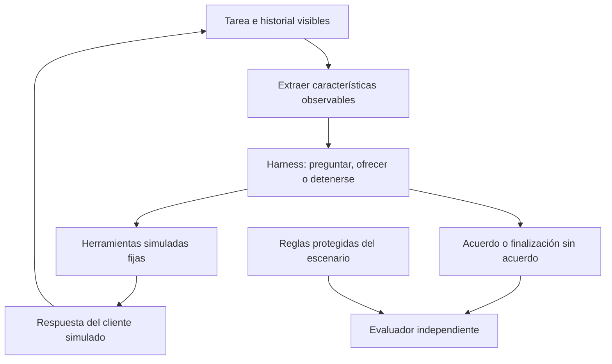
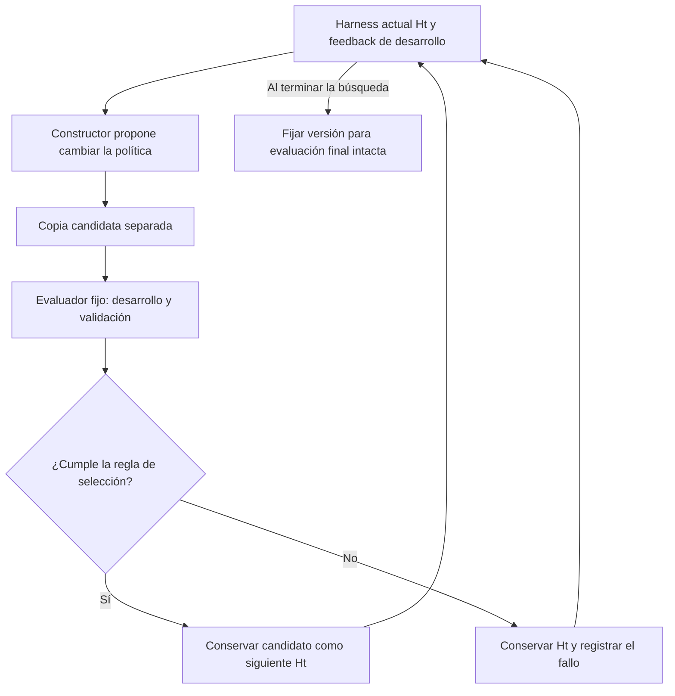
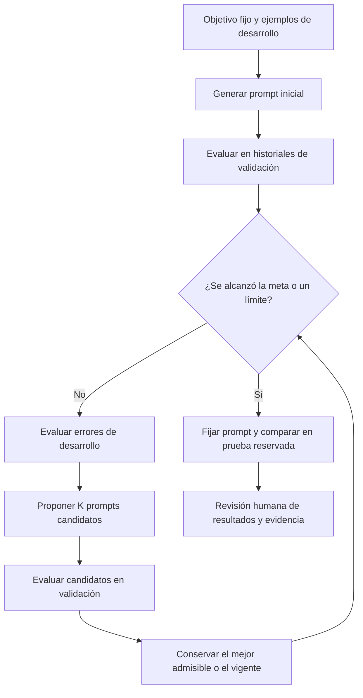

# Harness de negociación de deudas sintéticas

[English](README.md) | Español

## 1. Caso y objetivo

Una entidad ficticia ofrece planes de pago para tres deudas del año anterior. El asistente
busca un acuerdo explícito sobre la deuda de mayor importe que sea viable, respetando las
condiciones permitidas y la capacidad declarada del cliente. Ante un rechazo, puede ser
necesario aclarar el motivo u ofrecer otro plan antes de considerar una deuda menor.
Finalizar sin acuerdo es válido cuando el cliente no desea negociar o ningún plan es viable.

| Deuda | Importe en unidades ficticias | Un pago | Dos pagos mensuales iguales |
|---|---:|---:|---:|
| A | 200 | 200 | 100 cada uno |
| B | 300 | 300 | 150 cada uno |
| C | 600 | 600 | 300 cada uno |

Simplificación inicial: como máximo una deuda por acuerdo, primer pago en el periodo actual,
segundo en el siguiente, capacidad mensual constante, sin intereses, descuentos ni pagos reales.
Los importes, reglas y conversaciones son sintéticos; no se reutilizan datos ni implementación
institucionales. Un acuerdo mide importe comprometido, no dinero recuperado ni probabilidad de pago futuro.

**Pregunta de investigación:** ¿los cambios en un harness de negociación acotado pueden mejorar
los acuerdos válidos y la calidad de interacción frente a un harness fijo con los mismos recursos?
Es un candidato activo junto con [corrección de código](../case-0001-code-repair-harness.es.md),
no una selección definitiva del método de tesis. El [caso de servicios](../case-0002-service-workflow-harness.es.md)
anterior se conserva como referencia sustituida.

## 2. Modelamiento y características derivadas

| Parte | Definición inicial |
|---|---|
| Entradas visibles | Lista de deudas, planes autorizados, mensajes del cliente e historial de conversación |
| Características derivadas | Cuota propuesta, cuota menos capacidad declarada, motivo conocido del rechazo, planes permitidos restantes y turnos disponibles |
| Herramientas | `list_debts`, `get_allowed_plans`, `present_offer` y `record_acceptance` en un backend simulado |
| Salida | Deuda y plan aceptados explícitamente, o finalización veraz sin acuerdo |
| Harness modificable | Inicialmente una política acotada de selección de ofertas: preguntar, elegir un plan permitido o detenerse |
| Entorno fijo | Modelo/versión, contratos de herramientas, planes permitidos, comprobaciones de consentimiento, presupuestos, simulador de cliente y evaluador |
| Optimizador futuro | Propone cambios candidatos a esa política; no puede editar el entorno ni la evaluación final |

La capacidad es desconocida hasta que se comunica; un valor ausente no equivale a cero.
El agente no puede leer preferencias ocultas del simulador ni respuestas de referencia.
Ejemplo: una cuota de 300 y una capacidad declarada de 150 producen una diferencia de 150.
Esta transformación corresponde al feature engineering; definir entradas, herramientas y
salidas corresponde al modelamiento del sistema. No requiere entrenar el modelo.

## 3. Harness inicial y construcción

El harness no parte de la nada. `H0` es una estructura mínima ejecutable con interfaces de
herramientas fijas, estado de conversación, límites de parada y una política inicial sencilla.
Puede escribirse manualmente o generarse desde una especificación y después revisarse.
El modelo preentrenado ya aporta capacidad lingüística; no se reconstruyen sus pesos ni el backend.

Una primera política podría ofrecer C en un pago, aclarar un rechazo, intentar un plan
permitido asequible y después considerar B o A. Es una hipótesis de referencia, no una
conversación óptima prescrita. Por ejemplo, tras declarar una capacidad de 150, C en dos
pagos sigue siendo inviable, mientras que B en dos pagos sí encaja. Aun así, la aceptación
debe ser explícita.

Un candidato `H1` podría consultar la capacidad antes de seleccionar un plan o conservar
mejor el motivo del rechazo. Solo puede cambiar la parte declarada de la política de ofertas.
Una mejor redacción, un acuerdo válido o superar un escenario no demuestran por sí solos
que el harness sea mejor.

## 4. Escenarios de referencia propuestos y evaluador

El golden set definiría estado inicial, comportamiento oculto del cliente, información
comunicada, resultados permitidos y reglas de evaluación. No sería una única transcripción
obligatoria: distintas conversaciones pueden cumplir el mismo resultado. Son casos de
referencia propuestos, no un dataset construido ni validado. La capacidad se comunica
cuando se pregunta; los tres primeros perfiles aceptan una oferta válida y asequible,
mientras que el cuarto rechaza cualquier oferta.

| Perfil | Comportamiento de referencia bajo estos supuestos |
|---|---|
| Capacidad mensual de 300 | C en dos pagos es viable y preferida por el objetivo de la entidad |
| Capacidad mensual de 150 | B en dos pagos es el acuerdo viable de mayor importe |
| Capacidad mensual de 80 | Ningún plan autorizado encaja; finalización veraz sin acuerdo |
| No desea negociar | Detenerse sin acuerdo, independientemente de la capacidad |

El evaluador fijo lee la traza de conversación y el estado final del backend. Comprueba
primero condiciones permitidas, consentimiento explícito,
ausencia de resultados inventados, coherencia con la capacidad y límites de turnos. Una
infracción invalida el resultado. Entre ejecuciones válidas, se informan importe comprometido
y tasa de acuerdos en escenarios elegibles, separados de las finalizaciones correctas sin
acuerdo. También se registran ofertas rechazadas repetidas, turnos innecesarios, tokens y
latencia. Una rúbrica breve revisada por una persona evaluaría claridad, pertinencia y
respuesta al rechazo; un juez basado en modelos sin calibrar es insuficiente. Una política
que siempre se detiene no debe puntuar como éxito en perfiles elegibles y dispuestos.

Reservar escenarios de desarrollo para orientar la construcción, de validación para
seleccionar candidatos y finales intactos para la comparación final. Agrupar variantes
relacionadas al dividirlos. Las respuestas finales y el estado oculto quedan fuera de las
entradas del constructor. El comportamiento sintético demuestra desempeño en el simulador,
no eficacia con clientes reales.

## 5. Mejora y mejora recursiva

Los escenarios de referencia aportan evidencia; no construyen el workflow por sí mismos.
Un coordinador fijo entrega al constructor los fallos de desarrollo y el código editable
del harness. Un agente constructor con un LLM fijo propone un candidato; una evaluación protegida lo comprueba
sobre varios escenarios. Una regla de selección predefinida lo conserva o rechaza dentro
del presupuesto de búsqueda. La prueba final no participa en ese ciclo. No se garantiza mejora.

Deben distinguirse dos etapas futuras:

- **Mejora automática del harness:** un constructor fijo mejora la política de negociación.
- **Construcción recursiva:** el harness aceptado también ejecuta al constructor que crea
  su sucesor. Pasar únicamente su código a un constructor sin cambios no es suficiente.

La política de negociación por sí sola no necesariamente ayuda a construir código. Un
estudio recursivo necesitaría un componente compartido, como selección de feedback o
planificación, utilizado tanto al negociar como al construir. Compararía un constructor
que opera mediante `H0` con otro que opera mediante `Ht`, con el mismo presupuesto total.
Ese componente y el protocolo siguen abiertos. Un ciclo de negociación, por tanto, todavía
no demuestra RSI.

## 6. Primer prototipo ejecutable

Abrir [prompt-search.ipynb](prompt-search.ipynb) en Jupyter o un editor compatible con un
kernel Python 3.10+. La ejecución completa predeterminada es local y no requiere API key.
La notebook explica el experimento; [prompt_search.py](prompt_search.py) contiene la
implementación con biblioteca estándar para probar la evaluación y el control de presupuesto.
[objective.md](objective.md) es la especificación fija, cargada explícitamente como un skill;
[scenarios.json](scenarios.json) contiene 18 ejemplos sintéticos de la siguiente respuesta.

La conversación con herramientas descrita arriba sigue siendo una extensión propuesta. Este
prototipo solo optimiza el prompt de la política. Evalúa la siguiente respuesta sobre historiales
locales fijos; no implementa herramientas, simulador de cliente, reescritura de código ni construcción
recursiva. El prompt inicial se genera una vez con el objetivo y los ejemplos de desarrollo.
La comparación con esa referencia permite distinguir el aporte adicional de la búsqueda iterativa.

### Entradas y mediciones

El negociador solo recibe las deudas, las cantidades de pagos permitidas y el historial.
Las decisiones esperadas y respuestas de referencia son exclusivas del evaluador; el optimizador
puede acceder a etiquetas y errores de desarrollo, nunca a detalles de validación o prueba final.
La selección del prompt sí depende de los resultados de validación. Cada grupo de perfiles queda
en una partición, pero estos ejemplos pequeños comparten plantillas y familias de intención entre
particiones. No constituyen un benchmark independiente ni evidencia de efectividad real.

El éxito requiere la acción y el plan estructurados esperados, ausencia de infracciones y un
veredicto positivo del juez fijo sobre consistencia, pertinencia y claridad. Se reportan por
separado la proporción de respuestas correctas y las infracciones. No es tasa de acuerdos ni dinero
recuperado. No se exige la redacción literal de referencia. El juez LLM comprueba aspectos semánticos
que las reglas numéricas no pueden establecer; todavía no está calibrado y requiere revisión antes
de formular conclusiones científicas. Las repeticiones exponen parte de la variabilidad, pero no
establecen significancia estadística.

### Protocolo de búsqueda y ejecución

- Fijos: objetivo, runtime/esquema, ejemplos, modelo, instrucciones del optimizador y rúbrica.
- Mutable: únicamente el prompt del negociador. No se ejecuta Python generado.
- Selección: conservar el vigente salvo que un candidato no presente infracciones en validación
  y mejore la proporción de éxito en al menos `min_gain`. Conservar candidatos rechazados y fallos.
- Valores iniciales: tres rondas, dos candidatos por ronda, dos evaluaciones por ejemplo, meta 1.0,
  paciencia de dos rondas y mejora mínima 0.01. Son parámetros editables del piloto.
- Parada por meta, rondas, paciencia, límites de tokens/costo, interrupción o fallo del proveedor.
- Fijar la selección antes de evaluar la referencia inicial y el prompt elegido en la prueba
  reservada. Su feedback no vuelve al optimizador. Si la referencia ya cumple, se omite la búsqueda.

La ejecución real requiere `RUN_LIVE = True`, un modelo explícito compatible con salidas
estructuradas de Responses, tarifas actuales y `OPENAI_API_KEY` en el entorno. La clave no debe
estar en celdas. Un modelo cumple tres roles separados y se mantiene fijo durante la ejecución.
La notebook muestra un límite superior de llamadas antes de ejecutar; rondas no equivale a costo.

Los límites de ejemplo editables son USD 1 y 100,000 tokens para todos los roles, incluida la prueba
final. Antes de cada llamada se reserva una estimación conservadora de bytes de entrada, un margen
de formato y el máximo de salida; el uso reportado reemplaza la reserva. Las tarifas son supuestos
configurados y la entrada en caché se contabiliza a tarifa completa. Es un control local estimado,
no un límite de facturación impuesto por el proveedor. Los fallos con consumo incierto detienen
llamadas posteriores, conservan la reserva y no se reintentan automáticamente. Si se agota el
presupuesto antes de terminar la prueba final, la comparación queda explícitamente incompleta.

Cada ejecución escribe `runs/<timestamp>-<id>/report.json` y `calls.jsonl` localmente, excluidos de
Git, con hashes, commit, configuración, modelos reportados por el proveedor, respuestas, evidencia
del juez, candidatos, consumo y motivo de parada. Revisar las trazas antes de compartirlas. Volver
a ejecutar crea una nueva ejecución con costo; mantener las notebooks versionadas sin salidas ni
credenciales. El módulo no requiere dependencias externas; el editor de notebooks aporta IPython.

Esta implementación no declara una evaluación real de modelos ni mejoras observadas. Los ejemplos
sencillos podrían resolverse al primer intento. Siguiente revisión: cobertura y calibración del juez;
después, elegir configuración y presupuesto para una ejecución real. El agente llega hasta Review;
solo Jairzinho decide integración y cierre.

### Referencias

- [Historial en OpenAI](https://developers.openai.com/api/docs/guides/conversation-state)
- [Salidas estructuradas en OpenAI](https://developers.openai.com/api/docs/guides/structured-outputs)
- [Automatic Prompt Optimization](https://arxiv.org/abs/2305.03495)
- [STOP](https://arxiv.org/abs/2310.02304)

La revisión 2 incorpora el prototipo de búsqueda limitada de prompts y lo distingue del caso amplio.

La revisión 3 elimina una nota desactualizada sobre coordinación de PRs. El prototipo y el alcance científico no cambian.
