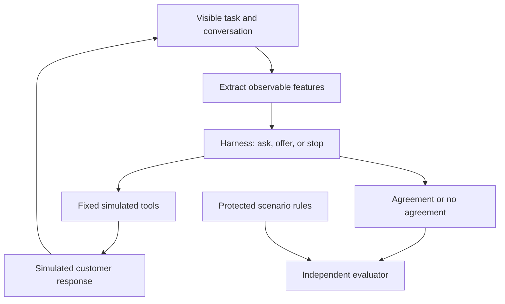
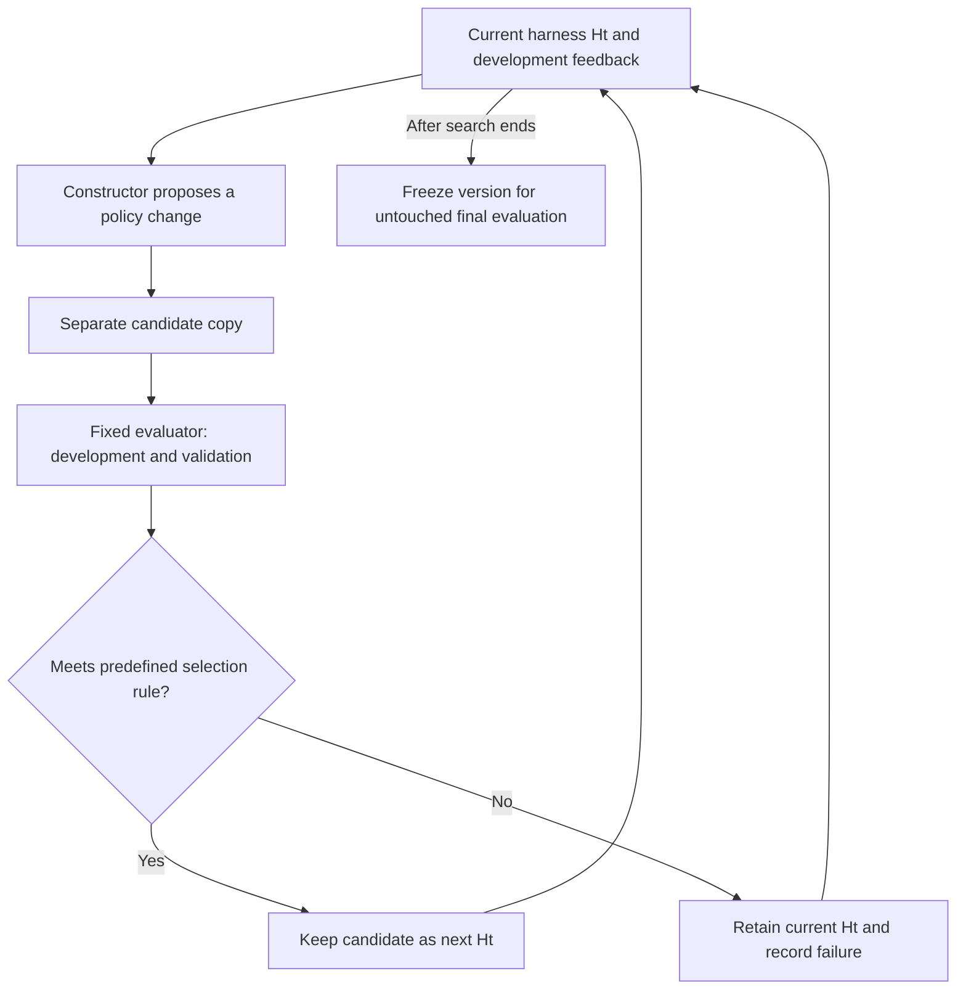
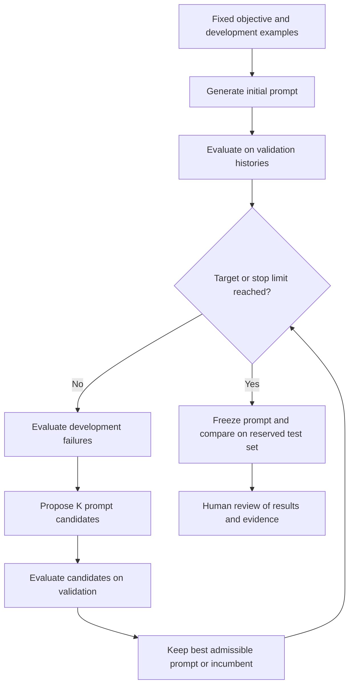

# Synthetic debt negotiation harness

English (primary) | [Español](README.es.md)

## 1. Case and objective

A fictional lender offers payment plans for three debts from a previous year. The assistant
seeks an explicit agreement for the largest feasible debt, within permitted terms and the
customer's stated capacity. A refusal may require clarification or another plan before
considering a smaller debt. A no-agreement outcome is valid when the customer declines or no plan fits.

| Debt | Amount in fictional units | One payment | Two equal monthly payments |
|---|---:|---:|---:|
| A | 200 | 200 | 100 each |
| B | 300 | 300 | 150 each |
| C | 600 | 600 | 300 each |

Initial simplification: at most one debt per agreement, first payment in the current period,
second in the next, unchanged monthly capacity, no interest, discounts, or real payments.
Amounts, rules, and conversations are synthetic; no institutional data or implementation is reused.
An agreement measures committed amount, not money recovered or future repayment probability.

**Research question:** can changes to a bounded negotiation harness improve valid agreements
and interaction quality compared with a fixed harness under the same resources?
This is an active candidate alongside [code repair](../case-0001-code-repair-harness.md),
not a final thesis-method selection. The earlier [service case](../case-0002-service-workflow-harness.md)
is retained as a superseded reference.

## 2. Model and derived features

| Part | Initial definition |
|---|---|
| Visible inputs | Debt list, authorized plans, customer messages, and conversation history |
| Derived features | Proposed installment, installment minus stated capacity, known refusal reason, remaining permitted plans, and remaining turns |
| Tools | `list_debts`, `get_allowed_plans`, `present_offer`, and `record_acceptance` in a simulated backend |
| Output | Explicitly accepted debt and plan, or a truthful no-agreement outcome |
| Mutable harness | Initially one bounded offer-selection policy: ask, choose a permitted plan, or stop |
| Fixed environment | Model/version, tool contracts, permitted plans, consent checks, budgets, customer simulator, and evaluator |
| Future optimizer | Proposes candidate changes to that policy; cannot edit the environment or final evaluation |

Capacity is unknown until disclosed; a missing value is not zero. The agent cannot read
hidden simulator preferences or reference answers. Example: a 300 installment and a stated
capacity of 150 produce an installment gap of 150. This transformation is feature engineering;
the full input/tool/output definition is system modeling. It does not require model training.

## 3. Seed harness and construction

The harness does not start from nothing. `H0` is a minimal runnable scaffold with fixed tool
interfaces, conversation state, stop limits, and a simple initial offer policy. It can be
written manually or generated from a specification and then reviewed. The pretrained model
already supplies language capability; neither its weights nor the tool backend are rebuilt.

A first policy might offer C in one payment, clarify a rejection, try an affordable permitted
plan, then consider B or A. This is a baseline hypothesis, not a prescribed optimal conversation.
For example, after a disclosed capacity of 150, C in two payments is still infeasible, while
B in two payments fits. Acceptance must still be explicit.

A candidate `H1` might ask about capacity before selecting a plan or retain the refusal reason
more reliably. Only the declared offer-policy surface may change. Better wording, a valid
agreement, or passing one scenario does not by itself establish a better harness.

## 4. Proposed golden scenarios and evaluator

The golden set would specify initial state, hidden customer behavior, visible disclosures,
permitted outcomes, and evaluation rules. It is not one mandatory transcript: different
conversations may satisfy the same outcome. These are proposed fixtures, not a built or
validated dataset. Capacity is disclosed when asked; the first three profiles accept a valid,
affordable offer, while the fourth declines every offer.

| Profile | Reference behavior under these assumptions |
|---|---|
| Monthly capacity 300 | C in two payments is feasible and preferred by the lender's objective |
| Monthly capacity 150 | B in two payments is the largest feasible agreement |
| Monthly capacity 80 | No authorized plan fits; truthful no agreement |
| Declines negotiation | Stop without an agreement, regardless of capacity |

The fixed evaluator reads the conversation trace and final backend state. It first checks
allowed terms, explicit consent, no fabricated outcome,
capacity consistency, and turn limits. A violation invalidates the result. Among valid runs,
report committed amount and agreement rate on eligible scenarios separately from correct
no-agreement outcomes. Also record repeated rejected offers, unnecessary turns, tokens, and
latency. A short human-reviewed rubric would assess clarity, relevance, and response to refusal;
an uncalibrated model judge is insufficient. An always-stop policy must not score as success
on eligible, willing profiles.

Reserve development scenarios for construction feedback, validation scenarios for candidate
selection, and untouched final scenarios for the final comparison. Group related profile
variants when splitting. Final answers and hidden state remain outside constructor input.
Synthetic behavior demonstrates simulator performance, not effectiveness with real customers.

## 5. Improvement and recursive improvement

Golden scenarios supply evidence; they do not construct the workflow by themselves. A fixed
coordinator gives development failures and the editable harness source to a constructor.
A constructor agent using a fixed LLM proposes a candidate; protected evaluation checks it
on multiple scenarios.
A predefined selection rule retains or rejects it within a search budget. The final test set
is not used in that loop. Improvement is not guaranteed.

Two future stages must remain distinct:

- **Automatic harness improvement:** a fixed constructor improves the negotiation policy.
- **Recursive construction:** the accepted harness also runs the constructor that builds its
  successor. Merely passing its source to an unchanged constructor is insufficient.

The negotiation policy alone does not necessarily help construct code. A recursive study
would need a shared component, such as feedback selection or planning, exercised in both
negotiation and construction. It would compare a constructor running through `H0` against
one running through `Ht`, with the same total budget. That component and protocol remain open.
A negotiation loop alone therefore does not yet demonstrate RSI.

## 6. First executable prototype

Open [prompt-search.ipynb](prompt-search.ipynb) in Jupyter or a compatible editor with a
Python 3.10+ kernel. The default Run All path is offline and requires no API key.
The notebook explains the experiment; [prompt_search.py](prompt_search.py) holds the
standard-library implementation so its evaluation and budget logic can be tested.
[objective.md](objective.md) is the fixed task specification, loaded explicitly like a skill;
[scenarios.json](scenarios.json) contains 18 synthetic next-turn fixtures.

The broader tool-backed conversation above remains a proposed extension. This prototype
only optimizes the policy prompt. It evaluates the next reply on fixed local histories;
it does not implement tools, a customer simulator, code rewriting, or recursive construction.
The initial prompt is generated once from the objective and development examples. Comparing
against this one-shot baseline isolates the additional contribution of iterative search.

### Inputs and measurements

The negotiator sees only the debt table, allowed payment counts, and conversation history.
Expected decisions and reference replies remain evaluator-only; the optimizer can access
development labels and failures, never validation or final-test details. The selected prompt
is still influenced by validation scores. Each profile group stays in one partition, but
these small fixtures share templates and intent families across partitions. They are not an
independent benchmark or evidence of real-world effectiveness.

Success requires the expected structured action/plan, no rule violation, and a positive fixed
judge verdict for consistency, relevance, and clarity. Report the fraction of successful
next-turn responses and violations separately. This is not agreement rate or recovered money.
Exact reference wording is unnecessary. The fixed LLM judge checks meaning that numeric rules
cannot establish; it is not calibrated yet and must be reviewed before scientific claims.
Repetitions expose some variability; they do not establish statistical significance.

### Search protocol and execution

- Fixed: objective, runtime/schema, scenarios, model, optimizer instructions, evaluator rubric.
- Mutable: negotiator prompt only. No generated Python is executed.
- Selection: retain the incumbent unless a candidate has zero validation violations and
  improves success by at least `min_gain`. Keep rejected candidates and failures.
- Defaults: three rounds, two candidates per round, two evaluations per example, target 1.0,
  patience two rounds, minimum gain 0.01. These are editable pilot settings.
- Stop at target, rounds, patience, token/cost guard, interruption, or provider failure.
- Freeze selection before final testing of both the one-shot baseline and selected prompt.
  Final feedback never returns to the optimizer. A baseline already at target skips search.

Live execution requires `RUN_LIVE = True`, an explicit model supporting Responses structured
outputs, current input/output prices, and `OPENAI_API_KEY` in the environment. No key belongs
in notebook cells. One model serves three separate roles and stays fixed within a run.
The notebook shows an upper bound on call count before execution; rounds are not a dollar cost.

The editable example limits are USD 1 and 100,000 tokens across all roles, including final
testing. Each call reserves a conservative input-byte estimate plus framing allowance and
maximum output before sending; returned usage replaces that reservation. Prices are supplied
assumptions and cached input is charged at the full configured rate. This is a local estimated
budget guard, not a provider-enforced billing cap. Provider failures with uncertain usage stop
further calls, retain the reservation, and are not retried automatically. If budget runs out
before final evaluation, the comparison remains explicitly incomplete.

Each run writes ignored local `runs/<timestamp>-<id>/report.json` and `calls.jsonl`, recording
source hashes, commit, settings, provider-reported models, replies, judge evidence, candidates,
usage, and stop reason. Review traces before sharing. Re-running starts a separate charged run;
keep committed notebooks free of outputs and credentials. The helper has no third-party
runtime dependencies; the notebook frontend provides IPython display support.

No live model evaluation or improvement is claimed by this implementation. Easy fixtures may
be solved on the first attempt. Next review: inspect fixture coverage and judge calibration,
then choose a live configuration and budget. The agent prepares work up to Review; only
Jairzinho decides integration and completion. PRs #26 and #27 remain independent.

### References

- [OpenAI conversation state](https://developers.openai.com/api/docs/guides/conversation-state)
- [OpenAI structured outputs](https://developers.openai.com/api/docs/guides/structured-outputs)
- [Automatic Prompt Optimization](https://arxiv.org/abs/2305.03495)
- [STOP](https://arxiv.org/abs/2310.02304)

Revision 2 adds the bounded prompt-search prototype and distinguishes it from the broader case.
