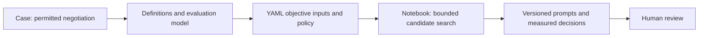

# Synthetic debt negotiation harness

English (primary) | [Español](README.es.md)

## Case

A fictional lender offers plans for three debts from a previous year. The assistant seeks
explicit agreement for the largest feasible debt, respecting capacity and the customer's
choice. A refusal or an unaffordable plan can correctly end without an agreement.

| Debt | Amount | One payment | Two monthly payments |
|---|---:|---:|---:|
| A | 200 | 200 | 100 each |
| B | 300 | 300 | 150 each |
| C | 600 | 600 | 300 each |

All amounts and conversations are synthetic. At most one debt is negotiated, monthly capacity
is constant, and there are no discounts, interest, or real payments. An accepted plan is a
commitment, not proof of collection. No private implementation or institutional data is used.

## Initial scope

The prototype improves **one YAML policy prompt**, using a fixed LLM, optimizer, and evaluator.
It generates the next reply from a supplied conversation history. It does not yet run a full
customer conversation, implement payment tools, rewrite code, or modify its optimizer.

**Question:** does iterative prompt search improve successful next-turn decisions over a
prompt generated once under the same objective, model, and evaluation protocol?
This is an active candidate alongside [code repair](../case-0001-code-repair-harness.md).
The [service case](../case-0002-service-workflow-harness.md) remains superseded.
The final thesis method is still open.

## Reading and execution

1. Read the [definitions and modeling](modeling.md): inputs, derived features, evaluator,
   selection rule, and limits.
2. Open the [English notebook](prompt-search.ipynb) or [Spanish notebook](prompt-search.es.ipynb).
   Both use the same YAML files, implementation, and run evidence.
3. Follow [local setup](modeling.md#local-setup). The default notebook replays the [first live run](results/20261017T011558Z-f5eca942/README.md)
   without API calls. A new charged run requires explicit opt-in.

The [objective](objective.md), [golden set](golden-set.yaml), [initial prompt](prompt.yaml), and
[configuration](config.yaml) are kept in this folder. The [runtime](prompt_search.py) stores
every proposed policy as YAML, including rejected versions. The notebook displays each
version, changes, evaluation, selection, stop reason, and final comparison when available.

A broader tool-backed harness could later extract refusal reasons, select authorized plans,
and track acceptance through explicit tools. That extension needs a separate protocol.
Automatic prompt improvement with a fixed optimizer is not recursive self-improvement.

Revision 5 adds the first measured run: no candidate accepted, token-limited search, final test not reached. The paired notebooks show the same saved evidence.
