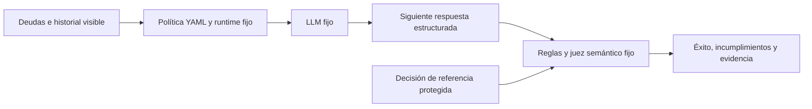
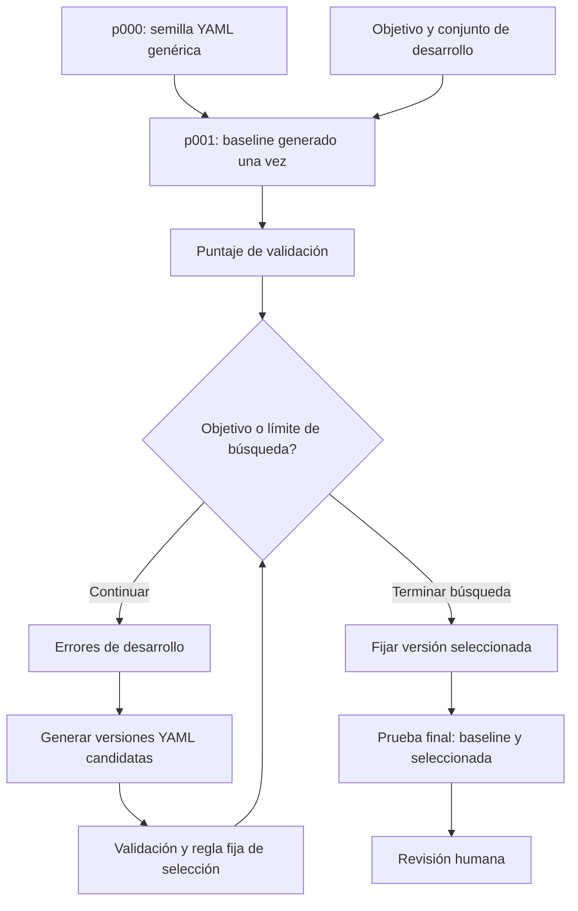

# Definiciones y modelamiento

[English](modeling.md) | Español | [Caso](README.es.md) | [Notebook](prompt-search.es.ipynb)

## Componentes

| Componente | Representación | Propósito |
|---|---|---|
| Objetivo | [objective.md](objective.md), fijo | Reglas de negociación, capacidad y consentimiento |
| Política inicial | [prompt.yaml](prompt.yaml), campo `prompt` modificable | Instrucción inicial mínima |
| Golden set | [golden-set.yaml](golden-set.yaml), fijo | Historiales, decisiones de referencia y respuestas ilustrativas |
| Configuración | [config.yaml](config.yaml), fija durante la ejecución | Modelo, precios, presupuesto y paradas |
| Runtime | [prompt_search.py](prompt_search.py), fijo | Proporciona historial y valida respuestas estructuradas |
| Optimizador | Instrucciones y LLM fijos | Propone un nuevo valor para el campo `prompt` del YAML |
| Evaluador | Reglas deterministas y rúbrica LLM fija | Mide decisiones, incumplimientos y significado |

La API transporta el campo del prompt mediante JSON estructurado; la política modificable y
cada versión guardada son YAML. No se ejecuta código generado. Cada ejemplo proporciona su
historial explícitamente; no se asume memoria automática de diez mensajes ni conversación
persistente en OpenAI. El negociador ve deudas, planes e historial, nunca respuestas esperadas.

## Entradas, salidas y características derivadas

Cada ejemplo tiene ID, partición, grupo, historial, capacidad declarada, rechazo, plan aceptado,
decisión esperada y respuesta ilustrativa. Las etiquetas de capacidad y consentimiento se
obtienen del historial para evaluar; no son entradas adicionales del negociador.
La salida contiene `action`, `debt`, `payments`, `installment` y `message`.

Para monto `d`, número de pagos `n` y capacidad mensual conocida `c`, la cuota es `a = d / n`
y la brecha es `g = a - c`. Una brecha no positiva indica viabilidad. La capacidad desconocida
es null, no cero. Estas sí son características numéricas derivadas; definir el contrato
completo de entradas y salidas es modelamiento del sistema. El prototipo calcula cuota y
capacidad en su evaluador, sin un pipeline aprendido de características. No entrena pesos
ni realiza un EDA convencional.



## Evaluador y selección

Una respuesta es exitosa si su acción y plan coinciden con la referencia, cumple las reglas
numéricas y de consentimiento, y el juez confirma consistencia, pertinencia y claridad.
No se exige la misma redacción. La similitud de embeddings puede pasar por alto montos
incorrectos o consentimiento inventado; por eso no es la regla de aceptación.

Para un conjunto `D` con `r` repeticiones, `s(i,j)` vale 1 si la respuesta es exitosa y 0 si no:

`S(P,D) = sum(s(i,j)) / (len(D) * r)`

`V(P,D)` cuenta respuestas con algún incumplimiento. Se conserva un candidato cuando
`V(candidate, validation) = 0` y `S(candidate, validation) - S(current, validation) >= min_gain`.
Entre candidatos admisibles se elige el mayor puntaje; un empate conserva la primera versión
admisible. Es búsqueda discreta de prompts, no descenso de gradiente. Ni el evaluador ni el
optimizador se modifican. STOP motiva estudiar un mejorador; esto no reproduce ese paper.

## Particiones y secuencia de versiones

Hay 18 ejemplos sintéticos: seis de desarrollo, seis de validación y seis de prueba final.
Solo los ejemplos y errores de desarrollo llegan al optimizador. Validación permite seleccionar;
la prueba final se usa después de fijar la versión. Los grupos e historiales exactos no cruzan
particiones, pero las familias de intención y plantillas sí se parecen. Es una demostración
pequeña, no un benchmark independiente. El juez no está calibrado; su evidencia requiere revisión.



`p000` es una semilla didáctica, no el baseline experimental. `p001` se genera una vez desde
la semilla, el objetivo y los ejemplos de desarrollo. Comparar contra `p001` evita atribuir
al bucle toda la ventaja de sustituir un saludo genérico. Cada candidato conserva su versión
padre, hash, archivo YAML y decisión, incluidos duplicados y descartados.
Si el baseline alcanza la meta, no se itera. No se inventan versiones ni mejoras para mostrarlas.

## Límites y evidencia

Valores iniciales: tres rondas, dos candidatos por ronda, dos repeticiones, meta 1.0, paciencia
dos y ganancia mínima 0.01. Un modelo fijo cumple los roles de optimizador, negociador y juez.
El presupuesto común es USD 1 y 100 000 tokens, incluida la prueba final. Cada llamada comprueba
una reserva conservadora y actualiza el consumo con la respuesta. Los precios configurados
son estimaciones; la entrada en caché se cobra al precio completo para el cálculo local.
No es un límite de facturación del proveedor. Un corte por presupuesto o error puede dejar
incompleta la comparación. No se reintenta automáticamente cuando el consumo es incierto.
Más rondas no garantizan mejores resultados.

La evidencia local queda en `runs/<run-id>/`, excluido de Git: `report.json`, `calls.jsonl` y
`prompts/*.yaml`. El reporte registra hashes, commit, parámetros, parentesco de prompts,
respuestas, evidencia del juez, candidatos conservados y descartados, consumo y parada.
La notebook presenta esa secuencia con diferencias YAML y decisiones. Ambos idiomas pueden
mostrar el mismo reporte sin llamar a OpenAI. Dos ejecuciones distintas no son una sola prueba.

La ejecución y publicación de resultados están pendientes. Después de revisar la ejecución
real se conservarán el reporte y prompts depurados, junto con las salidas de las notebooks,
en un commit de resultados. No publicar `.env`, credenciales, rutas locales absolutas ni
registros de solicitudes sin revisar. Las notebooks actuales no contienen mejoras medidas
ni versiones generadas por el modelo.

## Preparación local

Desde esta carpeta, con Python 3.11+:

```sh
python3 -m venv .venv
.venv/bin/python -m pip install -r requirements.txt
cp -n .env.example .env
.venv/bin/python -m ipykernel install --user --name thinking-harness --display-name "Thinking Harness"
```

Completar `OPENAI_API_KEY` en `.env`, excluido de Git. En un editor de notebooks, elegir el
kernel Thinking Harness. Confirmar acceso al modelo, precios y límites en [config.yaml](config.yaml).
Mantener `allow_live: false` hasta autorizar la ejecución; la notebook también exige
`RUN_LIVE = True`. Ejecutar un solo idioma y copiar su ruta relativa `runs/<run-id>/report.json`
en `REPLAY_REPORT` de la otra notebook. El modo real y la lectura de un reporte son excluyentes.

## Referencias

- [Estado de conversación en OpenAI](https://developers.openai.com/api/docs/guides/conversation-state)
- [Salidas estructuradas en OpenAI](https://developers.openai.com/api/docs/guides/structured-outputs)
- [Modelo y precios configurados](https://developers.openai.com/api/docs/models/gpt-5.4-mini)
- [Automatic Prompt Optimization](https://arxiv.org/abs/2305.03495)
- [STOP](https://arxiv.org/abs/2310.02304)
