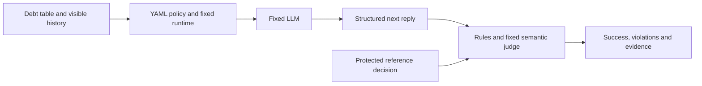
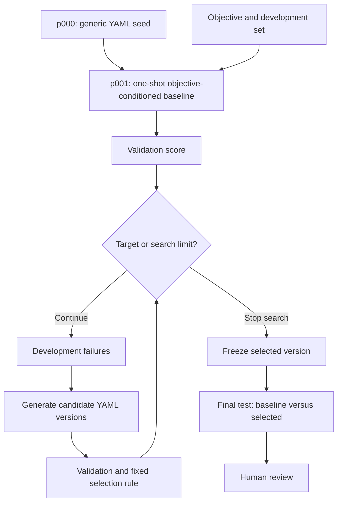

# Definitions and modeling

English (primary) | [Español](modeling.es.md) | [Case](README.md) | [Notebook](prompt-search.ipynb)

## Components

| Component | Representation | Purpose |
|---|---|---|
| Objective | [objective.md](objective.md), fixed | Allowed negotiation, capacity and consent rules |
| Initial policy | [prompt.yaml](prompt.yaml), mutable `prompt` field | Minimal runnable starting instruction |
| Golden set | [golden-set.yaml](golden-set.yaml), fixed | Histories, reference decisions and illustrative replies |
| Configuration | [config.yaml](config.yaml), fixed within a run | Model snapshot, prices, budget and stop conditions |
| Runtime | [prompt_search.py](prompt_search.py), fixed | Supplies history and validates structured responses |
| Optimizer | Fixed instructions and LLM | Proposes a new value for the YAML `prompt` field |
| Evaluator | Deterministic rules plus fixed LLM rubric | Measures decisions, violations and response meaning |

The API transports the prompt field as structured JSON; the editable policy and every saved
version are YAML. No generated code is executed. History is supplied explicitly for each
fixture; no automatic last-ten-message memory or persistent OpenAI conversation is assumed.
The negotiator sees debts, permitted payment counts and history, never expected answers.

## Inputs, outputs and derived features

Each fixture has an ID, split, group, history, disclosed capacity, refusal state, accepted plan,
expected structured action and an example reply. Capacity and consent labels are evaluation
annotations derived from the history; they are not extra negotiator inputs.
The output contains `action`, `debt`, `payments`, `installment`, and `message`.

For debt amount `d`, payment count `n` and known monthly capacity `c`, installment `a = d / n`
and affordability gap `g = a - c`. A nonpositive gap is affordable. Unknown capacity is null,
not zero. These are derived numerical features; designing the complete input/output contract
is system modeling. The prototype calculates installment and capacity checks in its evaluator,
not a learned feature pipeline. It does not train model weights or run a conventional EDA.



## Evaluator and selection

A response succeeds only if its structured action and plan match the reference, no numeric
or consent rule is violated, and the fixed judge confirms consistency, relevance and clarity.
Exact reference wording is unnecessary. Embedding similarity alone would miss wrong amounts
or fabricated consent, so it is not the acceptance rule.

For dataset `D` with `r` repetitions, let `s(i,j)` be 1 for a successful reply and 0 otherwise:

`S(P,D) = sum(s(i,j)) / (len(D) * r)`

`V(P,D)` counts replies with any violation. Keep a candidate only when
`V(candidate, validation) = 0` and `S(candidate, validation) - S(current, validation) >= min_gain`.
Among qualifying candidates, select the highest score; ties retain the first qualifying version.
This is discrete prompt search, not gradient descent. The evaluator and optimizer do not improve
themselves. STOP motivates studying an improver; this prototype is not a reproduction of STOP.

## Partitions and version sequence

There are 18 synthetic fixtures: six development, six validation and six final test cases.
Only development examples and failures reach the optimizer. Validation selects candidates;
final test data is used after selection freezes. Groups and exact histories do not cross
partitions, but intent families and templates overlap. This is a small demonstration dataset,
not an independent benchmark. The judge is uncalibrated; review its evidence before claims.



`p000` is a teaching seed, not the scientific comparison baseline. `p001` is generated once
from the seed, objective and development examples. Comparing iteration with `p001` avoids
attributing all benefit to replacing a generic greeting. All candidates retain parent IDs,
content hashes, YAML files and decisions, including duplicates and rejections.
A baseline already at target skips search. No version or improvement is manufactured for display.

## Bounds and evidence

Defaults: three rounds, two candidates per round, two repetitions, target 1.0, patience two,
and minimum gain 0.01. One model snapshot serves optimizer, negotiator and judge roles.
The common budget is USD 1 and 100,000 tokens, including final testing. Before every call,
a conservative reservation is checked; returned usage updates accounting. Configured pricing
is an estimate, with cached input charged at the full rate. This is not a provider billing cap.
A budget or provider failure can leave the comparison incomplete. No automatic retries occur
when usage is uncertain. More rounds do not guarantee better results.

Local evidence goes to ignored `runs/<run-id>/`: `report.json`, `calls.jsonl` and `prompts/*.yaml`.
The report records source hashes, commit, parameters, prompt lineage, every evaluated response,
judge evidence, selected/rejected candidates, usage and stop reason. The notebook displays
this sequence with YAML differences and decisions. Both languages can replay one report;
replay does not call OpenAI. Never compare separate language executions as if they were one run.

Execution and publication are pending. After the live run is reviewed, retain sanitized
report/prompt evidence and notebook outputs in a dedicated results commit. Do not publish
`.env`, raw credentials, local absolute paths or unreviewed request logs. Current notebooks
contain no measured improvement or generated prompt versions.

## Local setup

Run from this case folder with Python 3.11+:

```sh
python3 -m venv .venv
.venv/bin/python -m pip install -r requirements.txt
cp -n .env.example .env
.venv/bin/python -m ipykernel install --user --name thinking-harness --display-name "Thinking Harness"
```

Fill `OPENAI_API_KEY` in the local `.env` file. It is ignored by Git. In an editor with notebook
support, choose the Thinking Harness kernel. Confirm model access, prices and limits in
[config.yaml](config.yaml). Keep `allow_live: false` until execution is explicitly authorized;
the notebook also requires `RUN_LIVE = True`. Run only one language version live, then paste
its relative `runs/<run-id>/report.json` path into `REPLAY_REPORT` in the other notebook.
A replay path and live mode cannot be enabled together.

## References

- [OpenAI conversation state](https://developers.openai.com/api/docs/guides/conversation-state)
- [OpenAI structured outputs](https://developers.openai.com/api/docs/guides/structured-outputs)
- [Configured model and pricing](https://developers.openai.com/api/docs/models/gpt-5.4-mini)
- [Automatic Prompt Optimization](https://arxiv.org/abs/2305.03495)
- [STOP](https://arxiv.org/abs/2310.02304)
