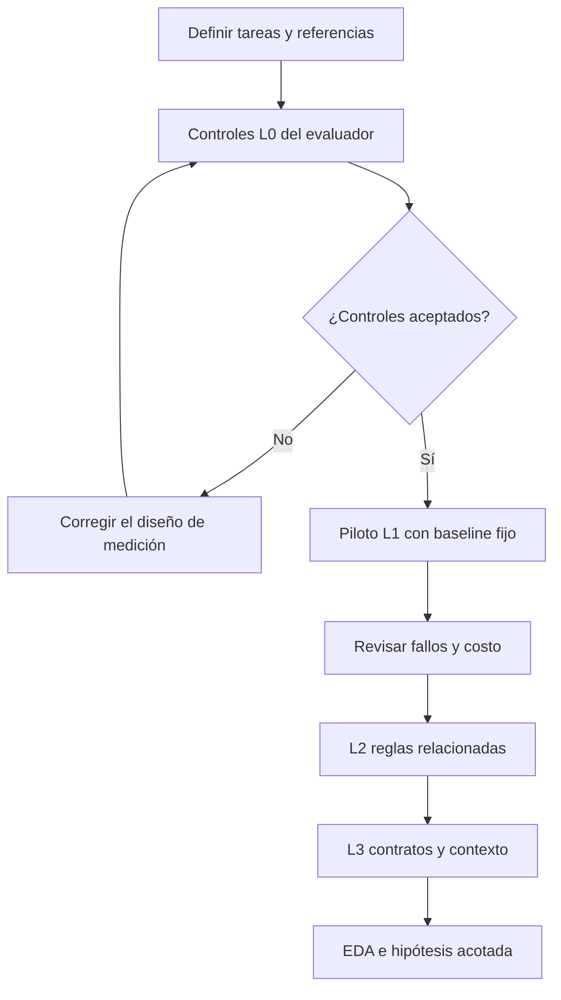
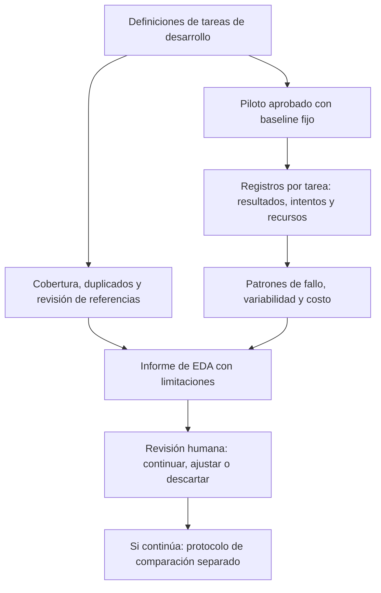

# Matriz de escenarios y plan de EDA para corrección de código

[English](doc-0005-code-repair-scenarios-and-eda.md) | Español

## 1. Propósito y límites de la evidencia

Concretar [case-0001](case-0001-code-repair-harness.es.md) mediante una matriz de
escenarios y un plan de análisis exploratorio de datos (EDA). La especificación del
caso define los límites de la investigación; este documento define observaciones
candidatas y reglas de aceptación. Ningún escenario ha sido implementado, validado ni
ejecutado. Los ejemplos numéricos son cálculos de referencia inventados, no mediciones
ni un golden set terminado.

El EDA caracterizará las tareas y un baseline fijo antes de seleccionar una intervención
en el harness. No demostrará mejora, causalidad ni automejora recursiva. El
[plan del flujo de servicio](doc-0006-service-workflow-scenarios-and-eda.es.md) es otro
candidato; sus tasas de éxito no deben combinarse en una única puntuación de benchmark.

## 2. Matriz de escenarios

Los identificadores de escenarios son locales a case-0001. Cada fila es una plantilla;
las entradas concretas recibirán identificadores de instancia antes de la ejecución.
Todas las filas tienen actualmente estado **planned**. L0 valida el instrumento de
medición y se excluye de las puntuaciones de rendimiento del agente.

| ID | Nivel y condición | Entrada o fallo ilustrativo | Resultado requerido y evidencia de aceptación |
|---|---|---|---|
| CR-00A | L0: sensibilidad del evaluador | Una solución correcta conocida y otra que suma precio y cantidad | La solución correcta pasa; la incorrecta falla para 250 × 3. Contrastar ambos veredictos con referencias revisadas |
| CR-00B | L0: artefactos protegidos | Un parche modifica una prueba de aceptación en lugar de la solución | Rechazar el parche, aunque las pruebas informadas pasen; registrar el cambio en el archivo prohibido |
| CR-01A | L1: aritmética local | Precio de 250 céntimos, cantidad 3; resultado inicial 253 | Resultado 750, entrada sin modificar y cumplimiento de todos los criterios comunes de tarea indicados más adelante |
| CR-01B | L1: casos límite | Precio 250, cantidad 0; y precio 0, cantidad 4 | Ambos resultados son 0; conservar el resultado habitual de 250 × 3 |
| CR-02A | L2: orden de reglas de precios | Subtotal de 1.000 céntimos, descuento fijo de 100, impuesto del 20 por ciento | Descuento primero: base de 900, total 1.080. Un total de 1.100 revela que se aplicó el impuesto antes del descuento fijo |
| CR-02B | L2: límite inferior del descuento | Subtotal de 100 céntimos, descuento fijo de 150, impuesto del 20 por ciento | Base y total iguales a 0; conservar el comportamiento de CR-02A y prohibir cargos negativos |
| CR-03A | L3: contrato entre módulos | Un total correcto de 1.080 se serializa como texto, o se omite un total igual a cero | Coinciden el cálculo de precios y el total numérico serializado; se conserva el cero y los campos no relacionados no cambian |
| CR-03B | L3: selección del contexto del fallo | Una tarea de la familia de CR-03A incluye fallos de integración relevantes mezclados con líneas de diagnóstico no relacionadas | Corregir el contrato dentro de los mismos límites y superar las mismas reglas de aceptación; registrar el contexto de diagnóstico suministrado |

Se utilizan céntimos enteros y cantidades enteras no negativas. En esta matriz inicial,
las entradas de precios deben producir un impuesto del veinte por ciento equivalente a
un número entero de céntimos; el redondeo y las entradas no válidas quedan fuera del
alcance. La regla de descuento fijo es ficticia, no una indicación tributaria. Para
CR-03B, las variantes emparejadas con diagnóstico limpio y con ruido deben permanecer
en la misma partición. Añadir texto es una condición diseñada, no una prueba de mayor dificultad.

Cada instancia concreta debe identificar todos los archivos modificables, los requisitos
completos, las comprobaciones de desarrollo disponibles y las pruebas de aceptación
independientes. Los ejemplos públicos son ilustraciones de desarrollo; no pueden tratarse
después como pruebas finales desconocidas.

## 3. Aceptación en tres niveles

| Nivel | Criterios de aceptación | Evidencia requerida |
|---|---|---|
| Escenario y evaluador | Los requisitos determinan el comportamiento aceptable; existe una solución revisada; se rechazan resultados incorrectos conocidos y cambios prohibidos; los restablecimientos limpios producen veredictos deterministas consistentes | Cálculos de referencia, resultados de controles, versión del evaluador y registro de ambigüedades |
| Ejecución individual | Pasan todas las comprobaciones funcionales y de regresión requeridas; solo cambian archivos permitidos; se conservan las entradas y el comportamiento no relacionado; se respeta el presupuesto de ejecución declarado | Parche, diferencias entre archivos, resultados completos de pruebas, estado final y registro de recursos |
| Afirmación posterior de mejora del harness | Se compara un candidato seleccionado con un baseline fijo mediante un protocolo definido previamente, tareas finales independientes, restricciones equivalentes y un análisis de incertidumbre especificado | Informe de comparación separado; fuera de este EDA |

Un parche parcialmente correcto es un fallo de tarea en la métrica principal. La fracción
de comprobaciones superadas se conserva solo como diagnóstico. Una ejecución que agota
su presupuesto es un fallo, no una observación ausente. Los fallos de infraestructura
tienen un estado separado; se conservan sus registros y se justifica cualquier repetición
o exclusión. Ninguna cantidad de pruebas superadas anula una modificación prohibida.

## 4. Progresión y baseline fijo

La progresión depende de la calidad de la medición y de su costo asumible, no de una tasa
de éxito prometida. Se conservan las tareas anteriores como estratos de regresión al
ampliar un nivel. Se fija una colección para cada comparación y se informan por separado
las nuevas instancias. No se cambia simultáneamente el modelo y la colección de tareas
para después atribuir la diferencia al harness.

El baseline propuesto utiliza un prompt y un ciclo de corrección fijos que reciben la
salida de las pruebas de desarrollo y permiten como máximo tres intentos de parche por
ejecución. Cada intento permite una solicitud al modelo que devuelve un parche. No hay
memoria persistente entre ejecuciones. El protocolo de ejecución aprobado debe registrar
identidad y parámetros del modelo, truncamiento de contexto, formato de retroalimentación,
contabilidad de reintentos de solicitudes, límites de tokens y de tiempo total. La
intervención candidata no se implementa durante el EDA del baseline.

Los ejemplos de una sola función pueden ser demasiado sencillos para una comparación
científica útil. Si el baseline los resuelve casi todos, se conservan como controles de
medición y se examinan estratos más difíciles definidos previamente. No se eliminan
tareas fáciles o difíciles solo para mejorar una puntuación principal.

## 5. Observaciones y muestreo propuestos

| Registro | Campos que se recogerían |
|---|---|
| Instancia de tarea | IDs de caso/escenario/instancia, nivel, familia, generador u origen, procedencia, partición, versión del requisito, hash del código inicial, archivos permitidos y versiones de referencia y evaluador |
| Ejecución | ID de ejecución, ID de tarea, revisión y commit del baseline, modelo/proveedor/parámetros, semilla si se admite, versión del entorno, inicio/fin, límite de intentos, estado final y resultado del restablecimiento |
| Intento | Índice de intento, referencia al parche, contexto suministrado, resultados de las pruebas de desarrollo, llamadas al modelo, tokens de entrada/salida, duración de pruebas y motivo de reintento o parada |
| Evaluación final | Comprobaciones de aceptación, cambios prohibidos, categoría de éxito/fallo, recursos totales, intervención humana, incidentes de infraestructura y enlaces a evidencia conservada |

Una muestra provisional de viabilidad sería de **dos instancias de desarrollo por cada
escenario desde CR-01A hasta CR-03B**: 12 instancias con tres repeticiones del baseline
cada una, para **36 ejecuciones previstas**. Los controles L0 y las repeticiones por
incidentes documentados se contabilizan aparte. Estas cantidades sirven para explorar
el instrumento y el costo, no constituyen un estudio de eficacia con potencia estadística
justificada ni permiten generalizaciones amplias. Repetir una tarea no crea otra tarea independiente.

Se muestrea deliberadamente a través de la matriz y se informa la regla de selección.
Generadores relacionados, familias de programas y variantes de diagnóstico permanecen
agrupados al crear posteriormente las particiones de desarrollo, validación y evaluación
final. Todas las instancias del piloto pasan a ser datos de desarrollo una vez inspeccionadas.
No se utiliza la partición final para EDA ni ajustes manuales. El tamaño de muestra final
y sus repeticiones se elegirán después según presupuesto, variabilidad observada y alcance de la afirmación.

## 6. Preguntas de EDA y resultados previstos

| Etapa | Pregunta | Análisis o visualización | Decisión que fundamenta |
|---|---|---|---|
| Antes de ejecutar | ¿Cada condición prevista tiene instancias válidas? | Matriz de cobertura de escenarios y condiciones; cantidades de instancias ambiguas, no válidas y casi duplicadas | Corregir la colección o acotar el alcance |
| Antes de ejecutar | ¿El evaluador detecta fallos relevantes? | Tabla de referencias y veredictos de controles L0 | Aceptar o revisar el instrumento |
| Después del baseline | ¿Qué estratos fallan y en qué etapa? | Conteos de éxito con denominadores por nivel/familia; mapa de calor de etapas de fallo | Identificar un problema acotado de retroalimentación o contexto |
| Después del baseline | ¿El rendimiento es consistente entre repeticiones? | Fracción de éxito por instancia y tabla de ejecuciones repetidas | Evaluar variabilidad antes de elegir el diseño de comparación |
| Después del baseline | ¿Qué consume recursos? | Distribuciones por ejecución de tokens, llamadas, intentos y duración; costo frente a resultado | Comprobar el presupuesto e identificar comportamientos costosos |
| Después del baseline | ¿La retroalimentación parece afectar a la recuperación? | Trayectorias de intentos y comparaciones de diagnóstico limpio/con ruido, conservando el emparejamiento por familia | Formular una hipótesis; no inferir causalidad de asociaciones exploratorias |

Con igual número de repeticiones, se promedia la fracción de éxito de cada tarea con
igual peso por tarea. Si las cantidades difieren, se conserva el mismo peso y se muestran
los intentos ausentes, evitando que las tareas repetidas más veces dominen. Se informan
numeradores, denominadores y cantidades de ejecuciones válidas frente a intentadas. Los
fallos de infraestructura permanecen visibles junto a los fallos del agente; cualquier
tasa secundaria sobre ejecuciones válidas debe explicar sus exclusiones.

Con muestras pequeñas se priorizan puntos individuales, tablas y rangos sobre tendencias
ajustadas. Si después se estiman intervalos de confianza, se trabaja al nivel de tarea o
familia, sin asumir que todas las repeticiones son independientes. No se inventan gráficos
antes de contar con observaciones.

Tokens y latencia durante la ejecución describen la operación. Cambios manuales, minutos
de revisión humana y gasto de búsqueda describen el esfuerzo de construcción y se
contabilizan por separado. Las estimaciones monetarias requieren tarifas del proveedor
con fecha y moneda; las llamadas por sí solas no son el costo. El EDA del baseline no
demuestra que construir autónomamente sea más económico.

El EDA tiene dos fuentes de observación: las definiciones de tareas antes de ejecutar
y los registros del baseline después de un piloto aprobado. El diagrama muestra el
flujo de datos previsto, no mediciones existentes. Las tareas finales reservadas
permanecen fuera de ambos caminos exploratorios.

## 7. Condiciones de ejecución y aceptación del EDA

Este documento no autoriza implementación, gasto en modelos ni ejecución. Antes de un
piloto posterior se aprobará un protocolo exp-NNNN mediante la
[plantilla](../../templates/experiment-protocol.md).

| Condición | Decisión o evidencia requerida |
|---|---|
| Alcance | Seleccionar este caso para un piloto; aprobar la colección de escenarios y requisitos |
| Instrumento | Pasan los controles L0; se revisan referencias y agrupación de particiones; funciona el restablecimiento del entorno |
| Presupuesto | Aprobar modelo, límite monetario total, límites de tokens y tiempo por ejecución, muestra del baseline, margen de reintentos/repeticiones por incidentes y presupuesto de revisión humana |
| Condiciones de parada | Detenerse al alcanzar el primer límite aplicable; detener el lote ante fallos de integridad del evaluador o restablecimientos poco fiables; conservar evidencia parcial y excepciones |
| Informe de EDA | Informar cobertura, exclusiones, todos los estados de ejecución, métricas con denominadores, categorías de fallo, costo, limitaciones y recomendación de continuar/revisar/descartar |

La aceptación del EDA requiere observaciones trazables y decisiones justificadas, no una
mejora positiva. Sin ejecución, el entregable es únicamente una matriz y un plan de
análisis revisados. Un piloto negativo o no concluyente también puede resolver dudas de viabilidad.

## 8. Secuencia de revisión y ubicación de artefactos

1. Revisar la matriz, las reglas de referencia y el diseño de medición en Markdown.
2. Si después se selecciona un piloto, definir el protocolo de ejecución e implementar L0 primero.
3. Revisar el EDA del baseline antes de elegir una intervención en el harness.
4. Definir un protocolo de comparación separado antes de afirmar mejoras.

Los documentos pueden apoyar objetivos acotados de sprint sin comprometer fechas. Las
futuras tareas y evaluadores corresponden a `benchmarks/case-0001/`; la procedencia de
datos, a `data/`; los protocolos, a `experiments/protocols/`; los manifiestos de ejecución,
a `experiments/manifests/`; y los hallazgos, a `experiments/reports/`. Este plan no crea
ninguno de esos artefactos de ejecución.

Los agentes preparan trabajo hasta Review. Jairzinho revisa y decide la integración de
PRs, el movimiento manual a Done, el cierre de issues como completadas y Completed date.
Las comprobaciones aprobadas o un merge previo no autorizan esas acciones. No se introduce
ninguna automatización para realizarlas.
