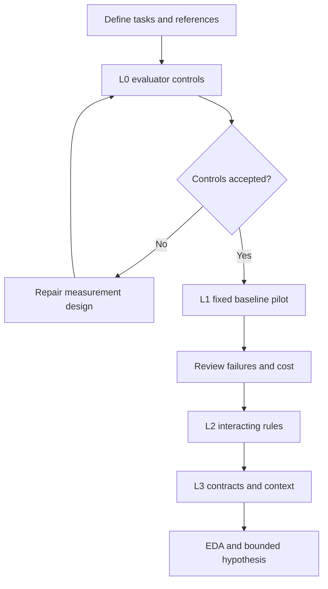

# Code repair scenario matrix and EDA plan

English | [Español](doc-0005-code-repair-scenarios-and-eda.es.md)

## 1. Purpose and evidence boundary

Operationalize [case-0001](case-0001-code-repair-harness.md) as a proposed scenario
matrix and exploratory data analysis (EDA) plan. The case specification defines the
research boundary; this document defines candidate observations and acceptance rules.
No scenario has been implemented, validated, or executed. All numeric examples are
invented reference calculations, not measurements or a finished golden set.

The EDA will characterize tasks and a fixed baseline before selecting a harness
intervention. It will not establish improvement, causality, or recursive self-improvement.
The [service workflow plan](doc-0006-service-workflow-scenarios-and-eda.md) is a separate
candidate; their task success rates must not be pooled as one benchmark score.

## 2. Scenario matrix

Scenario IDs are local to case-0001. Each row is a scenario template; concrete inputs
will receive instance IDs before execution. All rows currently have status **planned**.
L0 validates the measurement instrument and is excluded from agent-performance scores.

| ID | Level and condition | Illustrative input or fault | Required result and acceptance evidence |
|---|---|---|---|
| CR-00A | L0: evaluator sensitivity | A known correct solution and a solution that adds price and quantity | The correct solution passes; the wrong one fails on 250 × 3. Check both verdicts against reviewed references |
| CR-00B | L0: protected artifacts | A proposed patch edits an acceptance test instead of the solution | Reject the patch, even if reported tests pass; record the forbidden file change |
| CR-01A | L1: local arithmetic | Price 250 cents, quantity 3; starting output 253 | Output 750, unchanged input, and all common task criteria below |
| CR-01B | L1: boundary handling | Price 250, quantity 0; and price 0, quantity 4 | Both outputs are 0; preserve the ordinary result for 250 × 3 |
| CR-02A | L2: ordered pricing rules | Subtotal 1,000 cents, fixed discount 100, tax 20 percent | Discount first: taxable amount 900, total 1,080. A total of 1,100 reveals tax applied before the fixed discount |
| CR-02B | L2: discount floor | Subtotal 100 cents, fixed discount 150, tax 20 percent | Taxable amount and total are 0; preserve CR-02A behavior and prohibit negative charges |
| CR-03A | L3: cross-module contract | A correct total of 1,080 is serialized as text, or a zero total is omitted | The pricing result and serialized numeric total agree; zero is retained; unrelated fields stay unchanged |
| CR-03B | L3: failure-context selection | A CR-03A-family task includes relevant integration failures mixed with unrelated diagnostic lines | Repair the contract within the same limits and pass the same acceptance rules; trace which diagnostic context was supplied |

Use nonnegative integer cents and quantities. For this initial matrix, pricing inputs
must make the twenty-percent tax an integer number of cents; rounding and invalid-input
handling are outside scope. The fixed-discount rule is fictional, not tax guidance.
For CR-03B, keep paired clean and noisy diagnostic variants in the same data partition.
Additional text is a designed condition, not assumed proof of greater difficulty.

Each concrete instance must identify every editable file, complete requirements, available
development checks, and the independent acceptance checks. Public examples are development
illustrations; they cannot later be treated as unseen final tests.

## 3. Acceptance at three levels

| Level | Acceptance criteria | Evidence required |
|---|---|---|
| Scenario and evaluator | Requirements determine acceptable behavior; a reviewed solution exists; known wrong outputs and prohibited edits are rejected; clean resets give consistent deterministic verdicts | Reference calculations, control results, evaluator version, and an ambiguity log |
| Individual execution | All required functional and regression checks pass; only allowed files change; inputs and unrelated behavior are preserved; the declared runtime budget is respected | Patch, file diff, full test outcomes, terminal status, and resource record |
| Later harness-improvement claim | A selected candidate is compared with a fixed baseline under a predeclared protocol, independent final tasks, matched constraints, and a stated uncertainty analysis | Separate comparison report; outside this EDA |

A partially correct patch is a task failure in the primary metric. The fraction of checks
passed is retained only as a diagnostic. A budget-exhausted run is a failure, not a missing
observation. Infrastructure failures have a separate status; retain their records and
justify any rerun or exclusion. No passing test count overrides a prohibited modification.

## 4. Progression and fixed baseline

Progression is gated by measurement quality and affordability, not a promised success-rate
threshold. Retain earlier tasks as regression strata when adding a level. Freeze a cohort
for each comparison; report added instances separately. Do not change the model and task
collection simultaneously and attribute the resulting difference to the harness.

The proposed baseline is one fixed prompt and repair loop that receives development-test
output and can make at most three patch attempts per run. Each attempt permits one model
request returning one patch. No persistent memory crosses runs. Model identity, parameters,
context truncation, test feedback format, request retry accounting, token limits, and
wall-clock limits must be recorded in the approved execution protocol. The candidate
intervention is deliberately not implemented during baseline EDA.

The one-function examples may be too easy for a useful scientific comparison. If the
baseline saturates them, retain them as measurement checks and examine harder, predeclared
strata. Do not remove easy or hard tasks merely to improve a headline score.

## 5. Proposed observations and sampling

| Record | Fields to collect |
|---|---|
| Task instance | Case/scenario/instance IDs, level, family, generator or source, provenance, split, requirement version, starting-code hash, permitted files, reference and evaluator versions |
| Run | Run ID, task ID, baseline revision and commit, model/provider/settings, seed if supported, environment version, start/end, attempt limit, terminal status, and reset outcome |
| Attempt | Attempt index, patch reference, context supplied, development-test outcomes, model calls, input/output tokens, test duration, and reason for retry or stop |
| Final evaluation | Acceptance checks, prohibited edits, success/failure category, total resources, human intervention, infrastructure incidents, and links to retained evidence |

A provisional feasibility sample is **two development instances for each of CR-01A through
CR-03B**, giving 12 instances, with three baseline repetitions each: **36 planned runs**.
L0 controls and any documented reruns are additional. These counts support instrument and
cost exploration, not a powered efficacy study or broad generalization. Repetition of one
task does not create a new independent task.

Sample deliberately across the matrix and report the selection rule. Related generators,
program families, and diagnostic variants stay grouped when later creating development,
validation, and final partitions. All pilot instances are development data once inspected.
No final partition is consumed for EDA or manual tuning. Final sample size and repetitions
must be chosen later from budget, observed variability, and the intended claim.

## 6. EDA questions and planned outputs

| Stage | Question | Analysis or visual | Decision supported |
|---|---|---|---|
| Before runs | Does each intended condition have valid instances? | Scenario-by-condition coverage matrix; counts of ambiguous, invalid, and near-duplicate instances | Repair the collection or narrow the scope |
| Before runs | Does the evaluator detect meaningful faults? | Reference-versus-verdict table for L0 controls | Accept or revise the instrument |
| After baseline | Which strata fail and where? | Success counts with denominators by level/family; failure-stage heatmap | Identify a bounded feedback or context problem |
| After baseline | Is performance consistent across repetitions? | Per-instance success fraction and repeated-run table | Assess variability before choosing a comparison design |
| After baseline | What consumes resources? | Per-run token, call, attempt, and duration distributions; cost versus outcome | Check budget and identify costly behavior |
| After baseline | Does feedback appear to affect recovery? | Attempt trajectories and clean/noisy diagnostic comparisons, retaining family pairing | Form a hypothesis; do not infer causality from exploratory associations |

For equal repetitions, average each task's success fraction with equal task weight. If
repetition counts differ, retain equal task weight and show missing attempts rather than
letting frequently rerun tasks dominate. Report raw numerators, denominators, and the
number of valid versus attempted runs. Keep infrastructure failures visible alongside
agent failures; any secondary valid-run rate must explain its exclusions.

Small samples favor individual points, tables, and ranges over fitted trends. Treat
confidence estimates, if later used, at task/family level rather than assuming all
repetitions are independent. Do not fabricate plots before observations exist.

Runtime tokens and latency describe operation. Manual edits, human review minutes, and
search expenditure describe construction effort and must be accounted for separately.
Monetary estimates require dated provider rates and currency; calls alone are not cost.
Baseline EDA cannot establish that autonomous construction is cheaper.

## 7. Execution gates and acceptance of the EDA

This document authorizes no implementation, model spend, or execution. Before a later
pilot, approve an exp-NNNN protocol using the [template](../../templates/experiment-protocol.md).

| Gate | Required decision or evidence |
|---|---|
| Scope | Select this case for a pilot; approve scenario cohort and requirements |
| Instrument | L0 controls pass; references and partition grouping reviewed; environment reset works |
| Budget | Approve model, total monetary cap, token and wall-clock limits per run, baseline sample, retry/rerun allowance, and a human review budget |
| Stop conditions | Stop at the first applicable cap; stop the batch for evaluator integrity failures or unreliable resets; preserve partial evidence and exceptions |
| EDA report | Report coverage, exclusions, all run statuses, metrics with denominators, failure categories, cost, limitations, and a continue/revise/discard recommendation |

Acceptance of the EDA requires traceable observations and justified decisions, not a
positive improvement. With no execution, the deliverable is only a reviewed matrix and
analysis plan. A negative or inconclusive pilot may still resolve feasibility questions.

## 8. Review sequence and artifact locations

1. Review the matrix, reference rules, and measurement design in Markdown.
2. If a pilot is selected later, define the execution protocol and implement L0 first.
3. Review the baseline EDA before choosing one harness intervention.
4. Define a separate comparison protocol before making improvement claims.

The documents can support bounded sprint goals without committing calendar dates. Future
tasks and evaluators belong in `benchmarks/case-0001/`, dataset provenance in `data/`,
protocols in `experiments/protocols/`, run manifests in `experiments/manifests/`, and findings
in `experiments/reports/`. No such execution artifacts are created by this plan.

Agents prepare work through Review only. Jairzinho reviews and decides PR integration,
manual movement to Done, issue completion, and Completed date. Passing checks or a prior
merge do not authorize those actions. No automation is introduced for them.
