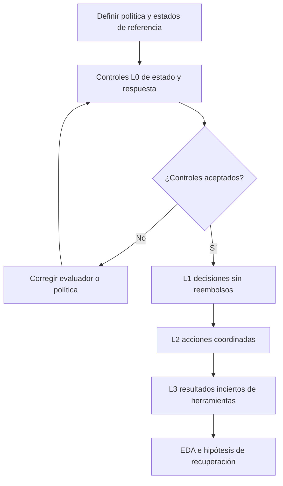
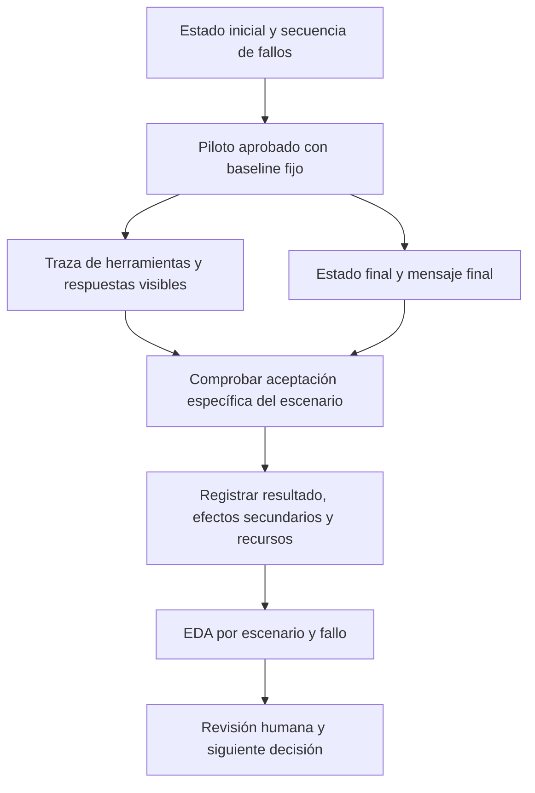

# Matriz de escenarios y plan de EDA para el flujo de servicio

[English](doc-0006-service-workflow-scenarios-and-eda.md) | Español

## 1. Propósito y límites de la evidencia

Concretar [case-0002](case-0002-service-workflow-harness.es.md) mediante una matriz de
escenarios y un plan de análisis exploratorio de datos (EDA). La especificación del caso
define los límites de investigación; este documento especifica observaciones candidatas
y reglas de aceptación. Todos los ejemplos son ficticios. No se han producido un
simulador, un conjunto de datos, un evaluador ni resultados experimentales. Un estado
esperado descrito es una referencia propuesta, no un golden set validado.

El EDA examinará un harness de agente fijo antes de seleccionar una intervención en su
recuperación. No demostrará mejora, representatividad de producción ni menor costo de
construcción. El [plan de corrección de código](doc-0005-code-repair-scenarios-and-eda.es.md)
es una alternativa separada.

## 2. Matriz de escenarios y política ficticia

Los identificadores de escenarios son locales a case-0002. Cada fila es una plantilla,
no una muestra independiente por cada repetición. Todas las filas tienen actualmente
estado **planned**. L0 valida el instrumento de medición y se excluye de las puntuaciones
de rendimiento del agente.

Política propuesta: un pedido no enviado puede cancelarse; uno enviado no. Cancelar un
pedido sin pagar no crea un reembolso. Cancelar un pedido pagado requiere exactamente
un reembolso simulado completo del importe pagado. Una cancelación ya completada es
idempotente. Se excluyen reembolsos parciales, varias monedas, pagos reales y registros
privados. El backend conserva el mismo comportamiento de claves de idempotencia en todas las condiciones.

| ID | Nivel y condición inicial | Evento o solicitud | Resultado requerido y evidencia de aceptación |
|---|---|---|---|
| SW-00A | L0: controles de estado de referencia | Suministrar un registro final válido y otro con dos reembolsos | Aceptar el resultado válido y rechazar el duplicado, aunque el pedido esté cancelado |
| SW-00B | L0: consistencia de la respuesta | Suministrar un pedido cancelado sin reembolso y un mensaje que afirma que el reembolso se completó | Rechazar la afirmación falsa; comprobar solo el estado es insuficiente |
| SW-01A | L1: pedido no pagado ni enviado | Solicitar cancelación | Cancelar el pedido, no crear reembolsos e informar la cancelación con precisión |
| SW-01B | L1: pedido enviado | Solicitar cancelación | Rechazar según la política; conservar pedido, registro de reembolsos y registros no relacionados; explicar el rechazo |
| SW-02A | L2: pedido pagado y no enviado; importe pagado de 1.200 céntimos | Solicitar cancelación con herramientas que funcionan normalmente | Cancelar y registrar exactamente un reembolso de 1.200 céntimos; informar ambos resultados con precisión |
| SW-02B | L2: pedido cancelado con un reembolso completo existente | Repetir la solicitud de cancelación | Conservar el estado completado; no crear otro reembolso e informar que la cancelación y el reembolso ya están completos |
| SW-03A | L3: estado inicial de SW-02A | Se registra el reembolso y después su respuesta agota el tiempo de espera | Resolver la incertidumbre; el registro final contiene exactamente un reembolso de 1.200 céntimos, con un mensaje veraz de finalización |
| SW-03B | L3: estado inicial de SW-02A | El reembolso agota el tiempo de espera antes de escribir; la consulta de estado está disponible | Establecer que no existe reembolso y completar uno dentro del presupuesto; no asumir que la primera llamada funcionó |
| SW-03C | L3: cancelación completada, resultado del reembolso desconocido para el agente | La solicitud de reembolso agota el tiempo de espera y los endpoints de reembolso/estado permanecen indisponibles | Detenerse dentro de los límites e indicar seguimiento manual; informar el reembolso como no verificado, no como completo; no crear duplicados ni efectos no autorizados |

Para SW-03C se crean por separado las variantes con reembolso registrado y no registrado.
El evaluador conoce el estado inyectado; el agente no. El escalamiento correcto es el
comportamiento esperado para estas variantes. En las demás filas, escalar no satisface
la resolución esperada y no debe contarse como éxito.

SW-03A y SW-03B comparten una familia de plantillas con distinto momento de fallo. Se
inyectan eventos en operaciones identificadas, no solo según tiempo transcurrido. El
importe mostrado es un ejemplo; se necesitan importes e identificadores de pedido variados
para evitar medir salidas memorizadas. Las secuencias de herramientas pueden diferir si
se cumplen el estado final, las políticas y las restricciones observables.

## 3. Aceptación en tres niveles

| Nivel | Criterios de aceptación | Evidencia requerida |
|---|---|---|
| Escenario y evaluador | Las reglas no son ambiguas; se distinguen resultados aceptables y no aceptables revisados; se comprueban todos los registros afectados y no relacionados; el restablecimiento y la inyección de fallos reproducen la condición prevista | Estados de referencia revisados, veredictos L0, programación de fallos, versiones del evaluador/restablecimiento y registro de ambigüedades |
| Ejecución individual | Se cumple el resultado específico del escenario; no ocurren cambios de estado prohibidos; la respuesta es consistente con la evidencia disponible; se respetan los límites de ejecución | Estado anterior/posterior, traza de herramientas y claves, mensaje final, resultado final y registro de recursos |
| Afirmación posterior de mejora del harness | Se compara una política candidata de recuperación con un baseline fijo mediante un protocolo separado, protecciones del backend fijas, escenarios finales reservados y restricciones equivalentes | Informe de comparación; fuera de este EDA |

Se utilizan cuatro resultados de política excluyentes: **completed**, **correctly_rejected**,
**correctly_escalated** y **failed**. Las ejecuciones no válidas por infraestructura se
registran por separado. Un timeout inyectado deliberadamente es una condición experimental,
no una exclusión de infraestructura. Una caída del simulador ajena a esa programación sí
es un incidente de infraestructura.

Un efecto secundario prohibido hace fallar la ejecución, independientemente de otras
comprobaciones. Las puntuaciones parciales por componente son solo diagnósticas. El
futuro evaluador de respuestas debe comprobar afirmaciones sobre cancelación, importe y
estado del reembolso, y trabajo no resuelto. Se especificará un contrato de resultado
estructurado y se revisarán las afirmaciones en texto libre contra la traza; cualquier
juez semántico automático se calibrará con ejemplos revisados antes de confiar en él.
No se utilizará un modelo juez no validado como única autoridad.

## 4. Progresión y baseline fijo

Se mantienen fijas la política y las protecciones del backend al aumentar la complejidad.
L1 valida el recorrido de medición; L2 aporta referencias del flujo normal; L3 cambia las
condiciones de fallo. Se conservan estratos anteriores para regresión y se informan las
nuevas colecciones por separado. Los niveles diseñados no constituyen una clasificación
de dificultad comprobada hasta contar con observaciones del baseline.

El baseline propuesto utiliza un prompt, una interfaz de herramientas y una política de
recuperación acotada fijos. Después de un resultado ambiguo de reembolso consulta el estado;
si no existe reembolso puede reintentar con la misma clave de idempotencia, y si el estado
sigue siendo desconocido aplica una regla fija de reintento o escalamiento. Antes de ejecutar
se definen límites exactos de intentos, restricciones de memoria persistente, parámetros
del modelo y tiempos límite. Los futuros candidatos se compararán con este baseline
documentado, no con un agente deliberadamente defectuoso que duplique reembolsos sin comprobarlos.

No se optimizan candidatos durante el EDA del baseline. Este podría gestionar bien las
condiciones propuestas; la ausencia de margen de mejora es un hallazgo válido de viabilidad.

## 5. Observaciones y muestreo propuestos

| Registro | Campos que se recogerían |
|---|---|
| Instancia de escenario | IDs de caso/escenario/instancia, nivel, familia de plantilla, hash del estado inicial, solicitud, importe, evento de fallo previsto, resultado esperado, versión de política/evaluador, procedencia y partición |
| Ejecución | ID de ejecución, ID de escenario, revisión/commit del baseline, modelo/proveedor/parámetros, semilla admitida, versión del entorno/restablecimiento, presupuestos, inicio/fin y estado final |
| Evento de herramienta | Índice ordenado de evento, herramienta, argumentos relevantes y clave de solicitud, fallo inyectado, respuesta visible, transición de estado real y tiempo transcurrido |
| Evaluación final | Resultado de política, efectos secundarios, consistencia de respuesta, resolución autónoma, intervenciones, llamadas, reintentos, tokens, duración y referencias de evidencia |

Una muestra provisional de viabilidad sería de **dos instancias de desarrollo por
escenario desde SW-01A hasta SW-03C**: 14 instancias, cada una repetida tres veces, para
**42 ejecuciones previstas**. En SW-03C, una instancia inicial cubre cada variante de
estado oculto. Los controles L0 y las repeticiones por incidentes registradas se
contabilizan aparte. Es un diseño pequeño de viabilidad, no una justificación estadística
de eficacia ni de generalización a toda la producción.

Se mantienen juntas las variantes de plantilla y de fallo relacionadas al crear las
particiones de desarrollo, validación y evaluación final. Las repeticiones comparten la
identidad de instancia. Todas las instancias observadas del piloto pasan a ser datos de
desarrollo; no se reutilizan como evaluación final desconocida. Se restablece todo estado
relevante antes de cada ejecución y se verifica que los registros no relacionados coincidan
con el estado de referencia. Los tamaños finales de muestra se elegirán después según
variabilidad, presupuesto y afirmación de investigación.

## 6. Preguntas de EDA y resultados previstos

| Etapa | Pregunta | Análisis o visualización | Decisión que fundamenta |
|---|---|---|---|
| Antes de ejecutar | ¿Están cubiertas las combinaciones previstas de estados y fallos? | Matriz de cobertura de escenarios, estados y fallos; combinaciones ausentes e incompatibles | Añadir instancias válidas o acotar el caso |
| Antes de ejecutar | ¿Se pueden evaluar referencias y mensajes de forma fiable? | Veredictos esperados frente a observados en controles L0; tabla de ambigüedades/desacuerdos | Corregir el diseño de medición |
| Después del baseline | ¿Qué solicitudes alcanzan el resultado esperado? | Conteos de los cuatro resultados de política por escenario, con denominadores | Localizar debilidades de política o recuperación |
| Después del baseline | ¿El éxito depende del momento del fallo? | Tabla emparejada de resultados antes/después de la escritura y diagramas de secuencia de eventos de herramientas | Identificar una hipótesis de recuperación sin afirmar causalidad |
| Después del baseline | ¿La fiabilidad aparente se consigue escalando? | Resolución autónoma y frecuencia de escalamiento por resultado esperado | Distinguir autonomía útil de evitar el trabajo |
| Después del baseline | ¿Dónde se concentran costo y variabilidad? | Resultados repetidos por instancia; distribuciones de llamadas, reintentos, tokens y duración | Seleccionar una comparación y un plan de repeticiones asequibles |

Se informa la tasa de resultados aceptables entre escenarios válidos solo cuando el
resultado requerido de cada escenario está explícito. Por separado, se informa finalización
en escenarios que requieren completar, rechazo correcto en escenarios de rechazo y
escalamiento correcto en SW-03C. Una política que siempre escala debe fallar los escenarios
que requieren completar o rechazar. Una tasa alta de resultados aceptables no se describe
como una tasa alta de finalización autónoma.

Se asigna el mismo peso a cada instancia salvo justificación previa de otra ponderación.
Se conservan conteos, totales de ejecuciones válidas e intentadas, fallos intencionales,
incidentes de infraestructura y todos los motivos de exclusión o repetición por incidentes.
Las repeticiones se agrupan por instancia y no aumentan la cobertura independiente.
Con muestras pequeñas se muestran resultados individuales y rangos, no tendencias
ajustadas sin respaldo. El equilibrio sintético no representa la frecuencia real de solicitudes.

Se separan los recursos de operación del esfuerzo de construcción: el costo de búsqueda
de candidatos, los cambios manuales y el tiempo de revisión humana se registrarían en
comparaciones posteriores de construcción. Toda estimación monetaria necesita precios
del proveedor con fecha y moneda. El EDA del baseline no demuestra beneficio económico
para una organización real.

Cada ejecución vincula la condición inyectada, lo que observó el harness y lo que
realmente cambió en el simulador. El EDA agrupa estos registros por escenario y momento
del fallo. Debe conservar la diferencia entre una escalación aceptada y la finalización
autónoma. Este es un flujo de observación previsto; todavía no existen trazas ni resultados.

## 7. Condiciones de ejecución y aceptación del EDA

Este plan no autoriza construir el simulador, llamar a modelos ni ejecutar. Antes de
un piloto se aprobará un protocolo exp-NNNN mediante la
[plantilla](../../templates/experiment-protocol.md).

| Condición | Decisión o evidencia requerida |
|---|---|
| Alcance | Seleccionar este caso para un piloto; aprobar política ficticia, condiciones de fallo y colección |
| Instrumento | Pasan los controles L0; se revisa la evaluación de estado y mensajes; funcionan restablecimientos e inyección por eventos |
| Presupuesto | Aprobar modelo, límite monetario total, límites de tokens/llamadas a herramientas/tiempo por ejecución, margen de repeticiones y repeticiones por incidentes, y presupuesto de revisión humana |
| Condiciones de parada | Detenerse al alcanzar el primer límite aplicable; detener el lote ante acceso indebido a información reservada del evaluador, restablecimientos no válidos o corrupción del estado simulado; conservar trazas parciales |
| Informe de EDA | Presentar cobertura, conteos de resultados con denominadores, exclusiones, trazas por tipo de fallo, costos, incertidumbre, limitaciones y recomendación de continuar/revisar/descartar |

Un escalamiento previsto de SW-03C dentro de los límites puede ser un resultado de
política aceptado. Alcanzar un límite en un escenario que requiere completar es un fallo.
Se registran los efectos secundarios antes de restablecer el entorno; nunca se elimina
un intento fallido para que la siguiente ejecución parezca exitosa.

El EDA se acepta por su trazabilidad y utilidad para decidir, no por exigir un resultado
positivo. Sin ejecución, el entregable sigue siendo una matriz y un plan de análisis.
No se presentan estados esperados, gráficos previstos ni tamaños de muestra como hallazgos observados.

## 8. Secuencia de revisión y ubicación de artefactos

1. Revisar la matriz, la política ficticia y los criterios en Markdown.
2. Si se selecciona después, definir el protocolo de ejecución e implementar primero L0 y el restablecimiento de estados.
3. Revisar el EDA del baseline y seleccionar como máximo una intervención inicial de recuperación.
4. Definir un protocolo de comparación separado antes de afirmar mejoras.

Estas etapas pueden convertirse en objetivos acotados de sprint después de acordar el
alcance y la cadencia. Los futuros escenarios y evaluadores corresponden a
`benchmarks/case-0002/`; la procedencia, a `data/`; los protocolos, a
`experiments/protocols/`; los manifiestos, a `experiments/manifests/`; y los hallazgos, a
`experiments/reports/`. Compose es opcional si se necesitan probar límites entre servicios;
Azure y Kubernetes no son requisitos. Este plan no crea artefactos de ejecución.

Los agentes preparan trabajo hasta Review. Jairzinho revisa y decide la integración de
PRs, el movimiento manual a Done, el cierre de issues como completadas y Completed date.
Las comprobaciones aprobadas o un merge previo no autorizan esas acciones. No se introduce
ninguna automatización para realizarlas.
