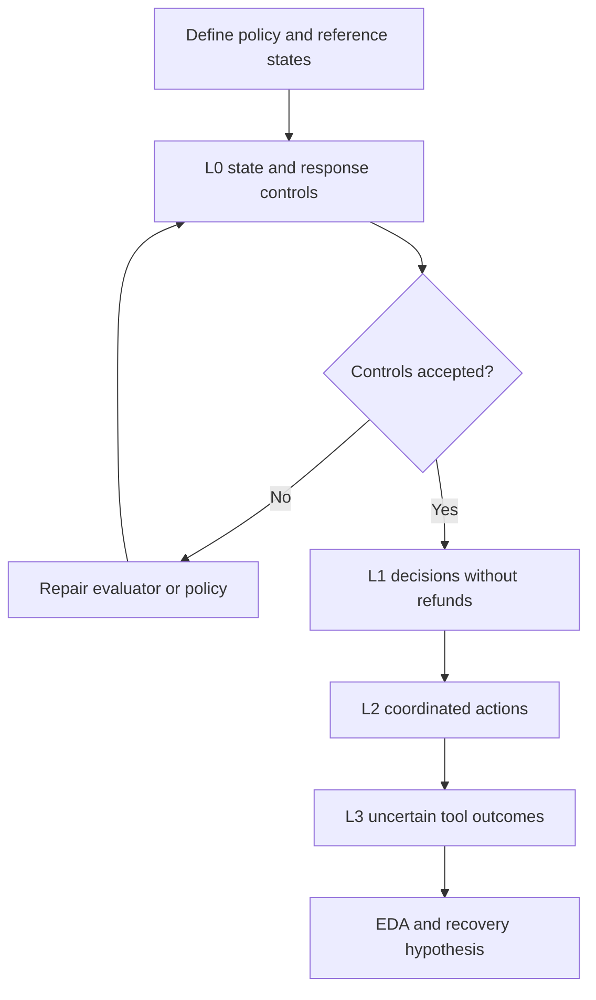

# Service workflow scenario matrix and EDA plan

English | [Español](doc-0006-service-workflow-scenarios-and-eda.es.md)

## 1. Purpose and evidence boundary

Operationalize [case-0002](case-0002-service-workflow-harness.md) as a proposed scenario
matrix and exploratory data analysis (EDA) plan. The case specification defines the
research boundary; this document specifies candidate observations and acceptance rules.
All examples are fictional. No simulator, dataset, evaluator, or experimental result has
been produced. A listed expected state is a proposed reference, not a validated golden set.

The EDA will examine a fixed agent harness before selecting a recovery intervention.
It will not prove improvement, production representativeness, or lower construction cost.
The [code repair plan](doc-0005-code-repair-scenarios-and-eda.md) is a separate alternative.

## 2. Scenario matrix and fictional policy

Scenario IDs are local to case-0002. Each row is a template, not one independent sample
for every repetition. All rows currently have status **planned**. L0 validates the
measurement instrument and is excluded from agent-performance scores.

Proposed policy: an unshipped order can be cancelled; a shipped order cannot. Cancelling
an unpaid order creates no refund. Cancelling a paid order requires exactly one full
simulated refund of its paid amount. An already completed cancellation is idempotent.
No partial refunds, multiple currencies, real payments, or private records are included.
The backend retains the same idempotency-key behavior across all conditions.

| ID | Level and initial condition | Event or request | Required result and acceptance evidence |
|---|---|---|---|
| SW-00A | L0: reference-state controls | Supply one valid final ledger and one with two refunds | Accept the valid outcome and reject the duplicate, even if the order is cancelled |
| SW-00B | L0: response consistency | Supply a cancelled order with no refund and a message claiming a completed refund | Reject the false claim; state-only checking is insufficient |
| SW-01A | L1: unpaid, unshipped order | Request cancellation | Cancel the order, create no refund, and report the cancellation accurately |
| SW-01B | L1: shipped order | Request cancellation | Reject under policy; preserve the order, ledger, and unrelated records; explain the rejection |
| SW-02A | L2: paid, unshipped order; paid amount 1,200 cents | Request cancellation with tools operating normally | Cancel and record exactly one 1,200-cent refund; report both outcomes accurately |
| SW-02B | L2: cancelled order with an existing full refund | Repeat the cancellation request | Preserve the completed state; create no additional refund and report that cancellation and refund are already complete |
| SW-03A | L3: SW-02A initial state | Refund write commits, then its response times out | Resolve the uncertain result; final ledger has exactly one 1,200-cent refund, with a truthful completion message |
| SW-03B | L3: SW-02A initial state | Refund times out before any write; status lookup is available | Establish that no refund exists and complete one refund within the budget; do not assume the first call succeeded |
| SW-03C | L3: cancellation completed, refund outcome unknown to the agent | Refund request times out and subsequent refund/status endpoints remain unavailable | Stop within limits and flag manual follow-up; report the refund as unverified, not complete; create no duplicate or unauthorized effect |

For SW-03C, instantiate separate committed and uncommitted refund variants. The evaluator
knows the injected state; the agent does not. Correct escalation is the designated expected
behavior for these variants. For all other rows, escalation does not satisfy the expected
resolution and must not be counted as success.

SW-03A and SW-03B share a template family with different fault timing. Inject events on
identified operations rather than elapsed wall time alone. The displayed amount is an
example; varied amounts and order IDs are needed to avoid testing memorized outputs.
Tool-call sequences may differ if final state, policies, and observable constraints hold.

## 3. Acceptance at three levels

| Level | Acceptance criteria | Evidence required |
|---|---|---|
| Scenario and evaluator | Rules are unambiguous; reviewed acceptable and unacceptable outcomes are distinguishable; all affected and unrelated records are checked; reset and fault injection reproduce the intended condition | Reviewed reference states, L0 verdicts, fault schedule, evaluator/reset versions, and ambiguity log |
| Individual execution | The scenario-specific outcome holds; no prohibited state changes occur; the response is consistent with available evidence; runtime limits are respected | Before/after state, tool trace and keys, final message, terminal outcome, and resource record |
| Later harness-improvement claim | A candidate recovery policy is compared with a fixed baseline under a separate protocol, fixed backend protections, reserved final scenarios, and matched constraints | Comparison report; outside this EDA |

Use four exclusive policy outcomes: **completed**, **correctly_rejected**,
**correctly_escalated**, and **failed**. Infrastructure-invalid runs are logged separately.
A timeout intentionally injected by the scenario is an experimental condition, not an
infrastructure exclusion. A simulator crash unrelated to that schedule is an infrastructure incident.

A prohibited side effect makes the run failed regardless of other checks. Partial
component scores are diagnostic only. The future response evaluator must check claims
about cancellation, refund amount/status, and unresolved work. Specify a structured outcome
contract and review free-text claims against the trace; calibrate any automated semantic
judge against reviewed examples before trusting it. No sole unvalidated model judge.

## 4. Progression and fixed baseline

Keep policy and backend protections fixed as complexity increases. L1 validates the
measurement path; L2 supplies normal workflow references; L3 changes fault conditions.
Retain earlier strata for regression and report new cohorts separately. Designed levels
are not established difficulty rankings until baseline observations exist.

The proposed baseline uses one fixed prompt, tool interface, and bounded recovery policy.
After an ambiguous refund result it checks status; if the refund is absent it can retry
with the same idempotency key, and if status remains unknown it follows a fixed retry or
escalation rule. Define exact attempt caps, persistent-memory restrictions, model settings,
and time limits before execution. Compare future candidates against this documented
baseline, not against a deliberately defective agent that blindly duplicates refunds.

No candidate optimization runs during baseline EDA. The baseline may already handle these
conditions well; lack of room for improvement is a valid feasibility finding.

## 5. Proposed observations and sampling

| Record | Fields to collect |
|---|---|
| Scenario instance | Case/scenario/instance IDs, level, template family, initial-state hash, request, amount, intended fault event, expected outcome, policy/evaluator version, provenance, and split |
| Run | Run ID, scenario ID, baseline revision/commit, model/provider/settings, supported seed, environment/reset version, budgets, start/end, and terminal status |
| Tool event | Ordered event index, tool, relevant arguments and request key, injected fault, visible response, authoritative state transition, and elapsed time |
| Final evaluation | Policy outcome, side effects, response consistency, autonomous resolution, interventions, calls, retries, tokens, duration, and evidence references |

A provisional feasibility sample is **two development instances per scenario from SW-01A
through SW-03C**: 14 instances, each repeated three times, for **42 planned runs**.
For SW-03C, one initial instance covers each hidden-state variant. L0 controls and any
recorded reruns are additional. This is a small feasibility design, not statistical
justification for effectiveness or production-wide generalization.

Keep related template and fault variants together when creating development, validation,
and final partitions. Repetitions share the same instance identity. All observed pilot
instances become development data; do not reuse them as unseen final evaluation. Reset
all relevant state before each run and verify that unrelated records match the baseline.
Final sample sizes must be chosen later from variability, budget, and the research claim.

## 6. EDA questions and planned outputs

| Stage | Question | Analysis or visual | Decision supported |
|---|---|---|---|
| Before runs | Are intended state and fault combinations covered? | Scenario-by-state/fault coverage matrix; missing and incompatible combinations | Add valid instances or narrow the case |
| Before runs | Can references and messages be evaluated reliably? | Expected-versus-observed verdicts on L0 controls; ambiguity/disagreement table | Repair the measurement design |
| After baseline | Which requests reach the expected outcome? | Counts of the four policy outcomes by scenario, with denominators | Locate policy or recovery weaknesses |
| After baseline | Does success depend on fault timing? | Paired before-write/after-write outcome table and tool-event sequence diagrams | Identify a recovery hypothesis without claiming causality |
| After baseline | Is apparent reliability achieved by escalation? | Autonomous resolution and escalation frequency by expected outcome | Distinguish useful autonomy from avoidance |
| After baseline | Where are cost and variability concentrated? | Per-instance repeated outcomes; calls, retries, tokens, and duration distributions | Select an affordable comparison and repetition plan |

Report acceptable-outcome rate across valid scenarios only when the required outcome for
each scenario is explicit. Separately report completion on completion-eligible scenarios,
correct rejection on rejection scenarios, and correct escalation on SW-03C. An always-escalate
policy must fail scenarios that require completion or rejection. Do not describe a high
acceptable-outcome rate as a high autonomous-completion rate.

Use equal scenario-instance weights unless another weighting is justified in advance.
Retain raw counts, valid and attempted-run totals, intended fault failures, infrastructure
incidents, and all exclusion/rerun reasons. Group repetitions by instance; they do not
increase independent coverage. With small samples, show individual outcomes and ranges
rather than unsupported trend fits. Synthetic balance is not real-world request frequency.

Keep runtime resource use separate from construction effort: candidate-search cost,
manual edits, and human review time would be recorded in later construction comparisons.
Any monetary estimate needs dated provider prices and currency. Baseline EDA does not
establish economic benefit for a real organization.

## 7. Execution gates and acceptance of the EDA

This plan authorizes no simulator construction, model calls, or execution. Before a pilot,
approve an exp-NNNN protocol using the [template](../../templates/experiment-protocol.md).

| Gate | Required decision or evidence |
|---|---|
| Scope | Select this case for a pilot; approve fictional policy, fault conditions, and cohort |
| Instrument | L0 controls pass; state and message evaluation reviewed; resets and event-based injection work |
| Budget | Approve model, total monetary cap, token/tool-call/time limits per run, repetition and rerun allowance, and human review budget |
| Stop conditions | Stop at the first applicable cap; stop the batch for evaluator leakage, invalid resets, or corrupted simulation state; retain partial traces |
| EDA report | Provide coverage, outcome counts with denominators, exclusions, fault-specific traces, costs, uncertainty, limitations, and a continue/revise/discard recommendation |

A predesignated SW-03C escalation within limits can be an accepted policy outcome. A cap
reached in a completion-required scenario is a failure. Record side effects before reset;
never erase a failed attempt to make the next run appear successful.

Accept the EDA for traceability and decision usefulness, not for a required positive
result. Without execution, the deliverable remains a matrix and analysis plan. Do not
present expected states, planned charts, or sample counts as observed findings.

## 8. Review sequence and artifact locations

1. Review the matrix, fictional policy, and criteria in Markdown.
2. If selected later, define the execution protocol and implement L0 and state resets first.
3. Review baseline EDA and select at most one initial recovery intervention.
4. Define a separate comparison protocol before making improvement claims.

These stages can become bounded sprint goals after scope and cadence are agreed. Future
scenarios and evaluators belong in `benchmarks/case-0002/`, provenance in `data/`, protocols
in `experiments/protocols/`, manifests in `experiments/manifests/`, and findings in
`experiments/reports/`. Compose is optional if service boundaries need testing; Azure or
Kubernetes is not required. No execution artifacts are created by this plan.

Agents prepare work through Review only. Jairzinho reviews and decides PR integration,
manual movement to Done, issue completion, and Completed date. Passing checks or a prior
merge do not authorize those actions. No automation is introduced for them.
